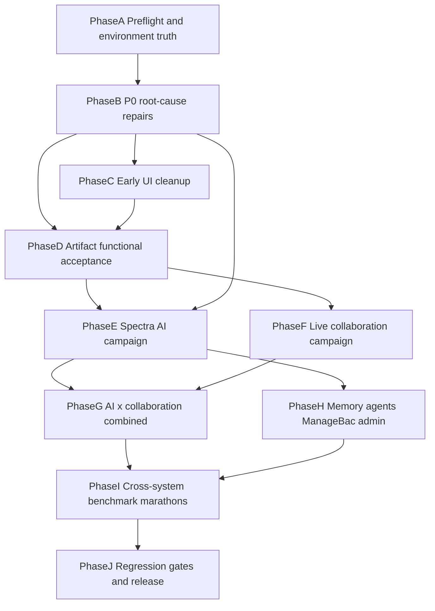

# Spectra Next-Generation Acceptance, Repair, and Elevation Campaign

Status: ACTIVE. This document is the single executable contract for testing, repairing, and elevating Spectra to a genuinely revolutionary standard. Every implementation and retrieval agent working on this campaign MUST read this document in full before acting, and MUST re-read it (plus `<local-workspace>`) after any context compaction.

The campaign ends only when every task in this plan has reached **Excellent** and the final release gates in Phase J pass. A task graded **Pass** is NOT complete. The goal is not a passable demo; it is a fully working, deeply tested, exceptionally capable, reliable, fast, cohesive product.

---

## 1. Ground truth (verified 2026-07-24, commit `4766b5c`)

Everything below was verified directly against the repository, not inherited from prior agent claims. Prior ledgers (`docs/spectra-rebuild/next-generation-plans/15_IMPLEMENTATION_AND_VERIFICATION_LEDGER.md` claims "Phase 1 deletion active") are STALE: the codebase contains the full next-generation implementation. Treat all prior completion claims as leads to verify.

### 1.1 Stack and processes

- Next.js (Turbopack) + Convex + Clerk + self-hosted Yjs (Hocuspocus). `npm run dev` runs four processes concurrently: `dev:web` (port 3000), `dev:collab` (Hocuspocus gateway, port 1234, health `/_spectra/health`), `dev:ai-worker` (`scripts/spectra-ai-worker.mjs`), `dev:managebac-worker` (`scripts/managebac-sync-worker.mjs`). The dev server is already running; verify all four processes are alive before any AI or collaboration test.
- AI runs are durable jobs: `convex/spectraRuns.ts` (begin/claim/heartbeat/stop/reconcile), `convex/spectraRunJobs.ts` (enqueue/claimNext, 90s lease), worker calls back into `src/app/api/spectra/run/route.ts` (`runAttempt`, ~10.9k lines). Quick Chat consumes NDJSON for the initial ack, then polls `getSpectraRunEvents` every 2.5s.
- Model calls go through OpenRouter: `src/features/spectra/ai/model-config.ts` + `openrouter-stream.ts` + `callModel` in the run route. Stream idle watchdog: 18s (60s for complex reasoning).
- Live artifacts: all 10 types sync via Yjs (`useArtifactLiveModel`, always partition `root`), gateway persists updates to Convex (`collaborationGatewayStore.append`) gated by region claims (`convex/regionClaims.ts`: human lease 20s, AI 45s). AI mutates artifacts through its own Hocuspocus connection (`src/features/spectra/ai/yjs-artifact-operation.ts`, 20s connect deadline).
- 10 first-class artifact types all registered end-to-end: document, flashcard_deck, quiz, planner_task, agent, timetable, presentation, sheets, code, whiteboard (`src/features/spectra/artifacts/registry.ts`, editors in `src/features/spectra/components/*-studio.tsx` and `artifact-studio.tsx`). Plus pseudo-type `thread_reference`.
- Memory (`convex/memory.ts`, deterministic local embeddings), agents (publish gate + eval + routing threshold 0.64 in run route), ManageBac (read-only connector, app-worker-driven sync, `convex/managebac.ts`), admin (`/admin`), superadmin (`/superadmin` — note: there is no `/super-admin` route), metering/audit/operator sessions.
- Tests: 24 vitest files under `src/features/spectra/__tests__/` (node env); `convex/__tests__` does NOT exist. `npm run lint` must end clean (max-warnings 0). Known lint defects BASE-001..004 recorded in the old ledger.

### 1.2 Confirmed root-cause leads (repair before deep testing)

| ID | Defect (verified in code) | Location |
|----|---------------------------|----------|
| RC-1 | **Model/provider incoherence.** `.env.local` sets `SPECTRA_MODEL_ID=deepseek/deepseek-v4-pro`, but `model-config.ts` hard-codes `SPECTRA_PRIMARY_PROVIDER="Xiaomi"`, `only: ["Xiaomi"]`, `allow_fallbacks:false`, fallback `AtlasCloud`, and `assertPrimarySpectraRouting` enforces Xiaomi. OpenRouter is asked to serve a DeepSeek model exclusively through a provider that cannot host it. This is the prime suspect for the 18s stall errors, provider assertion failures, and ~96s failing runs. Tests (`openrouter-stream.test.ts`, `run-route.test.ts`, `run-lifecycle.test.ts`) already expect DeepSeek-native routing and are out of sync with the code. Vision model is `xiaomi/mimo-v2.5` with Xiaomi-only vision routing — also incoherent. | `src/features/spectra/ai/model-config.ts` |
| RC-2 | **`AI_ARTIFACT_CONNECT_TIMEOUT`**: 20s wait for Hocuspocus `synced && authenticated` in the AI mutation path. Failure leaves `createPending` artifact shells if `finalizePendingLive` never runs ("creating" pulsating cards). Causes: gateway down/misconfigured `NEXT_PUBLIC_SPECTRA_COLLAB_URL`, token/policy failure, slow sync. | `src/features/spectra/ai/yjs-artifact-operation.ts` ~373; `convex/spectraArtifacts.ts` `finalizePendingLive` ~1686, `discardPendingForRun` ~2017 |
| RC-3 | **"Spectra could not safely apply that plan"**: generic `publicError` for any plan Zod failure (run route ~7349–7360). No plan-repair retry, no actionable diagnostics for the user or logs. | `src/app/api/spectra/run/route.ts` |
| RC-4 | **Job activation latency**: `spectraRunJobs:enqueue` sets `availableAt = now + 60_000` until `activate` runs; any missed activation adds a silent minute. Combined with 2.5s event polling and worker 850ms claim loop, perceived first-progress latency needs an end-to-end budget. | `convex/spectraRunJobs.ts`, `use-spectra-run.ts` |
| RC-5 | **AI presence invisible to peers**: gateway `beforeHandleAwareness` (~422–451) rewrites awareness `user` and DROPS `actorKind`, `runId`, `operationId`. Peers cannot render "Pablo's Spectra" AI presence (cyan avatar, Sparkles) — the owner-specific AI presence requirement is structurally broken for shared artifacts. | `scripts/collaboration-gateway.mjs`; `collaboration-presence.tsx` |
| RC-6 | **No client handler for `spectra.permission_changed`** stateless messages; revocation relies on the 4403 close sweep only. | `src/features/spectra/collaboration/hocuspocus-transport.ts` |
| RC-7 | **Workspace artifact open dead-end**: in `workspace-shell.tsx`, `openArtifactPanel` calls `studio.openTab`, but when a `workspaceId` is selected only the `mode === "split"` branch renders `ArtifactStudio` (~5127). Tab-presentation artifacts can be "open" with no visible editor. Also violates the product decision that artifacts open beside existing work by default. | `src/features/spectra/pages/workspace-shell.tsx`, `artifact-studio.tsx` `useArtifactStudioState` |
| RC-8 | **Dead navigation**: `/models` and `/analytics` links in `app-shell.tsx` (~78–85) have no routes; `/request-access` is linked from sign-up but has no page; `KeyboardShortcutsRegistrar` exists but is never mounted (shortcut help likely lies). | `src/components/layout/app-shell.tsx`, `src/app/sign-up/` |
| RC-9 | **Document gutter misalignment**: drag/+ handles positioned with fixed offsets (`top+3`, `left-52`) against the wrapper without scroll sync or per-line hit accuracy on wrapped blocks. | `src/features/spectra/editor/drag-handle.ts`, `globals.css` ~5477 |
| RC-10 | **UI density/typography drift**: arbitrary Tailwind sizes (`text-[8px]`..`text-[20px]`), hard-coded `bg-[#fbfaf8]` vs tokens, rail tabs `min-w-[104px] text-[10px]` with `+` pushed to far right of a full-width flex, context trigger with label+chevron+border instead of compact square icon. | `workspace-shell.tsx`, `app-shell.tsx`, `command-bar.tsx`, `context-controls.tsx`, `artifact-studio.tsx` `StudioTabRail` |
| RC-11 | **Room partitioning unused**: manifests declare `roomPartition` (slide/sheet/file/viewport) but all connections use partition `root` — a scaling and conflict-granularity risk for big artifacts. | `use-artifact-live-model.ts`, `registry.ts` |
| RC-12 | **Undo is per-user local stacks** (sheets/presentation/whiteboard), not Yjs UndoManager — verify collaborative undo does not destroy peer work. | `*-studio.tsx` |
| RC-13 | Stale plan ledgers and `.env.example` gaps (`SUPER_ADMIN_EMAILS` missing; example models still Xiaomi). | `docs/spectra-rebuild/next-generation-plans/*`, `.env.example` |

### 1.3 Test environment and accounts

- Both Chrome profiles are open, each with exactly one tab at `http://localhost:3000`. Distinguish them by logged-in identity, not by profile plumbing: **Tab P** ("Pablo" profile) is signed into Spectra as `[school-account-email]` — has the ManageBac-connected school profile AND Super Admin. **Tab C** ("Carlos" profile) is signed into Spectra as `pablo.martinez.dovale@gmail.com` — no ManageBac connection; use for genuine two-user collaboration.
- All testing at **1920x1080**. Use the Chrome DevTools MCP (`user-chrome-devtools`): `list_pages` to find both tabs, `select_page` to switch, `resize_page` to enforce 1920x1080, `take_screenshot` liberally, `take_snapshot` for structure, `list_console_messages` + `list_network_requests` after every significant action, `performance_start_trace`/`performance_stop_trace` for latency benchmarks, `evaluate_script` for precise timing probes.
- Screenshot discipline: capture (1) the idle state before acting, (2) intermediate states while AI/collaboration work is in flight — progress in the Quick Chat bar, blue AI effect traces, AI presence/cursor animations, pending cards — and (3) the final state. Intermediate states are first-class evidence: at waiting stages, everything counts. Store evidence under `docs/spectra-rebuild/acceptance-campaign/evidence/<TASK-ID>/` with a short `notes.md` per task (timings, console/network findings, grade).
- Compare surfaces against the 21 reference images in `docs/spectra-rebuild/spectra-next-generation-ui/` whenever a surface is on screen, not only during dedicated UI tasks. If a surface visibly falls short of its reference, record it and improve it.
- Work directly on the current clean commit. Commit meaningful checkpoints frequently (e.g. after each phase or major repair) so that large changes stay reversible. Never leave the tree in a broken state at a commit boundary.

---

## 2. Operating protocol

### 2.1 Grading

Every task receives exactly one grade with recorded evidence:

- **Alarming** — a failure, data-risk issue, severe latency (see budgets below), misleading result, broken workflow, unsafe behavior, permission leak, state left dirty (stuck pulsating card, stale AI presence, orphaned pending artifact), or fundamentally poor experience. Triggers urgent root-cause work immediately (stop other testing on that system until understood). If diagnosis exceeds the current agent's capacity, launch a focused implementation subagent (grok 4.5 high) with the exact reproduction, code paths from Section 1.2, and instruction to read this plan and the frontend-design skill.
- **Pass** — works but is ordinary, incomplete, slow, fragile, confusing, or below Spectra's potential. NOT terminal: record what separates it from Excellent, implement the improvement, and rerun the task.
- **Excellent** — genuinely impressive: fast, accurate, polished, resilient, well-integrated. Still receives the regression checks listed for the task and the Phase J gates.

### 2.2 Escalation and repetition

1. On **Alarming**: reproduce once to confirm; capture console, network, worker logs, Convex data state; identify root cause in code; repair the cause (never merely document it); rerun the failing task; then rerun the task's listed regression set. Log everything in the campaign ledger (`docs/spectra-rebuild/acceptance-campaign/LEDGER.md` — create it at Phase A with columns: Task, Date, Grade, Evidence path, Defects found, Repairs made, Retests, Final grade).
2. On **Pass**: record the specific deficiency; schedule the improvement in the same phase where feasible; rerun until Excellent. If the deficiency is systemic (e.g. global latency), attach it to the relevant P0/benchmark task instead of duplicating work.
3. Any repair that touches shared systems (run route, model config, gateway, region claims, authority, artifact-studio, app-shell) triggers the corresponding **Regression Gate** in Phase J's matrix before the phase closes.
4. Rerun cadence: a task upgraded to Excellent after repair is rerun once more, fresh (new artifacts/threads), to confirm stability, then marked complete.

### 2.3 Latency budgets (measure with DevTools timestamps; record in evidence)

| Metric | Excellent | Pass | Alarming |
|--------|-----------|------|----------|
| Quick Chat ack (send → visible acknowledgment/run created) | < 1.5s | < 4s | > 8s |
| First useful progress (send → first meaningful progress event/streamed text) | < 5s | < 12s | > 20s |
| Simple conversational answer complete | < 10s | < 25s | > 45s |
| Single-artifact creation complete (e.g. tightly scoped document) | < 35s | < 75s | > 120s or failure |
| Multi-artifact/multi-step run: visible steady progress | continuous, no silent gap > 10s | gaps < 25s | stall > 45s or misleading progress |
| Live edit propagation between two users | < 300ms | < 1s | > 3s or lost |
| Presence (join/leave/region change) propagation | < 1s | < 3s | > 8s or stale/false presence |
| Reconnect after gateway/network interruption to synchronized | < 5s | < 15s | > 30s, data loss, or silent divergence |
| Artifact open (click → interactive editor) | < 1s | < 2.5s | > 5s |
| Route navigation | < 0.8s | < 2s | > 4s |

A stream that produces no meaningful data for 18s (the current watchdog) is automatically not Excellent; recurring stalls are Alarming even if the run eventually completes.

### 2.4 Sub-agent policy

- **Retrieval subagents** (model `composer-2.5`): use liberally for code reading, cross-referencing, and evidence gathering. Prompt must instruct them to first read the frontend-design skill and this plan.
- **Implementation subagents** (model `cursor-grok-4.5-high`): reserve for Alarming outcomes needing focused parallel root-cause work. The primary implementer should otherwise make changes itself and review/retest via Chrome DevTools MCP. Every implementation subagent must (a) read the frontend-design skill and this plan first, and (b) end its report with an explicit "RETEST:" list naming exactly which task IDs and checks must be rerun to confirm its changes — unless the change is trivially small (a few lines, no behavior change).
- Every subagent of any kind activates the frontend-design skill regardless of task.

### 2.5 Repair-first doctrine

Implementation agents repair underlying causes, then repeat the relevant tests until Excellent. Do not: stub failures away, hide defects behind fallbacks, weaken tests to make them pass, or mark anything complete based on documentation claims. Fallback providers must never mask provider, streaming, latency, schema, planning, or execution defects — when a fallback fires during a normal test, that is a defect to diagnose, not a pass.

If unrelated breakage appears (build failures, dev-server crashes, flaky processes), fix it before continuing. The campaign does not stop for setbacks.

---

## 3. Phase overview and dependencies

Ordering rationale: AI is currently broken (RC-1/RC-2/RC-3), so deep AI testing before Phase B is pointless. The UI cleanup phase is early but small, so later screenshots compare cleanly against references. The most demanding end-to-end marathons are last, when earlier repairs have prepared Spectra to excel at them.

Task ID scheme: `<PHASE>-<NN>`. Each task specifies Objective, Setup, Actions, Evidence, Grading (A/P/E), and On-outcome. "Tab P"/"Tab C" refer to Section 1.3. "QC" = Quick Chat. Unless stated otherwise, tasks run on Tab P.

---

## Phase A — Preflight and environment truth

### A-01 Process and health verification
- **Objective:** Prove all four dev processes and Convex are genuinely healthy before trusting any test result.
- **Setup:** Terminal access; both tabs open.
- **Actions:** Check `npm run dev` terminal output for all four processes; hit `http://localhost:3000/api/health` and `http://localhost:1234/_spectra/health`; confirm the AI worker is claiming (log lines) and the ManageBac worker polls without auth errors; confirm Convex WebSocket connected in both tabs (console).
- **Evidence:** Health responses, worker log excerpts, console captures from both tabs.
- **Grading:** A = any process dead/erroring or health failing. P = healthy but with warning noise that could pollute later diagnosis. E = all healthy, console clean (Clerk dev-key warnings acceptable and noted).
- **On-outcome:** A → fix the process/config before anything else. P → clean the warnings if cheap, else record and continue.

### A-02 Account, role, and resolution verification
- **Objective:** Confirm the two test identities, their roles, and the display environment.
- **Actions:** In Tab P verify signed-in user `[school-account-email]`, presence of Super Admin access (`/superadmin` loads) and ManageBac connection state (`/managebac`). In Tab C verify `pablo.martinez.dovale@gmail.com` and that `/superadmin` and `/managebac` admin functions are correctly absent/denied. `resize_page` both tabs to 1920x1080 and screenshot.
- **Evidence:** Screenshots of both tabs' account state; denial behavior on Tab C.
- **Grading:** A = wrong identity, role leakage (Tab C sees admin), or ManageBac absent on Tab P. P = correct but confusing role indication. E = correct, clearly communicated in UI.
- **On-outcome:** A on role leakage → immediate authority root-cause (this is a data-risk class defect).

### A-03 Campaign ledger and evidence scaffolding
- **Objective:** Create `docs/spectra-rebuild/acceptance-campaign/LEDGER.md` and `evidence/` folder; register all task IDs with state `pending`.
- **Evidence:** The ledger file itself.
- **Grading:** E when the ledger exists and matches this plan's task inventory exactly (see §Completeness audit).

### A-04 Baseline capture
- **Objective:** Snapshot the product's current visual and functional baseline for later comparison.
- **Actions:** At 1920x1080 capture: home/workspace, artifacts hub, one artifact of each of the 10 types (create quickly by hand if none exist — these become the campaign's standing fixtures), `/agents`, `/memory`, `/managebac`, `/admin`, `/superadmin`, `/chat`. Run `npm run lint`, `npm run test:run`, `npx tsc --noEmit`; record results (BASE-001..004 lint defects expected until repaired).
- **Evidence:** Screenshot set named `baseline-*`; command outputs.
- **Grading:** A = build/type failures or pages that crash. P = lint/test failures only where already known. E = clean toolchain (achieved after B-08).
- **On-outcome:** Crashing surfaces become immediate Alarming investigations.

---

## Phase B — P0 root-cause repairs (repair, then verify; no deep AI testing before this phase closes)

### B-01 DeepSeek-native provider routing (RC-1)
- **Objective:** Production AI uses `deepseek/deepseek-v4-pro` through OpenRouter routed to the actual DeepSeek provider; fallback exists for emergencies only and never masks defects.
- **Actions:** Rewrite `src/features/spectra/ai/model-config.ts` so primary routing is `order:["DeepSeek"], only:["DeepSeek"], allow_fallbacks:false` for the DeepSeek model; choose and justify a coherent emergency fallback provider serving the exact same model; make `assertPrimarySpectraRouting` enforce DeepSeek; resolve the vision-model strategy coherently (a vision-capable model with correct provider routing — document the choice); update `.env.example`; align `openrouter-stream.test.ts`, `run-route.test.ts`, `run-lifecycle.test.ts`, `model-strategy.test.ts` with the real contract (strengthen, never weaken).
- **Verification:** `npm run test:run` green on those files. Then a live QC message in Tab P: confirm via network/worker logs the request body carries DeepSeek routing and the response `provider` is DeepSeek. Log fallback activations loudly; a fallback firing in any normal campaign test is a defect.
- **Evidence:** Diff summary, test output, captured request/response provider metadata, QC screenshots including in-flight progress.
- **Grading:** A = still stalling, provider mismatch, or fallback silently firing. P = works but first-token latency near budget edges. E = stable DeepSeek-provider streaming within §2.3 budgets across 5 consecutive varied prompts.
- **On-outcome:** Rerun after any later change to model config or the run route (Gate G-AI in Phase J).

### B-02 Stream stall diagnosis and resilience (18s stall class)
- **Objective:** Eliminate the "no meaningful stream data for 18 seconds" failure class and make remaining stall handling honest and recoverable.
- **Setup:** After B-01.
- **Actions:** Instrument `[spectra.openrouter.phase]` timing logs; run 10 varied QC prompts (short, long, tool-heavy, reasoning-heavy). If any stall occurs, root-cause (provider vs parsing vs watchdog misclassification — e.g. reasoning deltas or keep-alives not counted as meaningful). Review `readStreamChunk`'s definition of "meaningful"; ensure the watchdog message names the true model/provider dynamically (it currently hard-codes "DeepSeek" in the string regardless of route). Ensure a stall produces: clear user-facing state, safe retry, no partial ghost state.
- **Evidence:** Timing table for 10 runs (ack/first-progress/complete), any stall traces, screenshots of user-facing stall handling.
- **Grading:** A = any unexplained stall or misleading error copy. P = no stalls but stall handling untested/unclear. E = zero stalls in 10 runs AND a deliberately induced stall (e.g. temporary bogus model id) degrades gracefully with accurate messaging and a working retry.
- **On-outcome:** Induced-failure test repeats in Phase E error-recovery tasks.

### B-03 AI artifact connection reliability (RC-2)
- **Objective:** Kill `AI_ARTIFACT_CONNECT_TIMEOUT` as a failure class and make any residual connection failure clean.
- **Actions:** Measure AI-side Hocuspocus connect+sync time across 10 artifact operations (create + update, several types). Root-cause any slowness (token round-trips, `ensureRoom`, gateway load path, snapshot hydration). Add fast-fail with actionable diagnostics; ensure failure before `finalizePendingLive` always cleans the pending shell (verify `discardPendingForRun` runs on every path — stop, retry, worker death, timeout) so no card is left permanently "creating"/pulsating.
- **Verification:** Kill the gateway mid-create once: confirm the run fails honestly, the pending artifact is discarded or recovered, UI shows no stuck state, and a retry succeeds after gateway restart.
- **Evidence:** Connect timing distribution, kill-test screenshots (before/during/after), Convex `spectraArtifacts` state checks.
- **Grading:** A = any connect timeout in normal conditions, or dirty state after induced failure. P = connects but median > 3s. E = median connect < 1.5s, induced failure fully clean.
- **On-outcome:** The induced gateway-kill scenario reruns in Phase G.

### B-04 Plan application safety and diagnostics (RC-3)
- **Objective:** Replace the opaque "could not safely apply that plan" dead-end with plan repair, precise user guidance, and internal diagnostics.
- **Actions:** Add structured logging of Zod failure paths; implement at least one bounded model-side plan-repair retry for schema-invalid plans; differentiate user-facing messages (missing context object vs invalid operation vs unknown ids); write unit tests around `resolveAndValidatePlan` failure modes.
- **Verification:** Craft prompts historically likely to produce invalid plans (ambiguous multi-artifact edits, references to unopened artifacts) — confirm either successful repair or a specific, actionable message.
- **Evidence:** Test output, before/after transcripts, log excerpts.
- **Grading:** A = generic dead-end persists for common prompts. P = better messages, no repair loop. E = repair loop recovers typical schema slips transparently; unrecoverable cases explain exactly what to select or rephrase.

### B-05 Run pipeline latency budget (RC-4)
- **Objective:** End-to-end run latency meets §2.3 budgets; no hidden fixed delays.
- **Actions:** Trace one run end-to-end with timestamps at: QC send → `beginRun` → job enqueue → `activate` → worker claim → `claimExecution` → model first token → first progress event visible in UI → completion. Verify `activate` always fires immediately (the 60s `availableAt` cushion must never be waited on); assess event-poll cadence (2.5s) against the first-progress budget and improve if it is the bottleneck (e.g. faster initial poll or reactive subscription).
- **Evidence:** Annotated timeline for 5 runs; any code changes.
- **Grading:** A = any silent fixed delay (job sitting inactive, poll gap > budget). P = budgets met marginally. E = ack < 1.5s and first progress < 5s consistently.

### B-06 Workspace artifact opening restored (RC-7)
- **Objective:** Artifacts open beside existing work by default in every surface, with a deliberate expand-to-full-page control; no dead-end open states.
- **Actions:** In `workspace-shell.tsx` make workspace artifact opens default to split (align with `artifacts-shell.tsx`), render the studio for both `split` and `tab` presentations when a workspace is selected, and keep the `Maximize2` expand affordance working both ways (expand ↔ return to split).
- **Verification:** From workspace List/Board/Timeline/Canvas and Home: open artifacts of several types; confirm split-beside-work default, expand to full page, close, reopen, and no state where `studio.isOpen` is true with nothing rendered.
- **Evidence:** Screenshots of each view's open behavior; interaction recording notes.
- **Grading:** A = any dead-end or lost editor. P = works but transitions jarring. E = smooth, spatially coherent, matches reference layouts.

### B-07 Dead routes and broken links (RC-8)
- **Objective:** No navigation target 404s; no lying UI.
- **Actions:** Decide deliberately for each: `/models` and `/analytics` (build the pages if they have real product value per the next-gen plans, else remove from nav), `/request-access` (implement the page — sign-up links to it), `KeyboardShortcutsRegistrar` (wire it so the shortcuts help reflects reality, or fix the help).
- **Evidence:** Screenshots of resolved states; click-through of every nav item in both tabs.
- **Grading:** A = remaining 404 from primary nav. P = removed links without addressing underlying need. E = every nav target lands on a real, polished surface consistent with the reference design language.

### B-08 Toolchain zero-defect gate
- **Objective:** `npm run lint`, `npx tsc --noEmit`, `npm run test:run` all clean, including BASE-001..004.
- **Actions:** Fix the four known lint defect files (`run/route.ts`, `durable-run-tabs.tsx`, `artifact-studio.tsx`, `workspace-shell.tsx`) properly (the `Date.now()`-in-render and hook-in-callback issues are real correctness risks, not style).
- **Evidence:** Clean command outputs committed to ledger.
- **Grading:** A = suppressions/disables used to silence real issues. E = genuinely clean.
- **On-outcome:** This gate re-runs at every phase close (Phase J references it as Gate G-TOOL).

---

## Phase C — Early UI cleanup (bounded; do not let it eat the campaign)

All Phase C tasks follow the frontend-design skill: refined editorial aesthetic per the references (warm ivory surfaces, Fraunces display serif, Manrope body, violet primary, green sync, blue reserved for ephemeral AI). Every change is screenshot-compared against the relevant reference image at 1920x1080.

### C-01 Overflow-menu rationalization (cleanup item a)
- **Objective:** No purposeless three-dot controls. Known actions get explicit icons (e.g. a recognizable history icon for version history); overflow menus only for meaningful grouped actions (delete, move).
- **Setup:** Inventory every `MoreHorizontal` usage: `app-shell.tsx` header (~1211, dispatches `spectra:page-more` which only artifact tab mode consumes), `artifact-studio.tsx` "History and more" (~4670), `workspace-shell.tsx` `WorkspaceHeader` (~979), `object-library.tsx`, `code-studio.tsx`, `sheets-studio.tsx`, deck UI.
- **Actions:** For each: if it opens exactly one thing, replace with that thing's icon and label; if it does nothing in the current mode (shell "more" outside artifact tabs), remove or make it context-correct; keep genuine grouped menus but audit their contents.
- **Evidence:** Before/after screenshots per site; click test of every remaining menu item.
- **Grading:** A = any control that does nothing. P = replaced but icons unclear. E = every control obviously purposeful; history reachable in one click on artifact surfaces.

### C-02 Rail tabs and + placement (cleanup item b)
- **Objective:** `StudioTabRail` tabs keep a fixed usable size; the `+` control sits directly beside the last tab, never drifting to the far right.
- **Actions:** Rework the rail layout (`artifact-studio.tsx` ~3361–3483 + `app-shell.tsx` slot): tab cluster sized to content, `+` adjacent, overflow scrolls without shrinking tabs below usable width; verify with 1, 3, 8, 15 tabs.
- **Evidence:** Screenshots at each tab count; interaction check (open/close/reorder if supported).
- **Grading:** A = tabs unusable at high counts or + detached. E = matches reference proportions, stable at all counts, readable labels (raise the 10px font to the reference scale).

### C-03 Quick Chat context trigger (cleanup item c)
- **Objective:** Context trigger is compact, fixed-size, square, icon-only, neutral, with no separate border/background strip.
- **Actions:** Rework `ContextFocusControl` (~333–367) and the `command-bar.tsx` context wrapper (~369–372): remove the bordered left strip, label, and chevron; a single square icon button with tooltip and a small badge when context is non-default; popover behavior unchanged; selected-context state still discoverable.
- **Evidence:** Screenshots default/hover/active/with-context; compare against composer treatment in references 01/05/09.
- **Grading:** A = context selection becomes undiscoverable. E = visually quiet, obvious on hover, context state clear at a glance.

### C-04 Document gutter alignment (cleanup items f)
- **Objective:** Document block `+` and drag controls align exactly with the hovered line and sit close to the text edge.
- **Actions:** Rework `drag-handle.ts` positioning: compute against the hovered block's actual rect including scroll, align vertically to the first line box (not block top + 3px), place horizontally just outside the text edge (not fixed −52px); handle wrapped lines, nested lists, tables, callouts, images; keep hidden < 768px.
- **Evidence:** Screenshots hovering: paragraph, long wrapped paragraph, H1, list item, nested list item, table row, callout, image block; scrolled mid-document.
- **Grading:** A = handles on wrong block or drifting while scrolling. E = pixel-faithful alignment on all block types, drag + insert both work.

### C-05 Multi-select, grouping, tiling repair (cleanup item e)
- **Objective:** Multi-select, grouping, and the tiling-window-manager behave fully and predictably.
- **Setup:** ≥8 fixture artifacts of mixed types in one workspace.
- **Actions:** Exercise: enter/exit multi-select in workspace and artifacts hub; select across groups; `SelectionActionBar` actions (Group→tiles, move, others); `ArtifactTileSurface` — open 2/3/4+ tiles, drag reorder, cycle size, isolate focus set, close tiles, dirty-close protection; the 24-object store cap behavior; grouping in List (type groups) and Board (columns) including drag between groups where supported.
- **Evidence:** Screenshot sequence of each flow; console clean throughout.
- **Grading:** A = selection lost, tiles orphaned, or actions silently failing. P = works with rough edges (jumps, unclear states). E = coherent TWM feel — predictable placement, keyboard escape, smooth transitions.
- **On-outcome:** Regressions here are common after studio changes; this task reruns in Gate G-UI.

### C-06 Scale, typography, density normalization (cleanup item g)
- **Objective:** Consistent type scale, spacing, and component proportions; artifact views use available space; advanced sections collapse when that improves clarity.
- **Actions:** Define/enforce a small set of text sizes via tokens (eliminate stray `text-[8px]`–`text-[10px]` where they harm readability, hard-coded `bg-[#fbfaf8]`); sweep: `WorkspaceHome`, `WorkspaceHeader`, `StudioTabRail`, command bar vs context control (13.5px vs 11.5px), agent library topbar, editor toolbars; verify artifact editors expand into available width at 1920x1080 (no wasted margins) and secondary panels (details, settings) collapse sensibly.
- **Evidence:** Before/after screenshots of each surface beside its reference image.
- **Grading:** A = readability regressions. P = improved but still visibly drifting between surfaces. E = surfaces feel like one product and sit extremely close to references.

### C-07 Reference sweep — shell and workspace surfaces (refs 05–09)
- **Objective:** Home, workspace List/Board/Timeline/Canvas each compared against references 05–09 and improved to extremely close.
- **Actions:** One surface at a time: open, screenshot, diff against reference (layout, metrics cards, chips, spacing, iconography, composer), record exact discrepancies, fix, recapture, repeat.
- **Evidence:** Per-reference iteration log (capture → discrepancies → fix → recapture) in evidence folder.
- **Grading:** A = missing functional elements the reference implies (e.g. canvas minimap, board drag). P = close with listed residuals. E = extremely close, all implied controls functional.

### C-08 Reference sweep — editor surfaces (refs 01–04, 15–19)
- **Objective:** Same protocol as C-07 for Document, Flashcards, Quiz, Planner, Presentation, Sheets, Code, Whiteboard, Timetable editors.
- **Grading:** Same as C-07. Note quiz must show the single correct-answer control (ref 03) and flashcards live-sync language, not manual save (ref 02).

### C-09 Reference sweep — system surfaces (refs 10–14, 20–21)
- **Objective:** Superadmin overview, school-admin overview, ManageBac integration, agent library, agent guided creation, history comparison, embedded artifacts — compared and elevated.
- **Grading:** Same protocol; history (ref 20) and embeds (ref 21) must be validated on at least three artifact types each.

### C-10 Interaction-language polish for AI and collaboration affordances
- **Objective:** The visual language for AI activity (blue ephemeral effects, progress in QC bar, pending cards) and human presence (avatars, active regions) is polished, consistent, and never stuck.
- **Actions:** Trigger a simple AI edit and a two-user session; screenshot every transient state; verify blue effects clear on completion/failure/cancel; verify no permanent pulsating cards; verify reduced-motion variants exist (`useReducedMotion`, `motion-reduce:`) and remain informative.
- **Evidence:** Timed screenshot sequences of transient states, including reduced-motion mode.
- **Grading:** A = stuck effects or false "active" states. E = transitions feel alive and precise; every state honestly reflects the system.

---

## Phase D — Artifact-type functional acceptance (every control, every mode)

Protocol for D-01..D-10: on Tab P, with the fixture artifact of that type, exercise EVERY control enumerated below (inventories from the code exploration; extend if the live UI shows more), every editor mode, import and export paths, history, embeds, and per-type special systems. Screenshot each major state. Console/network must stay clean. Then grade the type as a whole; any broken control is at minimum Pass-blocking, data-loss is Alarming. Each type's history and embed checks feed refs 20/21.

### D-01 Document
- **Controls:** Full toolbar (text styles, bold/italic/underline/strike, inline code, bullet/task list, quote, equation, link, callout, table + row/col ops, import, more-formatting popover: outline, find/replace, focus mode, page/continuous layout, 3 templates, alignment, 3 highlights + remove, export Word/PDF/Markdown/HTML, print); all `/` slash commands; gutter +/drag (post C-04); block types incl. images (upload via `artifactAssets`) and equations.
- **Import/export:** docx, odt, pdf, md, html, txt import with fidelity report + quarantine states; all four exports open correctly in target apps (spot-check content fidelity).
- **Special checks:** `sanitize-html` behavior with pasted rich content; very long document performance (≥ 5k words) — typing latency, scroll.
- **Grading:** E requires every control functional, imports faithful with honest fidelity reports, and editor feel comparable to the best consumer editors.

### D-02 Flashcard deck
- **Controls:** Study trigger; templates/export; card navigation; list/grid; filter/search; select-all + bulk (move section, set difficulty); add/duplicate/remove card; image upload + occlusion masks; swap front/back; tags; variants (basic, cloze, image occlusion); sections; deck settings (shuffle, reveal modes).
- **Study:** Full SM-2 session — ratings again/hard/good/easy (keyboard 1–4), typed reveal, private state isolation (Tab C must never see Tab P's study state on a shared deck).
- **Import/export:** APKG, CSV, TSV, Quizlet text, spectra-deck package in; CSV/TSV/PDF/print/package out.
- **Grading:** E = studying feels excellent (speed, animation, keyboard flow) and imports handle real Anki decks.

### D-03 Quiz
- **Controls:** Builder/Settings/Preview/Responses tabs; all 9 question types (multiple_choice, short_answer, true_false, select_all, ordering, numeric, fill_blank, long_response, matching); per-question duplicate/remove/reorder/media/standards tags; single correct-answer control; settings (instructions, feedback release, timing, shuffle, target score, attempts, resume, time multiplier); publish practice / practice live / start practice.
- **Privacy:** As a learner (Tab C with read access): answers/rubrics/explanations stripped (`quizPrivacy`), version list empty, attempts immutable and version-pinned.
- **Import/export:** QTI, Moodle, CSV, JSON in (some controls are `sr-only` — make them properly visible); Spectra JSON, CSV, QTI 2.2, print/PDF out.
- **Grading:** A includes any answer leakage to learners (data-risk). E = building and taking a quiz both feel polished.

### D-04 Planner task
- **Controls:** Status, priority, due/start/end, all-day, timezone, recurrence, subtasks, assignees/watchers, reminders (enable, offsets, add), linked artifacts/threads, attachments, sources overlay, rich description toolbar, tags, archive.
- **Reminders:** Set a near-future reminder; verify `plannerReminders.dispatchDue` cron delivers a notification in the shell.
- **Import/export:** ICS, CSV, Todoist in; ICS/CSV/JSON/Todoist out. DST/timezone edge: create an event across a DST boundary; verify times.
- **Grading:** E = reminder arrives on time; recurrence/DST correct.

### D-05 Agent (as an artifact)
- **Controls:** All six wizard steps (purpose → users/access → knowledge/resources → capabilities → tone → review/publish); resource binding + version pinning; tool catalog toggles; routing examples; eval cases; preview conversation; publish gates (instructions ≥ 40 chars, eval pass unless internal_test); releases; export json/md; manifest import.
- **Grading:** E = a non-technical user could genuinely build a useful agent through the flow; deep agent behavior itself is H-05..H-08.

### D-06 Timetable/Calendar
- **Controls:** Week/month/agenda views; range navigation; layer visibility; add/edit event (sidebar); personal vs shared layers (`artifactUserStates`); print; ICS/CSV import with fidelity report; export/print; reminders via `timetableReminders`.
- **Special:** Personal layers must never leak into shared projections or embeds.
- **Grading:** A on any personal-layer leak. E = fluid navigation, correct recurrence, reference-19-quality rendering.

### D-07 Presentation
- **Controls:** Slides/settings/theme/preview tabs; undo/redo; add slide/object; arrange; slide rail (reorder, duplicate, delete); object resize/move; presentation mode; rehearsal report; PPTX/ODP/PDF import with fidelity; PDF/PPTX/PNG export.
- **Special:** Present mode on a second window while editing continues; 20+ slide deck performance.
- **Grading:** E = native quality clearly beyond a PPT clone (per D-27 decision), import of a real PPTX honest and useful.

### D-08 Sheets
- **Controls:** Formula bar; number formats; font/size/colors/borders/merge; conditional formatting; charts (create, edit, link data); filters; named ranges; validation; sheet tabs add/delete/rename; zoom; CSV/XLSX/ODS import (macro quarantine messaging); XLSX/ODS/CSV/PDF export.
- **Special:** Formula correctness spot-suite (SUM/AVERAGE/IF/VLOOKUP-equivalents, cross-sheet refs, error values); 10k+ cell sheet performance; chart embedded into a document stays live.
- **Grading:** A on any formula miscalculation (misleading result). E = feels like a real spreadsheet product.

### D-09 Code / interactive visualisation
- **Controls:** Source/preview/settings views; run/stop; full preview; file tree create/rename/delete; publish/unpublish build; zip/html/ipynb/py import; zip/html export; network policy, env schema, parameters, tests, resource bindings, asset downloads.
- **Special:** Execute an HTML/JS page, a React/TS component, and a Python script; sandbox isolation (no access to app origin); an intentionally erroring program surfaces errors clearly; published build viewable via public share.
- **Grading:** A on sandbox escape (unsafe behavior). E = run loop is fast and the visualisation design guidance (`visualisation-design.ts`) produces genuinely attractive output via AI (cross-checked in E-06).

### D-10 Whiteboard
- **Controls:** Select, pan, text, sticky, shape, connector, frame, card, table, embed-artifact tools; add image; import svg/pdf/png/excalidraw/drawio; export svg/pdf/png; minimap; arrangement controls; grouping.
- **Special:** Large-board behavior (hundreds of nodes): pan/zoom smoothness, selection marquee performance.
- **Grading:** E = drawing feels immediate; import of a real Excalidraw file works.

### D-11 Version history across all types (ref 20)
- **Objective:** History creation, comparison, and restore work per type with correct attribution.
- **Actions:** For each of the 10 types: make human edits, wait for the 45s idle change-group commit, verify a version appears; open `HistoryComparisonOverlay`, compare versions, full restore (creates a NEW version, never rewrites), partial region restore where supported; verify quiz learner sees no versions.
- **Grading:** A = restore loses data or attribution wrong. E = comparisons are type-aware and legible per ref 20.

### D-12 Embeds across types (ref 21)
- **Objective:** Live and pinned embeds behave correctly with permissions.
- **Actions:** Embed a document, sheet range, quiz, code build, and whiteboard into a document; verify live embeds update with source, pinned embeds freeze at version; revoke access to a source → embed shows bounded placeholder + access-request flow (`artifactAccessRequests`); compact/expanded embed states.
- **Grading:** A = embed leaks content after revocation. E = embeds feel native, load fast, degrade gracefully.

### D-13 Artifact links, assets, and lifecycle
- **Objective:** Cross-artifact links (all 7 relation types), asset upload constraints per type (allowlist excludes agent/timetable/sheets), archive/unarchive, delete, move between workspaces, pin, hide, duplicate-on-import protections.
- **Grading:** E = every lifecycle action reversible and reflected instantly everywhere (library, tabs, search, embeds).

### D-14 Import framework hardening
- **Objective:** The shared import job model (`artifactImports.ts`: begin → upload → parse → complete with fidelity/quarantine) is robust.
- **Actions:** Feed each importer: a valid file, a corrupted file, an oversized file, a wrong-extension file, and (for code/sheets/presentation) an executable-content file expecting quarantine; verify `abortUpload` on failure and no orphan storage.
- **Grading:** A = crash, hang, or silent bad import. E = every failure mode produces a clear, recoverable report.

---

## Phase E — Spectra AI campaign

Spectra AI is the system that holds the product together: Quick Chat must be able to do essentially anything a user can do manually, but faster and often better. Every task here measures the three latencies (§2.3: ack, first useful progress, completion) and judges the RESULT's quality, not just completion. During every run, screenshot the in-flight states: QC progress updates, blue effect traces, pending cards, and (where an artifact is open) AI activity indicators. All runs on DeepSeek-primary (B-01); any fallback activation is a defect.

### E-01 Conversational baseline battery
- **Objective:** Ordinary Q&A is fast, accurate, and well-formatted.
- **Actions:** 8 prompts spanning: short factual, long explanation, school-context ("what's due this week" style — grounding correctness), math with reasoning, formatting-heavy (tables/lists), multi-turn follow-ups in one thread (≥ 4 turns with pronoun references), a prompt in Spanish, and a deliberately ambiguous prompt (expect a good clarifying question, not a guess).
- **Evidence:** Per-prompt latency triple + transcript screenshots.
- **Grading:** A = wrong answers stated confidently, or budgets blown. P = correct but bland/slow. E = answers a knowledgeable person would call impressive, all budgets green.

### E-02 Single-artifact creation battery (every type)
- **Objective:** QC creates each of the 10 artifact types from one prompt, and the result is genuinely good.
- **Actions:** One demanding, tightly scoped prompt per type (e.g. document: structured IB-style biology notes with callouts and a table; quiz: 10 mixed-type questions with correct single-answer marking; sheets: a gradebook with working formulas; presentation: 8-slide deck with speaker notes; code: an interactive physics visualisation; whiteboard: a concept map; timetable: a revision schedule; planner: a multi-subtask task with reminders; flashcards: 20 cards with cloze variants; agent: a draft subject-tutor agent). Verify workspace placement, result card, tab creation, and open each result to inspect quality in depth.
- **Evidence:** Latency triples; screenshots of pending → creating → complete card states; content-quality notes per artifact.
- **Grading:** Per type. A = failure, empty/broken content, stuck pending shell, or > 120s. P = valid but generic content. E = content you would show off, < 35s, honest live progress throughout.
- **On-outcome:** The document case is the regression probe for the historical 96s failure; rerun it 3× across the campaign.

### E-03 Focused-edit battery (every type)
- **Objective:** QC edits the open, focused artifact surgically — changing what was asked, preserving everything else.
- **Actions:** With each fixture artifact open and focused: one localized edit ("rewrite section 2 more concisely", "add a validation column", "make slide 3's chart a bar chart", "add a question about X after question 4", "recolor the frame in the whiteboard"). Diff-check preservation of untouched regions via history.
- **Evidence:** Before/after screenshots; history diff; blue effect trace screenshots on the exact edited region; effect cleanup confirmation.
- **Grading:** A = collateral damage to untouched content (data-risk) or effects stuck. P = correct but clumsy placement/format. E = surgical, well-integrated, effects precise.

### E-04 Understanding, transformation, and reasoning over artifacts
- **Objective:** AI reads and reasons about existing artifacts accurately.
- **Actions:** (1) Summarize a long fixture document; (2) "find inconsistencies between my sheet's totals and my document's claims" (plant one); (3) transform document → flashcards, document → quiz, sheet → chart-bearing document section, document outline → presentation; (4) answer a question whose answer requires combining two artifacts.
- **Grading:** A = fabricated content presented as artifact-derived (misleading). E = catches the planted inconsistency and transformations preserve semantics with excellent structure.

### E-05 Multi-step and multi-artifact orchestration
- **Objective:** One prompt produces a coherent set of linked artifacts with visible staged progress.
- **Actions:** Prompt: "Prepare a complete revision pack for [topic]: notes document, 20 flashcards, a 10-question practice quiz, and a study-plan task for next week — link them together in this workspace." Verify all four artifacts, `generated_from` links, workspace placement, and progressive per-operation progress in QC (not one opaque blob).
- **Evidence:** Full timeline (per-operation timestamps); screenshots at ≥ 4 intermediate points; link graph check.
- **Grading:** A = partial completion with dangling state, or misleading progress. P = completes but serial/slow or weakly linked. E = parallel where safe, clearly narrated, all artifacts individually excellent.

### E-06 Image and file inputs
- **Objective:** Attachments ground the run correctly.
- **Actions:** (1) Photo of handwritten notes → "make a document from this" (vision path — verify the vision model routing chosen in B-01); (2) a real PDF paper → "summarize and make flashcards of key terms"; (3) an XLSX → "import and analyze anomalies"; (4) DOCX + image together in one prompt; (5) a 4-attachment run (the durable max).
- **Grading:** A = attachment silently ignored or hallucinated content. E = extraction faithful, outputs high quality, latencies within budget given file size.

### E-07 Context selection and continuation
- **Objective:** The context system (focus mode, selected artifacts, explicit context objects, thread continuity) feeds the right material and continues prior work.
- **Actions:** (1) With nothing focused, reference "my biology notes" — verify retrieval/selection behavior; (2) focus one artifact, ask an edit, then in the same thread "now do the same to the other document" — verify context switch; (3) continue a previous day's thread (create one, close, reopen) and ask a dependent follow-up; (4) use the compact context trigger (post C-03) to pin 3 artifacts and ask a cross-cutting question; (5) `showContinuationConflict` path: continue a thread whose artifact was deleted.
- **Grading:** A = wrong-artifact edits (data-risk). E = context choices feel psychic but are transparent (visible in the run's context display).

### E-08 Agent routing in QC
- **Objective:** Automatic routing to published agents is correct, visible, and reversible.
- **Setup:** Publish two contrasting agents (from D-05/H-05) with routing descriptions + negative examples.
- **Actions:** (1) Prompt squarely in agent A's domain → expect visible `agent_routed` chip and A's behavior; (2) prompt in neither domain → ordinary Spectra; (3) borderline prompt → check the 0.64 threshold behavior is sensible; (4) mid-thread, route continuation retention (retained agent kept unless clearly better match); (5) explicit agent selection; (6) explicit "use normal Spectra" opt-out; (7) reverse a routing and confirm the thread continues coherently.
- **Grading:** A = invisible routing or wrong-agent lock-in. E = routing decisions all justifiable, visible, one-click reversible.

### E-09 Memory in the loop
- **Objective:** Memory is created, retrieved, and used appropriately by QC (deep memory CRUD is H-01..H-03).
- **Actions:** (1) "Remember that I prefer British spelling and my exam board is IB" → verify claims created; (2) new thread: request a document → verify spelling preference honored WITHOUT being asked; (3) correct a memory ("actually A-levels, not IB") → verify supersede + future use; (4) pause memory capture and verify nothing new is captured; (5) verify no "updating memory" noise ever appears in run progress.
- **Grading:** A = memory leaks across accounts or ignores pause. E = personalization is noticeable, silent, and accurate.

### E-10 ManageBac grounding
- **Objective:** School-data answers are grounded, fresh, and honest about staleness/absence.
- **Setup:** Tab P (connected). Also test Tab C (not connected).
- **Actions:** (1) "What deadlines do I have this week?" → cross-check against `/managebac` data; (2) "Make planner tasks for my upcoming assignments" → verify source-linked tasks with provenance; (3) "What's on my timetable Tuesday?"; (4) force staleness (if sync is old) → answer must flag freshness; (5) same prompts on Tab C → honest "not connected" behavior, zero fabrication.
- **Grading:** A = fabricated school data (misleading; urgent). E = grounded, cited, fresh, and useful transformations into artifacts.

### E-11 Cancellation and stop safety
- **Objective:** Stopping a run at any phase is safe, clean, and honest.
- **Actions:** Start artifact-creating runs and stop them at: (a) planning (pre-operations), (b) mid-first-operation (during Yjs apply), (c) between operations of a multi-artifact run, (d) during final text streaming. After each: verify pending shells discarded or completed operations kept coherently (partial execution policy is explicit to the user), region claims released, no stuck effects, thread state sensible, and an immediate retry works.
- **Evidence:** State inspection after each stop point (UI + spectraArtifacts/regionClaims via a retrieval check where needed).
- **Grading:** A = orphaned pending artifacts, stuck claims, or false "still running" UI. E = stop is instant, the explanation of what was kept/discarded is precise.

### E-12 Retry and idempotency
- **Objective:** Retries never duplicate work or corrupt state.
- **Actions:** (1) Retry after a stopped run (E-11 continuation); (2) retry after an induced failure (bogus model id window); (3) double-submit protection: rapid duplicate QC sends (submissionKey idempotency); (4) worker crash mid-run (kill the worker process) → lease expiry → reconcile (`reconcileStaleRuns` cron ≤ 2min) → verify honest interruption state and a working resume/retry; (5) refresh the page mid-run → durable run tab reattaches with full progress history.
- **Grading:** A = duplicate artifacts, lost runs, or runs stuck "running" forever. E = every interruption path recovers within one reconcile cycle with clear narration.

### E-13 Concurrent runs and concurrent human edits
- **Objective:** Multiple simultaneous runs and human edits during runs behave safely.
- **Actions:** (1) Start two QC runs in different threads simultaneously (different artifacts) → both complete correctly; (2) start an AI edit on a document, and while it runs, edit a DIFFERENT region yourself → both changes land, separate history attribution; (3) edit the SAME region the AI is working on → expect queue/pause/conflict handling (claims), no silent overwrite in either direction; (4) start a second AI run targeting the same artifact region → verify the paused-claim path and its user-facing explanation.
- **Grading:** A = silent overwrite or deadlock (stuck paused forever with no resolution path). P = safe but confusing. E = the contention story is understandable and resolvable in the UI.

### E-14 Error recovery end-to-end (induced failures)
- **Objective:** Each induced failure produces diagnosis-grade logs, clean user recovery, and no residue.
- **Actions:** Induce, one at a time, with a QC run in flight: (a) OpenRouter unreachable (block network to it), (b) invalid API key window, (c) gateway down (repeat of B-03 kill in a full-run context), (d) Convex reconnect blip, (e) worker down before claim. For each: user-facing message quality, retry success after restoration, ledger the diagnostic quality (could an engineer find the cause from logs alone?).
- **Grading:** A = any hang > 45s without honest status, or residue. E = every failure is explained to the user in plain language with a working next step.

### E-15 QC does everything a user can do (manual-parity sweep)
- **Objective:** Verify breadth: the operation surface (`artifact.create/update/archive`, `workspace.create/update`, `artifact.link`, `workspaceItem.add/hide/setPinned`) is all reachable through natural QC prompts.
- **Actions:** Prompt-driven: create a workspace; rename it; pin an artifact; hide an item; archive an artifact; link two artifacts with a stated relation; move work between workspaces (or verify graceful explanation if unsupported); plus 3 free-form "do X" requests chosen adversarially against the operation schema.
- **Grading:** A = claimed success without real effect (untruthful tool results). E = parity: everything a user can do manually, QC does correctly and faster.

### E-16 Progress protocol and effect-trace quality audit
- **Objective:** Progress events are operation-specific, honest, and visually excellent; effects map to real regions.
- **Actions:** Across 5 varied runs, audit every progress line: no generic filler ("Working..."), no leaked structured tags, no memory-maintenance noise, region hints match actually-edited regions; blue effects appear on the real regions and clear on all four terminals (complete/fail/cancel/reject).
- **Grading:** A = lying progress (says done what isn't) or leaked tags. E = progress reads like a competent collaborator narrating.

### E-17 Long-context and scale stress
- **Objective:** AI handles large inputs/outputs gracefully.
- **Actions:** (1) Edit request against the 5k-word fixture document; (2) "summarize this workspace" with 20+ artifacts; (3) generation request that produces a very long document (streaming stability over minutes); (4) a sheet with 1k rows → "analyze trends".
- **Grading:** A = stalls (watchdog), truncation without disclosure, or context overflow errors surfaced raw. E = graceful chunking/disclosure, budgets scaled sensibly with honest progress.

### E-18 Latency benchmark suite (standing)
- **Objective:** A repeatable 12-prompt benchmark (drawn from E-01/02/03/05) with recorded latency triples, run at Phase E close, Phase G close, and Phase J.
- **Evidence:** A benchmark table in the ledger comparing runs over time; regressions > 25% are Alarming.
- **Grading:** E = all 12 within Excellent budgets on the final Phase J run.

### E-19 Thread and result-card lifecycle
- **Objective:** Durable run tabs, result cards, thread titles/summaries, keep-as-thread, and revisit flows all work.
- **Actions:** Verify: auto titles are meaningful (no truncated JSON), result cards deep-link to artifacts, `DurableRunTabs` show/clear correctly across navigation and refresh, old threads list/search well in `/chat`, choices/`confirm`/`revise` flows (approval-gated operations) round-trip properly.
- **Grading:** A = tabs that never clear or cards linking nowhere. E = the run history reads like a tidy work journal.

### E-20 Safety and permission boundaries for AI
- **Objective:** AI respects authority: it cannot read or modify what its owner cannot.
- **Actions:** From Tab C, ask QC about Tab P's private artifact (by name and by guessable reference) → must not leak; ask AI to modify a read-only shared artifact → honest refusal with the reason; verify AI cannot widen access ("share this with everyone" respects explicit-public rules and confirmation).
- **Grading:** A = ANY leak or unauthorized mutation (urgent, data-risk). E = refusals are polite, specific, and suggest the legitimate path.

---

## Phase F — Live collaboration campaign (two real users: Tab P + Tab C)

Every artifact type must ultimately be validated in three dimensions: AI alone (Phase E), human live collaboration alone (this phase), and AI + collaboration together (Phase G). F-01..F-04 build the shared foundations; F-05 runs the per-type matrix.

### F-01 Sharing and permission lifecycle
- **Objective:** The full sharing model works: private default, direct read-only/modify shares, workspace access propagation with per-artifact exceptions, explicit public links, revocation.
- **Actions:** (1) New artifact on Tab P → confirm Tab C cannot access (direct URL too); (2) share read-only → Tab C sees content, cannot edit (UI + transport `readOnly` + rejected `transact`); (3) upgrade to modify → editing works without reload; (4) share a workspace → artifact access flows to Tab C; add a per-artifact exception → that artifact alone blocked; (5) public link → incognito-style check via a fresh page (`/public` share shell); un-public → link dies; (6) revoke modify WHILE Tab C is editing → within seconds Tab C is honestly locked out (4403 sweep ≤ 1s + client state `permission_lost`), no lost keystroke confusion, no silent divergence. Verify RC-6 repair: the client reacts to `spectra.permission_changed` promptly.
- **Evidence:** Screenshots of every permission state from BOTH tabs; propagation timings.
- **Grading:** A = any access beyond grant (urgent) or editing continuing after revocation. E = state changes propagate < 3s with clear, calm UI on both sides.

### F-02 Presence foundations
- **Objective:** Presence is accurate, live, and never stale.
- **Actions:** Both tabs in one shared document: verify avatars, "Here now", active-region indication as each user moves; leave/close tab → presence clears (≤ 8s); refresh → rejoins cleanly; idle tab → no false "active" state; presence propagation timings per §2.3.
- **Grading:** A = ghost collaborators or missing peers. P = correct but coarse (no region detail). E = presence feels alive; region-level activity visible per the manifest's awareness contract.

### F-03 Concurrent editing mechanics
- **Objective:** Simultaneous edits converge correctly under all region relationships.
- **Actions:** In a shared document: (1) different-region simultaneous typing → both land, no flicker, < 300ms propagation; (2) same-region simultaneous edit → region-claim exclusivity: second editor sees queue/conflict UI, no silent overwrite, resolution flows work; (3) rapid-fire alternating edits (30+ ops/min) for 3 minutes → convergence check (both docs byte-identical afterward); (4) claim lease expiry: hold a region idle past 20s → verify release + peer can claim; (5) same account in two contexts (Tab P + a second window) → expected conflict behavior per `clientId` rules.
- **Evidence:** Screen captures from both tabs during contention; convergence diff.
- **Grading:** A = divergence, lost edits, or deadlocked claims. E = contention feels smooth and communicative, never mysterious.

### F-04 Disruption, reconnect, and recovery
- **Objective:** Network trouble is honest and recoverable, never corrupting.
- **Actions:** (1) Kill the gateway mid-session (both users editing) → both show reconnect states honestly (no fake "Live"), no offline queue lies; restart gateway → both resync ≤ 5s, pending local changes reconciled per the no-offline-editing contract; (2) refresh mid-edit → rejoin with correct content; (3) block only Tab C's network (DevTools offline emulation) for 60s → honest unsynchronized state, then clean recovery; (4) leave a session open 15+ min → JWT refresh (10-min expiry) invisible to the user; (5) stale-session cleanup: abandoned tab's claims and presence expire correctly.
- **Grading:** A = data loss, silent divergence, or permanent "reconnecting". E = every disruption is narrated accurately and recovery is automatic and fast.

### F-05 Per-type collaboration matrix (10 sub-runs)
- **Objective:** Human-human collaboration is real for EVERY artifact type, not just documents.
- **Actions:** For each type (document, flashcards, quiz, planner, agent, timetable, presentation, sheets, code, whiteboard): two-user session covering: simultaneous different-region edits (e.g. different cards/questions/slides/cells/files/nodes), one same-region contention, one refresh mid-session, presence indication, and one undo by each user after mixed edits (verify RC-12: undo must only revert the undoing user's changes — peer work intact).
- **Evidence:** Per-type screenshot pair (both tabs) at contention moment + convergence checks.
- **Grading:** Per type. A = overwrite/divergence/undo destroying peer work. E = collaboration on this type feels first-class.

### F-06 Comments and mentions
- **Objective:** Region-anchored comments work under live collaboration.
- **Actions:** Comment on a region from Tab C; verify anchor follows edits from Tab P; mention flows (mention a user without access → correct error per authority); resolve/delete; notification surfacing.
- **Grading:** E = comments survive heavy concurrent editing with stable anchors.

### F-07 History under collaboration
- **Objective:** Mixed-author history is correctly attributed and restorable.
- **Actions:** Both users edit in interleaved bursts (respecting the 45s idle grouping); verify version list attributes change groups to the right authors; restore an older version while Tab C is editing → conflict/queue behavior, restore lands as a new version, Tab C's live state reconciles visibly.
- **Grading:** A = misattribution or restore clobbering live work. E = ref-20-quality history that makes the session's story legible.

### F-08 Collaborative embeds and cross-artifact sessions
- **Objective:** Embeds and multi-artifact workflows behave with two users.
- **Actions:** Tab P edits a sheet embedded live in a document Tab C is viewing → embed updates live; Tab C works in the document while Tab P works in the sheet; pinned embed stays frozen; revoke sheet access mid-view → placeholder appears live.
- **Grading:** E = the workspace feels like one connected surface across users.

### F-09 Workspace-level collaboration
- **Objective:** Shared workspace views stay coherent under concurrent changes.
- **Actions:** Both users in the same workspace: Tab P creates/moves/pins/archives artifacts while Tab C watches List/Board/Canvas — verify live reflection without refresh, stable placement IDs (no card teleporting), simultaneous drags of different cards, and multi-select actions by one user while the other edits an item.
- **Grading:** A = views desync or drags corrupt placement. E = the workspace feels multiplayer-native.

### F-10 Deletion, moving, and destructive actions under collaboration
- **Objective:** Destructive actions are safe with an active peer.
- **Actions:** Tab P archives then deletes an artifact Tab C has open → Tab C gets an honest terminal state (not a crash), claims/presence cleaned; move an artifact between workspaces while Tab C edits → session continuity or clean handoff; delete a workspace containing shared artifacts → correct access consequences for Tab C.
- **Grading:** A = crash, orphaned session, or Tab C silently editing a deleted artifact. E = every destructive path has a considered, calm UX for the affected peer.

### F-11 Collaboration scale smoke
- **Objective:** More-than-two presence works.
- **Actions:** Open a third session (second window on either profile, different `clientId`): 3 concurrent editors in one document and one whiteboard; verify presence, claims, and convergence still hold; note any performance cliffs.
- **Grading:** P acceptable if 3-user has minor presence lag; A = correctness break.

---

## Phase G — AI × collaboration combined (highest-priority interaction)

### G-01 AI presence as a collaborator (unshared artifact)
- **Objective:** Even solo, AI activity is visible through the same interaction language as a human collaborator: presence entry ("Your Spectra"), active region indication, live changes animating in.
- **Actions:** With a document open, run a multi-region QC edit; verify AI appears in presence with Sparkles/cyan treatment, its active region tracks the real work, blue effects animate on regions as they change, and everything clears at completion.
- **Evidence:** Timed screenshot sequence of the AI "moving through" the artifact.
- **Grading:** A = invisible AI or effects/presence outliving the run. P = static indicator only. E = AI genuinely feels like a collaborator working alongside you.

### G-02 Owner-specific AI presence on shared artifacts (RC-5 repair validation)
- **Objective:** Every participant sees the correct owner-attributed AI presence: "Pablo's Spectra" vs "Carlos's Spectra", including what it is working on and its live changes.
- **Setup:** Requires the RC-5 gateway awareness repair (forward `actorKind`, `runId`, owner attribution safely).
- **Actions:** (1) Tab P runs an AI edit on a shared document → Tab C must see "Pablo's Spectra" in presence with its active region, and watch the changes stream in with AI-attributed visual treatment; (2) swap roles: Tab C's AI edit → Tab P sees "Carlos's Spectra"; (3) verify the AI presence disappears for both users at completion/failure/cancel.
- **Grading:** A = peers see nothing, a wrong identity, or a human-looking ghost. E = both directions correct, live, and beautiful.

### G-03 Simultaneous AI + human editing, different regions
- **Objective:** AI edits one region while the peer edits another, concurrently, safely.
- **Actions:** Tab P launches an AI rewrite of section 1; Tab C simultaneously edits section 3. Verify both complete, correct attribution in history (AI version + human change group), no claim interference, effects only on AI regions.
- **Grading:** A = interference or misattribution. E = feels like three collaborators working in parallel.

### G-04 AI vs human same-region contention
- **Objective:** Contention between AI and a human is safe and legible in both directions.
- **Actions:** (1) Tab C holds an active edit in section 2; Tab P asks AI to edit section 2 → AI queues/pauses (paused claim), user-facing explanation on BOTH tabs, resolution when Tab C stops; verify the paused run RESUMES and completes (not stuck forever — explicit check of `resume_operations`); (2) reverse: AI working in a region, Tab C tries to type there → claim block with honest UI, and access after AI completes.
- **Grading:** A = silent overwrite either way, or paused runs that never resume. E = contention is narrated on both sides and resolves automatically.

### G-05 Two AIs on one artifact
- **Objective:** Both owners' AIs work simultaneously on the same shared artifact.
- **Actions:** Tab P and Tab C both launch QC edits on different sections of one shared document at once. Verify: both AI presences visible to both users with correct attribution, non-overlapping regions proceed in parallel, overlapping requests produce sane queueing, both histories attribute correctly, all effects clear.
- **Grading:** A = collision, corruption, or attribution mix-up. E = a genuinely multiplayer AI experience.

### G-06 Pre-AI checkpoint over live human work
- **Objective:** When AI starts over unversioned live human edits, a user checkpoint is created first, then the AI version (D-18 decision).
- **Actions:** Tab C makes fresh edits (within the 45s idle window, uncommitted); Tab P immediately launches an AI edit → verify history shows: human checkpoint capturing Tab C's work, then the AI version; restore each and verify integrity.
- **Grading:** A = human work absorbed into the AI version or lost. E = the history tells the true story.

### G-07 Failure and cancellation during shared sessions
- **Objective:** AI failure/cancel/disconnect during a shared session never leaves artifacts falsely active for anyone.
- **Actions:** During shared-artifact AI runs: (a) stop the run from Tab P → both tabs' AI presence/effects clear; (b) kill the AI worker mid-operation → within one reconcile cycle both tabs show honest state, claims released, artifact editable; (c) kill the gateway during an AI apply → after recovery, no permanently pulsating card or stuck "Spectra is working" on either tab.
- **Grading:** A = any permanent pulsation, stale presence, or locked region (this is the class the user explicitly banned). E = recovery is invisible-fast or clearly narrated.

### G-08 Permission changes during AI runs
- **Objective:** Authority changes mid-run are enforced.
- **Actions:** (1) Tab P starts an AI edit on a shared artifact; mid-run, Tab P revokes Tab C's access → Tab C ejected cleanly while the run completes; (2) Tab C starts an AI run on an artifact shared to them with modify; mid-run Tab P downgrades to read-only → the run must halt/fail-safe without applying further changes, with honest messaging to Tab C.
- **Grading:** A = post-revocation writes land (urgent, data-risk). E = enforcement immediate, states clean.

### G-09 AI during reconnects and refreshes
- **Objective:** Durable runs shrug off client-side chaos in shared sessions.
- **Actions:** During a long shared-artifact AI run: Tab P refreshes (run reattaches, progress intact), Tab C goes offline 30s and returns (sees consistent final state), both close the artifact and reopen mid-run (AI presence/effects still correct).
- **Grading:** E = the run is a durable fact of the workspace, not of any one tab.

### G-10 Collaborative AI benchmark (standing)
- **Objective:** A repeatable combined scenario for regression: shared document + simultaneous Tab C human edits + Tab P AI multi-region edit + one same-region contention + one mid-run refresh, all latencies recorded.
- **Grading:** E = full scenario green within budgets; reruns at Phase I close and Phase J.

---

## Phase H — Memory, agents, ManageBac, admin, identity

### H-01 Memory lifecycle CRUD and UI
- **Objective:** `/memory` surface: list/search/filter claims, correct (supersede chain), dispute, forget (immediate retrieval exclusion + async deletion job), clear-all (`FORGET ALL` confirmation), export JSON, preferences (enable/pause/category toggles/capsule token target).
- **Grading:** A = forget that doesn't forget (data-risk). E = the memory page makes the system trustworthy and inspectable.

### H-02 Memory capture and consolidation quality
- **Objective:** Capture triggers (explicit "remember", strong signals), merge behavior (propositionHash + ~0.88 similarity), capsule rebuild per scope, expiry policies (inferred 180d, proposed 30d), and rejection filters (secrets, health/sensitive, transient).
- **Actions:** Seed 10 varied statements incl. 2 that MUST be rejected (a password-like string; a sensitive-health statement); verify claims/merges/rejections; run the maintenance path (cron fires every minute) and verify capsules.
- **Grading:** A = sensitive capture stored. E = capture judgment feels discerning, merges deduplicate cleanly.

### H-03 Memory privacy, scoping, and relevance
- **Objective:** Scopes (`private_global`, `private_school`, workspace, shared_artifact) enforce visibility; retrieval requires currently-available evidence; relevance ranking is useful.
- **Actions:** Create workspace-scoped memory; revoke workspace access → memory must stop being retrievable; delete a source thread → evidence-gated claims drop out; verify Tab C never retrieves Tab P claims; probe relevance with 5 retrieval-dependent prompts (note the deterministic local embedding quality — if relevance is poor, that is a Pass-blocking product deficiency to improve).
- **Grading:** A = cross-account/scope leak. E = the right memory shows up at the right time, verifiably.

### H-04 Memory under AI at scale (interaction with Phase E)
- **Objective:** Long-horizon usefulness: after a week's worth of simulated usage (20+ threads seeded), personalization measurably improves outputs without noise.
- **Actions:** Seed history, then run 5 E-style tasks; compare with memory paused (same prompts) — outputs with memory should be visibly better-tailored.
- **Grading:** E = a blind reviewer would pick the memory-on outputs.

### H-05 Agent creation → eval → publish pipeline
- **Objective:** Full guided creation (D-05 flow) through eval gating and release for a real, useful agent (e.g. "IB Biology tutor" bound to fixture resources).
- **Actions:** Build; run evals (verify HMAC-bridged eval settle, replay protection); attempt publish with failing evals (blocked), with < 40-char instructions (blocked), with an invalid tool key (blocked); publish `internal_test` (gate bypass — verify labeled honestly); then full publish.
- **Grading:** E = the pipeline pushes creators toward genuinely good agents, with honest gates.

### H-06 Agent runtime truthfulness and boundaries
- **Objective:** Published agents' tools tell the truth and respect permissions.
- **Actions:** Invoke the agent from both tabs: (1) `artifact_read`/`artifact_search` on resources Tab C cannot access → denial, no leak; (2) `school_data` on Tab C (no ManageBac) → structured honest error, no fabrication; (3) `web_search` — results actually reflect live search (spot-verify a claim); (4) `artifact_create`/`artifact_edit` respect the agent's declared toolset (undeclared tools unavailable); (5) private invocation threads: the agent owner must NOT see Tab C's conversation with the agent.
- **Grading:** A = tool result fabrication or private-thread leak. E = agent behavior is verifiably grounded and bounded.

### H-07 Agent sharing, versions, analytics, improvement loop
- **Objective:** Releases are immutable; sharing/following works; invocation analytics aggregate without exposing private content; improvement proposals flow.
- **Actions:** Publish v2 with changed behavior → old threads keep retention rules; verify analytics for the creator show useful aggregates and zero private prompts; file feedback and an improvement proposal; verify school-admin agent governance view.
- **Grading:** E = a creator can genuinely iterate an agent from real signals.

### H-08 Agent routing regression suite (standing)
- **Objective:** A golden set of 12 prompts (6 clearly in-domain across 2 agents, 3 out-of-domain, 3 borderline) with expected routing outcomes, recorded and rerun at Phase J.
- **Grading:** E = 12/12 expected outcomes, routing visible each time.

### H-09 ManageBac connection and capability truth
- **Objective:** `/managebac` shell: connection status, capability manifest verification states, sync policy config (15–1440 min), conflict mode, disconnect behavior (provenance goes stale, no data invented afterward).
- **Grading:** A = UI claiming capabilities the tenant lacks. E = the integration page is an honest operations console.

### H-10 ManageBac sync correctness and freshness
- **Objective:** Manual + scheduled sync (via `managebac-sync-worker`) produce correct normalized records; freshness SLA (default 120 min) flags stale data; the worker being down is DETECTABLE (this is an architecture gap — sync lives outside Convex crons; verify or add monitoring/alerting surface).
- **Actions:** Trigger manual sync; inspect sync history, quarantine entries, identity mapping queue; kill the sync worker and verify the product's stale-data honesty and any operator visibility.
- **Grading:** A = silent staleness presented as fresh. E = freshness is visible everywhere school data appears (incl. AI answers, E-10).

### H-11 ManageBac structures: class workspaces, tasks, timetable, overlays
- **Objective:** Bootstrap idempotency and overlay preservation.
- **Actions:** Verify class workspaces/tasks/timetable layers exist with provenance and source links; customize a synced task (overlay); resync → overlay preserved; simulate a source change conflict → review queue with `rebase/keep_overlay/detach/archive_projection` resolutions; re-run bootstrap → zero duplicates.
- **Grading:** A = duplicate workspaces or overlay loss. E = school data feels alive but never bulldozes user customization.

### H-12 ManageBac large-data retrieval and AI grounding depth
- **Objective:** `recordsForPurpose` scales and grounds AI truthfully across purposes (deadlines, class resources, timetable, classes, CAS).
- **Actions:** For each purpose: direct QC prompts verified against raw records; a large-window query (full term of deadlines); permission scoping (student sees own scope only).
- **Grading:** A = scope leak or fabricated records. E = grounded answers cite source and freshness.

### H-13 Identity and membership invariants
- **Objective:** Single-active-school invariant, email-verified mapping, invitation flows, role parity.
- **Actions:** Verify `identity:me` behavior; invitation accept with wrong email → rejected; second-school invitation → blocked; ordinary capability parity (Tab P's admin/superadmin roles add management pages but do NOT change ordinary creation/AI/sharing capability — spot-check by comparing available ordinary actions on both tabs).
- **Grading:** A = invariant violation. E = flows are smooth and self-explanatory.

### H-14 School admin product
- **Objective:** Every `/admin` tab works: overview, people (invite/change/remove; last-owner protection), groups, communication (scheduled announcements — verify cron delivery), usage, agents governance, integrations, governance, feedback, profile, audit.
- **Actions:** Exercise each tab's primary actions with evidence; verify D-37: NO control anywhere gates ordinary users' AI/memory/agents/artifacts capabilities; verify analytics exclude private content.
- **Grading:** A = feature-gating control exists or private content visible. E = a real school could operate on this.

### H-15 Superadmin product and operator sessions
- **Objective:** `/superadmin` tabs (overview, schools, operations, usage, requests, governance, security), school onboarding saga, limit policy simulate/configure (enforcement OFF), operator sessions.
- **Actions:** Walk onboarding saga states; simulate a limit policy and verify no enforcement occurs; open a time-boxed operator session into the school → labeled banner, `manage` vs `inspect` gates on secret writes; verify expiry revokes access mid-session; audit log records it all.
- **Grading:** A = unexpired operator access or enforcement firing. E = platform operations feel safe and auditable.

### H-16 Metering, audit, notifications, settings sweep
- **Objective:** Cross-cutting operational surfaces: metering events accumulate correctly for a known action set; audit entries for security-relevant actions (shares, revocations, operator sessions, secret writes); the notification bell (reminders, mentions, announcements); the settings drawer; theme/dark mode; cookie consent; legal pages.
- **Grading:** E = every operational surface accurate and presentable.

---

## Phase I — Cross-system benchmark marathons (the product working as one)

These are the demanding end-to-end workflows reserved for last, when prior repairs let Spectra excel. Each marathon is run in full, timed, screenshotted at every phase change, and graded on the TOTAL experience. Any component failure mid-marathon is root-caused, repaired, and the entire marathon rerun.

### I-01 Exam preparation marathon
Tab P, grounded in ManageBac: "I have a biology exam [date from real synced data]. Build me a complete preparation system." Expect: notes document from class context, flashcards, practice quiz, revision timetable layered onto the real calendar, planner tasks with reminders — all linked, all excellent. Then STUDY: run a flashcard session, take the quiz, ask AI to analyze the quiz attempt and strengthen weak-area cards. Duration target: productive throughout, no dead waits > 15s.

### I-02 Collaborative project marathon
Both tabs: create a shared workspace for a joint project. Tab P's AI drafts a document while Tab C builds a sheet; embed the sheet live into the document; both AIs make simultaneous refinements (G-05 at scale); build a presentation from the document (AI transformation); rehearse present mode while Tab P keeps editing; one same-region conflict resolved mid-flow; finish with history review showing a legible mixed-author story and an export pack (PDF + PPTX).

### I-03 Teacher workflow marathon
Tab P as teacher-role behavior: build a quiz from a source document via AI; publish practice; Tab C takes it twice (resume + retry paths); review Responses aggregates; AI analysis of results ("which questions were weakest?"); iterate the quiz (v2) and verify attempt version-pinning integrity.

### I-04 Agent-centered marathon
Build a specialized agent (H-05) bound to workspace resources; both users converse with it privately; route to it implicitly from QC (E-08); the agent creates and edits artifacts under both users; verify boundaries, private threads, analytics after the fact.

### I-05 Chaos marathon
A scripted 30-minute session mixing everything while inducing failures at set minutes: gateway kill during a shared AI edit (min 5), worker kill during multi-artifact creation (min 12), network blip on Tab C (min 18), a stopped run + instant retry (min 24). The product must end the session with: zero corrupted artifacts, zero stuck states, complete honest history, and all latencies recovering to budget after each event. Full DevTools trace retained.

### I-06 Scale-and-density marathon
A workspace with 50+ artifacts across all types: navigation, search, grouping, tiling, canvas performance; a 5k-word document + 1k-row sheet + 25-slide deck opened simultaneously in tiles; AI cross-artifact query over the workspace ("build me an index document linking everything by theme").

### I-07 New-user experience marathon
A fresh-eye pass of the entire first-session arc on Tab C: landing → sign-in → workspace home → first artifact → first QC run → first share received from Tab P → joining the collaboration. Grade the emotional quality: is this a product that would disrupt the market on first contact? Every rough edge becomes a Pass-blocking item.

### I-08 Full-visual final sweep
Re-run the complete 21-reference comparison (C-07..C-09 protocol) on the finished product, plus responsive spot-checks (narrow widths, 200% zoom), keyboard-only navigation of the core flows, and reduced-motion verification. Every surface must be extremely close to its reference AND fully functional.

---

## Phase J — Regression gates, completeness audit, release criteria

### J-01 Regression gate matrix (run all; any failure reopens its phase)

| Gate | Trigger scope | Contents |
|------|---------------|----------|
| G-TOOL | always | lint + tsc + full `npm run test:run` clean |
| G-AI | any change to model config, run route, worker, stream parsing | B-01 provider proof, E-18 benchmark, E-11 stop battery, E-16 progress audit |
| G-COLLAB | any change to gateway, transport, claims, authority | F-03, F-04, F-01 revocation, G-02 presence |
| G-AIxC | any change touching both | G-10 standing benchmark |
| G-UI | any shell/studio change | C-02, C-03, C-05, B-06 open behavior, smoke of D per touched type |
| G-DATA | any Convex schema/authority change | E-20, F-01, H-03, H-13 permission probes |

### J-02 Completeness audit
- **Objective:** Prove every discovered feature and interaction is covered and Excellent.
- **Actions:** Walk the coverage matrix (§4 below) row by row against the ledger; walk every route (`/`, `/workspace`, `/artifacts`, `/chat`, `/agents`, `/memory`, `/managebac`, `/admin`, `/superadmin`, `/join`, `/sign-in`, `/sign-up`, `/public`, `/legal/*`, plus B-07 resolutions) and every editor control inventory from Phase D confirming a green ledger entry exists; enumerate any UI element discovered during the campaign that no task covered → create `X-` numbered addendum tasks and run them. The audit fails if ANY feature lacks an Excellent-graded task.

### J-03 Documentation truth reconciliation
- **Objective:** Repository documents tell the truth: update the stale next-generation ledgers/master checklist to reflect verified reality (RC-13), record the campaign's final state, and ensure `.env.example` and READMEs match the shipped configuration.

### J-04 Final release criteria (ALL must hold)
1. Every task in this plan graded **Excellent** with evidence, including reruns after repairs.
2. All six regression gates green on the final commit.
3. E-18, G-10, and H-08 standing benchmarks green on the final run.
4. Zero known defects in the ledger; zero stuck/pulsating/false-active states observed in a final 30-minute free-use session on both tabs.
5. DeepSeek-provider routing proven on the final commit with fallback silent.
6. All 21 references extremely close with functional parity (I-08).
7. The final commit builds, lints, types, and tests clean.

---

## 4. Coverage matrix (feature × dimension)

Rows are the systems discovered in the codebase; columns are the campaign dimensions. Cells name the owning tasks. The J-02 audit walks this matrix.

| System | Functional | AI alone | Human collab | AI + collab | Failure/recovery | Visual ref | Perf |
|--------|-----------|----------|--------------|-------------|------------------|------------|------|
| Document | D-01 | E-02/03/04 | F-05 | G-01..07 | E-11/14, F-04 | C-08 ref01 | E-17, I-06 |
| Flashcards | D-02 | E-02/03/04 | F-05 | G-05 | D-14 | C-08 ref02 | I-01 |
| Quiz | D-03 | E-02/03, I-03 | F-05 | G-05 | D-14 | C-08 ref03 | I-03 |
| Planner | D-04 | E-02/03, E-10 | F-05 | G-05 | D-14 | C-08 ref04 | I-01 |
| Agent | D-05, H-05..08 | E-08 | F-05 | I-04 | H-06 | C-09 ref13/14 | H-08 |
| Timetable | D-06 | E-02/03, E-10 | F-05 | G-05 | D-14 | C-08 ref19 | I-01 |
| Presentation | D-07 | E-02/03/04 | F-05 | G-05, I-02 | D-14 | C-08 ref15 | I-06 |
| Sheets | D-08 | E-02/03/04, E-17 | F-05 | F-08, I-02 | D-14 | C-08 ref16 | I-06 |
| Code | D-09 | E-02/03 | F-05 | G-05 | D-09 sandbox | C-08 ref17 | D-09 |
| Whiteboard | D-10 | E-02/03 | F-05, F-11 | G-05 | D-14 | C-08 ref18 | D-10 |
| History/versions | D-11 | E-03 | F-07 | G-06 | F-07 restore | C-09 ref20 | — |
| Embeds | D-12 | E-05 links | F-08 | F-08 | D-12 revoke | C-09 ref21 | F-08 |
| Links/assets/lifecycle | D-13 | E-15 | F-09/10 | — | F-10 | — | — |
| Imports | D-14 | E-06 | — | — | D-14 | — | — |
| QC/runtime | E-01..20 | all E | — | all G | B-02..05, E-11..14 | C-03/10 | B-05, E-18 |
| Collaboration core | F-01..04 | — | F-01..11 | G-01..10 | F-04, G-07..09 | C-10 | F-03/04 |
| Memory | H-01..04 | E-09 | — | — | H-03 | — | H-04 |
| ManageBac | H-09..12 | E-10 | — | — | H-10 | C-09 ref12 | H-12 |
| Identity/authority | H-13 | E-20 | F-01 | G-08 | F-01 | — | — |
| Admin | H-14 | — | — | — | — | C-09 ref11 | — |
| Superadmin/ops | H-15/16 | — | — | — | H-15 expiry | C-09 ref10 | — |
| Workspaces/shell | C-01..07, B-06/07 | E-15 | F-09 | I-02 | — | C-07 ref05-09 | I-06 |
| Threads/chat | E-19 | E-01/07 | — | — | E-12 | — | — |
| Onboarding/auth | A-02, I-07 | — | — | — | — | — | I-07 |

## 5. Known-defect register cross-reference

RC-1→B-01 · RC-2→B-03 · RC-3→B-04 · RC-4→B-05 · RC-5→G-02 · RC-6→F-01 · RC-7→B-06 · RC-8→B-07 · RC-9→C-04 · RC-10→C-02/03/06 · RC-11→(assess during F-05 sheets/presentation; repair if contention granularity or perf demands it) · RC-12→F-05 undo checks · RC-13→J-03.

## 6. Task inventory summary

Phase A: 4 · Phase B: 8 · Phase C: 10 · Phase D: 14 · Phase E: 20 · Phase F: 11 · Phase G: 10 · Phase H: 16 · Phase I: 8 · Phase J: 4 — **105 tasks**, plus X-addenda from the J-02 audit as discovered. No task is complete at Pass. The campaign is complete when J-04 holds.

