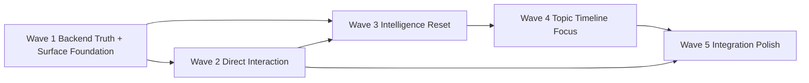
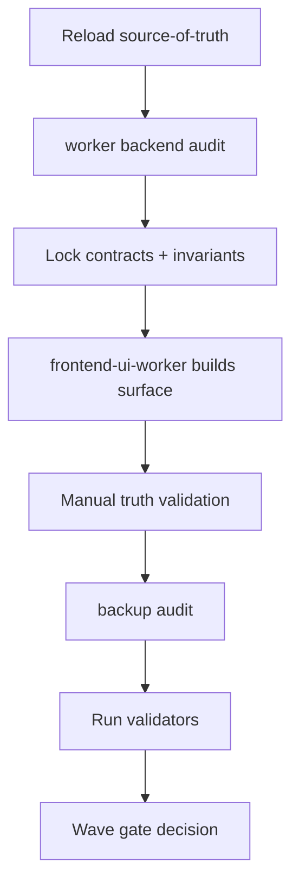

# Workspace Ground-Up Redefinition Spec

## Source-of-truth stance
This execution program is grounded by, in order: `spectra-workspace-redesign-agent-execution-spec.md`, `spectra-redesign-context.md`, the two sketches, the deep gap spec, the recovery plan, and the testing report. Current workspace UI code is not truth and should be treated as disposable scaffolding only. The workspace frontend is to be rebuilt from the ground up on top of verified backend truth.

## What this spec is for
This is the strict orchestration guide for the rebuild. It is intentionally hard-edged so later agents cannot hide behind partial progress, shell UI, or “it renders” claims. Completion means trustworthy behavior, correct data flow, strong spatial semantics, and a flagship-caliber workspace feel.

## Non-negotiable product principles
- Workspace is the working surface, not a launcher.
- Backend truth leads every wave.
- One authoritative workspace content contract.
- One authoritative workspace renderer path.
- Quick chat is an action surface, not a thread opener.
- Glance, Touch, and Deep Edit are semantically different layers.
- Free drag inside workspace lands in Wave 1, but only with hard persistence, placement, and undo rules.
- Planner is first-class early, not deferred into a side-system.
- Current workspace frontend implementation is not to be preserved as product truth.

## Sketch-grounded UI truths
From `1.jpeg` and `2.jpeg`, preserve these intentions:
- left-edge workspace selector ordered by last activity
- large workspace interior with light structural grouping, not boxed board clutter
- bottom-center unified command bar for creation + AI
- bottom-right timer/focus
- right-edge planner operating layer/tab present early
- everything user-relevant feels draggable/customizable, but only within strong logic and persistence rules
- no home screen; app lands in latest workspace

## Program shape
Keep the 5-wave structure from the source spec, but sharpen each wave with stricter entry gates, worker assignments, and anti-fake-completion criteria.

## Orchestration doctrine
### Worker roles
- `worker`: heavily used at the start of each wave for backend truth, contracts, projection, invalidation, persistence, and mutation semantics.
- `frontend-ui-worker`: primary execution worker for the rebuilt workspace surface, hub, renderer path, interactions, and flagship polish.
- `backup`: audits, contradiction checks, codebase discovery, final validation, and rescue only if primary frontend execution underdelivers.

### Controlled-wave execution
- Do not parallelize dependent frontend tracks.
- Do parallelize backend audits that do not mutate the same contract surface.
- Every wave starts with a worker-led truth audit and ends with backup-led validation.
- If context compacts, reload the source-of-truth files before continuing.

## Pre-wave 0: truth audit before any coding
Before implementation starts, run a dedicated truth audit using workers.

### Required audit outputs
1. authoritative backend contract map
   - schema fields
   - projection path
   - mutation → workspace mutation → workspace item upsert/archive → event → invalidation sequence
   - thread/planner/artifact parity gaps
2. authoritative frontend replacement map
   - which existing workspace files are safe as shells only
   - which renderer/store/panel paths are dead, misleading, or partial
3. risk register
   - zoom/scale risks
   - free-drag persistence risks
   - panel continuity risks
   - quick chat action-resolution risks
4. validator map
   - lint/test/build/typecheck commands actually present and usable

### Must not happen
- no implementation begins before the backend projection and content contract gaps are written down concretely
- no frontend code is accepted merely because it matches the sketch superficially

## Wave 1 — Backend Truth + Surface Foundation
### Objective
Create the trustworthy substrate and first real workspace shell: canonical runtime truth, immediate projection, strict content contract, real spatial model, unified hub primitives, planner present early, free-drag foundations, and one renderer path for Glance.

### Worker allocation
- `worker`: primary on schema/contracts/projection/persistence/placement/action resolution preconditions
- `frontend-ui-worker`: primary on new canvas shell, geometry, hub primitives, planner edge layer shell, and glance-tier rendering
- `backup`: audit the old workspace frontend paths and flag anything misleading

### Backend-first deliverables
- canonical artifact taxonomy active in runtime truth
- equal projection semantics for artifacts, threads, planner
- strict mutation ordering enforced
- batched workspace content query defined as the single frontend contract
- workspace item fields for per-view position persistence and provenance are present early
- undo entry point real enough for creation/move/layout operations
- placement semantics no longer naive count/grid only; use workspace center, viewport context, and semantic grouping
- thread creation dedup/idempotency fixed
- artifact creation/project/open flow made trustworthy

### Frontend deliverables
- entirely new workspace surface path established
- large territory model and zoom thresholds recalibrated around readable landscape → dominant workspace → usable content
- bottom-center unified command bar shell
- left dock shell ordered by last activity
- bottom-right timer shell
- right-edge planner shell/tab present from Wave 1
- soft tint zone infrastructure present
- glance-tier renderer suite for all required types
- free drag enabled for items inside workspace with visible placement trust cues

### Wave 1 validation gate
- workspaces are readable at far zoom and spatially believable
- immediate projection works for artifact/thread/planner creation
- no fragmented client assembly remains on the hot path for visible workspace content
- planner exists as an early operating layer, not a fake placeholder tab
- item drag positions persist by view mode and survive refresh/re-entry
- undo works for at least create/move/layout operations
- current workspace frontend path can be ignored because the new path is authoritative

### Explicit anti-cheat guardrails
- no dashed boxes as final grouping system
- no keeping scroll-as-pan if zoom narrative is still broken
- no separate quick chat and create launcher shells pretending to be the final bar
- no free drag without persistence, placement sanity, and undo
- no planner shell that visually exists but cannot truthfully navigate and persist

## Wave 2 — Direct Interaction
### Objective
Make the workspace truly usable as the working surface.

### Backend-first deliverables
- global search over artifact plaintext, thread content, planner items, workspaces
- real item/group/context-menu actions
- move/duplicate/archive flows with undo
- batch position updates and drag persistence hardened

### Frontend deliverables
- Touch tier becomes real, not enlarged Glance
- Note inline editing
- Code inline editing
- type-specific Touch renderers for all other supported types
- context menus on empty canvas, item, group
- overflow model
- focus ring, focus ownership, Escape hierarchy
- panel continuity improved so Deep Edit is escalation, not fallback primary

### Wave 2 validation gate
- Note and Code are truly editable inline
- right-click is reliable and meaningful
- search navigates across workspaces correctly
- move-to-workspace and undo are trustworthy
- workspace remains usable without constant panel opening

## Wave 3 — Intelligence Reset
### Objective
Replace heuristic fakery with real classifier + skill-driven orchestration and turn quick chat into a real action system.

### Backend-first deliverables
- structured cheap-model classifier installed as primary non-T0 routing truth
- mode logic collapsed into compatibility-only role
- substantive SKILL.md runtime system
- quick chat action-resolution layer before thread creation
- ghost service with suppression/expiry/provenance
- semantic agent matching
- background tasks on cheapest lanes only

### Frontend deliverables
- scope badges and targeting cues
- ghost rendering with proper lifecycle constraints
- provenance/status indicators
- action-resolved quick chat UX that can create/edit/plan without defaulting to thread creation

### Wave 3 validation gate
- non-trivial requests are classifier-led
- quick chat can resolve to artifact/planner/edit actions directly
- ghosts are useful and non-intrusive
- thread creation is no longer the default answer to creation intent

## Wave 4 — Topic, Timeline, Focus
### Objective
Add organizational intelligence without compromising workspace truth.

### Backend-first deliverables
- embedding-based topic clustering pipeline
- persistent overrides and renames
- timeline aggregation
- reclustering rules

### Frontend deliverables
- global view toggle: byType, byTopic, timeline
- mixed-type topic groups with persistent user overrides
- horizontal timeline
- timer-linked focus behavior

### Wave 4 validation gate
- By Topic is genuinely semantic and user-correctable
- Timeline is useful and not a fake calendar
- focus mode sharpens the workspace rather than creating a separate app mode

## Wave 5 — Integration + Flagship Polish
### Objective
Integrate preserved systems and push the workspace to flagship quality.

### Backend-first deliverables
- linked agent as implicit companion
- planner hub completion with ManageBac integration
- gamification tied in subtly
- template inference on workspace creation
- soul preference influence refined

### Frontend deliverables
- planner operating layer fully useful
- agent identity accents
- subtle XP/streak/achievement signals
- workspace template suggestion flow
- final motion, typography, hierarchy, and visual cleanup

### Wave 5 validation gate
- app opens into last active workspace
- workspace feels cohesive, powerful, and worth inhabiting
- planner, AI, versions, focus, and navigation all feel like one product
- no leftover wireframe/prototype cues dominate the experience

## Authoritative system contracts to lock early
### 1. Workspace content contract
The frontend must consume one batched content query shape for a workspace. No rebuilding from many endpoint fragments in the hot path.

### 2. Renderer contract
Exactly one renderer path owns workspace item display across glance/touch/deep-edit escalation.

### 3. Layout contract
Per-view-mode item positions are persisted. Auto-layout gives a strong initial placement, then user overrides persist. Free drag is allowed early, but never without clamping, conflict handling, and persistence rules.

### 4. Panel contract
Deep Edit is an escalation layer continuous with quick chat and touch-tier focus, not a disconnected app.

### 5. Hub contract
Workspace selector, unified command bar, timer, planner edge layer, and collapse behavior are persistent operating surfaces. They are edge-bound, visually strong, and never random floating widgets.

## Practical execution checklist for later implementation agents
### Before touching code
- reload the source-of-truth specs and sketches
- confirm current target files are still shells/evidence, not truth
- map validators
- assign worker tasks per wave

### Before claiming a wave complete
- pass backend validation criteria first
- verify in-product behavior, not just code presence
- run validators
- run manual checks against golden journeys
- run backup audit for contradiction detection

### Golden journeys that must be used as gates
1. open into last workspace
2. landscape → workspace → touch progression feels real
3. create with AI lands on canvas immediately
4. note inline editing + escape works
5. code inline editing + Deep Edit escalation works
6. move item across workspace + undo works
7. planner task is visible both in workspace and planner edge layer
8. quick chat resolves non-thread actions directly
9. By Topic overrides persist
10. ghost suppressed during active editing then reappears later if still relevant

## Specific pitfalls later agents must not hide behind
- “the backend mostly works already” without a worker audit proving projection correctness
- “the UI exists” without spatial trust, continuity, and believable scale
- “free drag works” without persistence and undo
- “planner exists” without being a real operating layer early
- “quick chat is improved” while it still mainly opens threads
- “topic view exists” because cluster fields exist but product behavior does not
- “deep edit works” when only documents are strong
- “flagship polish” while the product still feels boxed, dashed, blurry, or prototype-like

## Implementation sequence inside each wave

## Exit criteria for the full program
The redesign is done only when:
- the workspace is genuinely the main working environment
- backend truth is reliable enough that frontend trust holds under real use
- AI feels like an action system inside the workspace
- planner, versions, hub, search, and deep edit feel integrated
- the product reads as a high-end AI-native study environment, not a repaired prototype

If approved, I’ll use this as the hard execution contract and then start with a worker-heavy Wave 1 truth audit before any implementation.