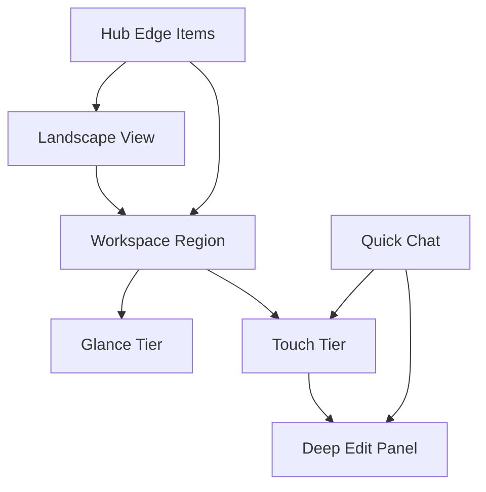
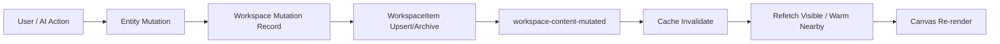
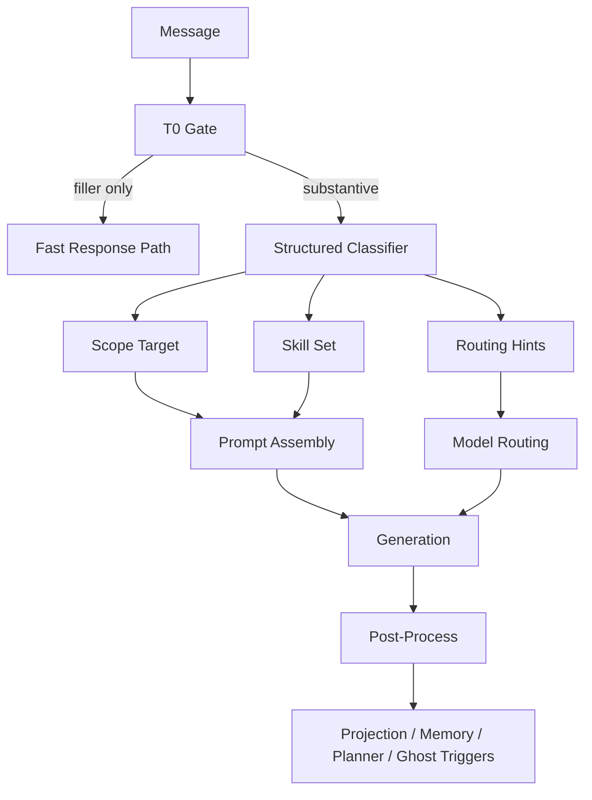
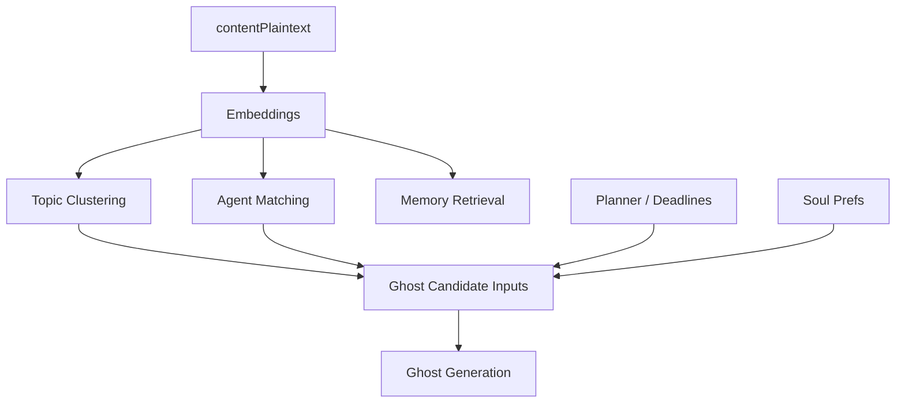
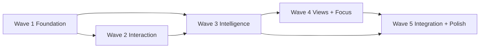

# 1. Execution Charter

This document is the agent execution spec for the Spectra workspace redesign.

Execution rules:
- Backend-first within each wave is mandatory.
- No wave proceeds until its validation gate passes.
- Preserve only systems explicitly marked for preservation or preservation-with-refactor.
- Non-goals and V2 boundaries are binding.
- This is a WHAT / BEHAVIOR / DATA FLOW / EXECUTION ORDER document, not code.
- If implementation pressure forces tradeoffs, protect the workspace surface, classifier architecture, projection correctness, and migration safety first.

---

# 2. Global Architecture Map

## 2.1 Workspace Surface Architecture



Legend:
- `Landscape View` = all-workspaces zoomed-out state
- `Workspace Region` = large spatial territory for one workspace
- `Glance Tier` = preview-only workspace item rendering
- `Touch Tier` = direct inline interaction layer
- `Deep Edit Panel` = right-side escalated editing surface
- `Hub Edge Items` = persistent edge-bound UI

### ASCII topology sketch

```text
+---------------------------------------------------------------+
| [Workspace Dock]                                              |
|                                                               |
|         Workspace A region          Workspace B region        |
|                                                               |
|                  [content groups / tint zones]                |
|                                                               |
|                                                               |
| [+] [Hub Toggle]            [Quick Chat]         [Timer]      |
+---------------------------------------------------------------+
```

---

## 2.2 Projection / Mutation / Invalidation Flow



### Required ordering
1. Entity truth changes first.
2. Workspace mutation is recorded where action is undo-relevant.
3. Workspace projection updates immediately.
4. Event dispatch occurs after projection state is safe.
5. UI invalidates and refreshes visible content.

---

## 2.3 Classifier + Skills + Generation Flow



### Key rule
For non-T0 requests, the classifier is the source of truth for skill loading and routing intent. Heuristic routing must not remain the primary path.

---

## 2.4 Shared Intelligence Substrate



### Shared substrate responsibilities
- cheap embeddings
- reusable vector infrastructure
- common content normalization rules
- cheap-model naming/generation only where vector math is insufficient

---

## 2.5 Wave Dependency DAG



### Dependency rules
- Wave 3 cannot be considered complete if Wave 1 canonical artifact/projection work is not complete.
- Wave 4 depends on embeddings/classifier-era infrastructure from Wave 3.
- Wave 5 depends on prior waves for coherence and integration.

---

# 3. System Inventory and Ownership Map

| Subsystem | Purpose | Decision | Primary files/systems likely touched | Upstream dependencies | Downstream consumers | Risk if implemented lazily |
|---|---|---|---|---|---|---|
| Workspace canvas surface | Primary study landscape and zoom-driven interaction surface | Preserve-but-refactor | `src/components/workspace/workspace-canvas.tsx` | workspace store, workspace content queries, projection events | all workspace rendering, navigation, hub overlays | workspace remains a shortcut graph |
| Workspace internal renderers | Glance/Touch renderers for projected items | Preserve-but-refactor | `src/components/workspace/views/*` | canonical artifact taxonomy, workspaceItems metadata | canvas content display | Touch tier degrades into generic cards |
| Right-side deep edit surface | Escalated editing context | Preserve-but-refactor | `src/components/chat/unified-panel.tsx`, `src/components/workspace/right-push-panel.tsx` | panel state, artifact/thread/planner models | Deep Edit flows | panel becomes default path again |
| Workspace state store | global workspace camera/view/focus/hub state | Preserve-but-refactor | `src/stores/workspace-store.ts` | canvas behavior, view modes, timer, panel state | all workspace surfaces | old mode semantics leak into redesign |
| Chat state | streaming, routing, attachments, composer controls | Preserve-but-refactor | `src/hooks/use-chat-state.ts` | pipeline, composer, panel/chat UI | chat composer/messages/panels | monolith blocks classifier/skills transition |
| Chat composer/messages | user AI interaction surfaces | Preserve-but-refactor | `src/components/chat/chat-composer.tsx`, `src/components/chat/chat-messages.tsx` | classifier output, scope badges, attachments | quick chat, thread panels | scope handling remains brittle |
| Pipeline/orchestrator | request routing and generation orchestration | Preserve-but-refactor | `src/lib/orchestrator/pipeline.ts`, `src/lib/orchestrator/pipeline-controller.ts` | classifier, skills, model routing, memory/retrieval | all AI behaviors | regex logic remains primary |
| Routing/model selection | model phase routing | Preserve-but-refactor | `src/lib/routing/phase-router.ts`, `src/lib/auto-settings.ts` | classifier outputs, budget rules | generation, background jobs | legacy heuristics continue to drive routing |
| Skills runtime | skill selection and prompt assembly | Preserve-but-refactor | `src/lib/skills/skill-registry.ts`, `src/lib/orchestrator/skills.ts`, `public/skills/*.md` | classifier | generation | skills remain shallow snippets |
| Modes/contracts | legacy mode abstractions | Replace or collapse into compatibility only | `src/lib/modes.ts`, `src/lib/contracts/studyModes.ts` | existing chat UI and pipeline | compatibility during migration only | old mode-first mental model survives |
| Artifact subsystem | canonical content entities, versions, AI edit flow | Preserve-but-refactor | `convex/artifacts.ts`, `src/lib/artifact-types.ts`, `app/api/artifacts/route.ts` | schema, projection sync, exports | workspace renderers, panel editors, search | type sprawl and broken projection persist |
| Workspace projection layer | spatial representation of items | Preserve-but-refactor | `convex/workspaceItems.ts`, `convex/workspaceItemSync.ts`, `convex/workspaceHelpers.ts` | artifacts/chats/planner mutations | canvas, search navigation, clustering | new content still fails to appear immediately |
| Workspace orchestration | workspace creation/suggestions/templates | Preserve-but-refactor | `convex/workspaceOrchestration.ts`, `convex/workstreams.ts` | classifier/title inference, planner, ManageBac | workspace creation and assignment | reactive suggestions only |
| Memory system | user/workstream memory extraction + retrieval | Preserve-but-refactor | `convex/memory.ts`, `convex/workstreamMemory.ts`, `src/lib/orchestrator/post-process.ts` | pipeline, embeddings, preferences | classifier/context injection/ghosts | prompt stuffing or memory loss |
| Agent matching | assign/recommend companion agents | Replace primary matching logic | `src/lib/agent-matching.ts`, `convex/agents.ts` | embeddings, linked agents, resources | pipeline, workspace agent companion | low-quality token overlap persists |
| Planner | deadlines/goals on workspace and hub | Preserve-but-refactor | `convex/plannerItems.ts` | workspace projection, ManageBac sync | workspace renderers, hub planner | planner becomes shallow or overbuilt |
| ManageBac integration | sync deadlines/classes/assignments | Preserve-but-refactor | `convex/managebacSync.ts`, `src/lib/managebac/*` | external sync, workstreams, planner | hub planner, workspace creation | sync stays flaky and disconnected |
| Gamification | XP/streaks/achievements/focus rewards | Preserve-but-refactor | `convex/gamification.ts` | workspace activity, timer | toolbar indicators, toasts | clutter or broken reward attribution |
| Schema | canonical data model | Preserve-but-refactor | `convex/schema.ts` | all backend tables | every subsystem | later waves blocked by missing early fields |
| Search / command palette | global retrieval and command navigation | Preserve-but-refactor | `components/command-palette.tsx`, `components/workspace/workspace-command-bar.tsx` | search indexes, navigation | overflow recovery, workspace navigation | search stays local/shallow |
| Visual generation pipeline | Spectra visuals + inline/workspace dual render | Preserve-but-refactor | visual skill assets, artifact generation flow, iframe sandbox surfaces | classifier, skills, artifact creation | thread render + workspace visual item | generic AI visuals, no dual render |
| Board/whiteboard | board artifact presence | Defer full editor, preserve type/preview | artifact types, renderers, panel placeholder | taxonomy and projection | glance/touch/deep edit placeholders | scope explosion into full board product |

---

# 4. Wave-by-Wave Execution Plan

# Wave 1 — Foundation: Canonical Surface, Projection Correctness, Spatial Rebuild

## Objective
Establish the minimal truthful substrate required for the redesign: canonical artifact taxonomy, immediate projection behavior, larger workspace geometry, LRU content caching, new workspace state semantics, and default hub primitives.

## Why this wave exists
All later work depends on three things being true:
1. The workspace surface must stop being a shortcut layer.
2. Content must project immediately and reliably.
3. Spatial zoom must have room to mean something.

## Entry criteria / prerequisites
- Current workspace/artifact/projection architecture has been inspected.
- Existing invalidation path (`workspace-content-mutated`) is understood.
- Legacy artifact type usage and editor mode usage have been cataloged.

## Exact scope
- Canonical artifact taxonomy and compatibility mapping
- WorkspaceItem projection correctness
- Schema additions needed by later waves
- LRU cache strategy and content query batching
- Workspace geometry and zoom band recalibration
- Glance-tier renderer system
- Hub primitive shells
- Undo entry point via workspace mutations
- AI discard flow fix path defined and implemented for persisted behavior

## Non-goals
- Touch-tier inline editing
- classifier/skills rewrite
- topic clustering
- ghost items
- full focus mode
- planner hub polish

## Deliverables
- Canonical artifact type contract in use
- Immediate projection on artifact creation/update/archive
- Workspace item/event/invalidation path stable
- Larger workspace territories visible in canvas
- New glance tier for all required item types
- Workspace store updated toward redesign semantics
- LRU cache operational
- Undo path available by keyboard

## Phase A — Data model / schema / contracts / compatibility
### Scope
- Add fields required by later waves early.
- Introduce canonical surface taxonomy without breaking compatibility.
- Define projection metadata fields as first-class contracts.

### Required actions
- Update `convex/schema.ts` with fields needed now and later:
  - canonical/normalized workspace-facing artifact typing support
  - `workspaceItems.topicCluster`
  - `workspaceItems.clusterOverride` or equivalent override mechanism field(s)
  - ensure `workspaceItems.provenanceSource` is sufficient and consistently used
  - store-level persistence compatibility for `viewMode: byType | byTopic | timeline`
  - placeholder state/data support for `studySurfaceActive`
- Define compatibility rules for reading old artifact types.
- Define compatibility rules for old editor modes mapping to `standard | full | ai`.
- Define mutation contract for undoable workspace actions.

### Files/systems likely touched
- `convex/schema.ts`
- `src/lib/artifact-types.ts`
- `src/lib/contracts/studyModes.ts` (compatibility implications only)
- `src/stores/workspace-store.ts`

### Output contract
- Old data still loadable.
- New fields exist early enough for Waves 3–5.
- No frontend is required to fully use all new fields yet.

## Phase B — Backend logic / orchestration / queries / mutations / events
### Scope
- Make workspace projection immediate and reliable.
- Introduce batched workspace content query semantics.
- Fix real AI discard persistence.
- Establish event/caching invariants.

### Required actions
- Update artifact create/update/archive flows in `convex/artifacts.ts` and sync helpers so that:
  - entity mutation occurs
  - relevant workspace mutation is recorded
  - workspaceItem is upserted/archived immediately
  - content-mutated event can be emitted and consumed
- Update `convex/workspaceItemSync.ts` to use canonical taxonomy rather than legacy display buckets.
- Ensure thread and planner projections follow the same immediate appearance rule.
- Replace delayed sync expectations with immediate projection guarantees.
- Define/implement batched workspace content fetch shape instead of fragmented hot-path fetches.
- Fix AI discard pathway end-to-end so discard mutation truly restores previous state.
- Implement or finalize undo entry point using `workspaceMutations`.

### Files/systems likely touched
- `convex/artifacts.ts`
- `convex/workspaceItemSync.ts`
- `convex/workspaceItems.ts`
- `convex/workspaceHelpers.ts`
- `convex/chats.ts`
- `convex/plannerItems.ts`
- `src/lib/workspace/events.ts`
- `app/api/artifacts/route.ts`

### Backend invariants introduced in this phase
- Chat-generated artifact appears on the workspace within the same response lifecycle.
- WorkspaceItem is not a deferred sync artifact.
- Projection must archive correctly when source entity becomes inactive.

## Phase C — Frontend rendering / interaction / state / UI surfaces
### Scope
- Rebuild the spatial model and glance-tier workspace rendering.
- Add persistent hub primitive surfaces.
- Replace old view/store semantics sufficiently for new workspace shell.

### Required actions
- Rework `workspace-canvas.tsx` to use large workspace territories.
- Recalibrate zoom thresholds and semantic tier behavior.
- Replace or retire old view mode assumptions (`structured | columns | graph`) in store/UI.
- Implement Glance-tier renderers for:
  - Note
  - Visual
  - Code
  - Export
  - Board
  - Flashcard Deck
  - Quiz
  - Thread
  - Planner Task
- Add tint zones with soft-edge styling and headers.
- Add hub primitives:
  - workspace selector dock
  - quick chat shell
  - timer shell
  - create launcher shell
  - hub widget collapse toggle
- Introduce LRU cache behavior in canvas-side content caching.

### Files/systems likely touched
- `src/components/workspace/workspace-canvas.tsx`
- `src/components/workspace/views/*`
- `src/stores/workspace-store.ts`
- `src/components/workspace/workspace-command-bar.tsx`
- `src/components/study-timer.tsx`
- `src/components/command-palette.tsx` (only if needed for shell alignment)

## Phase D — Migration / backfill / cleanup / rollout constraints
### Scope
- Safe rollout without breaking old records or old UI paths during transition.

### Required actions
- Introduce compatibility reads before destructive cleanup.
- Add backfill plan for old artifact/workspace item records if canonical fields need population.
- Keep old type names tolerated at API boundaries until Wave 1 validation passes.
- Keep legacy editor mode values readable until all consumers are migrated.
- Delay aggressive cleanup until downstream surfaces are confirmed stable.

### Rollout constraints
- Do not remove old type handling while existing records still depend on it.
- Do not assume all workspace items are canonicalized at once.

## Phase E — Validation / tests / manual QA / proof of done
### Validation gate
Wave 1 passes only when all are true:
- Workspaces occupy large, clearly separated spatial regions.
- Far zoom displays meaningful workspaces, not dots.
- Glance tier exists for all required types.
- New artifacts/threads/planner items relevant to a workspace appear immediately after creation.
- Cache no longer grows unbounded.
- Undo entry point is operational.
- Hub primitives render consistently across workspace contexts.
- No hard zoom boundary traps or route-like transitions exist.

### Proof-of-done checklist
- [ ] Canonical artifact mapping defined and active
- [ ] Immediate projection path implemented
- [ ] LRU cache implemented and validated
- [ ] Discard AI edit persists correctly
- [ ] Workspace store view semantics updated
- [ ] Glance renderers exist for all required item types
- [ ] Hub primitive shells present
- [ ] Manual QA confirms direct-open last workspace behavior

### Main implementation risks
- preserving current compressed layout with only cosmetic tweaks
- leaving projection delayed and invisible in live flows
- cleaning up legacy types too early
- keeping unbounded cache behavior hidden in frontend state

### Failure patterns to avoid
- “temporary” generic cards for glance tier
- UI-only discard flow
- projection via periodic sync instead of immediate upsert

---

## Work Packages — Wave 1

### Work Package W1-A1 — Canonical artifact taxonomy
- goal: establish workspace-facing canonical types and compatibility rules
- affected systems/files: `convex/schema.ts`, `src/lib/artifact-types.ts`, `convex/artifacts.ts`
- required behavior:
  - legacy types map cleanly to canonical types
  - Note remains distinct from Export
  - Board exists as first-class type even if editor is deferred
- compatibility/migration notes:
  - dual-read legacy type values
  - do not remove legacy names until cleanup window
- dependencies: none
- done criteria:
  - canonical mapping table is implemented and consumed by workspace-facing logic
- risks:
  - conflating document/note/export semantics

### Work Package W1-A2 — WorkspaceItem projection rewrite
- goal: make projection immediate and canonical
- affected systems/files: `convex/workspaceItemSync.ts`, `convex/workspaceItems.ts`, `convex/artifacts.ts`, `convex/chats.ts`, `convex/plannerItems.ts`
- required behavior:
  - new content appears on canvas immediately
  - archive/move/update flows maintain projection correctly
- compatibility/migration notes:
  - tolerate legacy item types while canonicalizing new writes
- dependencies: W1-A1
- done criteria:
  - live create/update/archive paths all project correctly
- risks:
  - duplicates, stale projections, orphaned items

### Work Package W1-A3 — Workspace content query + cache contract
- goal: replace fragmented hot-path fetching and unbounded cache use
- affected systems/files: `workspace-canvas.tsx`, backend query surfaces, workspace events
- required behavior:
  - batched workspace content fetch
  - LRU cache with 5–7 workspace limit
  - proper invalidation via workspace-content-mutated
- compatibility/migration notes:
  - current fetch endpoints may temporarily coexist
- dependencies: W1-A2
- done criteria:
  - visible refresh is correct and cache evicts
- risks:
  - stale data and race conditions

### Work Package W1-B1 — AI discard persistence fix
- goal: make discard real, not UI-local
- affected systems/files: `src/components/artifacts/artifact-ai-surface.tsx`, `app/api/artifacts/route.ts`, `convex/artifacts.ts`
- required behavior:
  - discard restores persisted previous state and updates version status
- compatibility/migration notes:
  - existing UI callbacks may remain but must call backend truth
- dependencies: none
- done criteria:
  - discard verified by refetch/reopen
- risks:
  - UI appears correct while backend remains wrong

### Work Package W1-C1 — Spatial canvas rebuild
- goal: create large readable workspace landscape
- affected systems/files: `workspace-canvas.tsx`, workspace layout helpers, store zoom bands
- required behavior:
  - workspace territories around 1500x1200
  - dramatic zoom contrast across levels
- compatibility/migration notes:
  - existing saved viewport data may need graceful tolerance
- dependencies: none
- done criteria:
  - zoomed-out landscape is readable and zoomed-in workspace is usable
- risks:
  - keeping old compressed thresholds

### Work Package W1-C2 — Glance renderer suite
- goal: ensure all item types have cheap preview representation
- affected systems/files: `src/components/workspace/views/*`
- required behavior:
  - all required types rendered
  - status and summary visible
- dependencies: W1-A1
- done criteria:
  - no workspace item falls back to generic placeholder card except acceptable empty/error states
- risks:
  - generic cards treated as final

### Work Package W1-C3 — Hub primitives shell
- goal: establish persistent edge UI
- affected systems/files: workspace canvas, workspace command bar, timer widget, create menu surfaces
- required behavior:
  - dock, quick chat shell, timer shell, create launcher, collapse toggle visible and persistent
- dependencies: W1-C1
- done criteria:
  - default hub items are always present and edge-bound
- risks:
  - implementing them as ordinary floating windows

---

# Wave 2 — Interaction: Touch Tier, Search, Menus, Workspace Manipulation

## Objective
Make the workspace directly usable through inline editing, type-specific touch rendering, global command/search behavior, and real item actions.

## Why this wave exists
Wave 1 creates truthful structure. Wave 2 turns that structure into a real working surface rather than a good-looking preview shell.

## Entry criteria / prerequisites
- Wave 1 validation gate passed
- canonical type mapping stable enough for renderer branching
- immediate projection behavior stable

## Exact scope
- Note Touch-tier inline editing
- Code Touch-tier inline editing
- Touch renderers for all non-inline-edit types
- focus ring/focus ownership model
- global Cmd+K search/navigation
- target-specific context menus
- overflow expansion
- item move between workspaces + undo

## Non-goals
- classifier rewrite
- ghost items
- clustering/topic view
- focus mode

## Deliverables
- inline note editing on canvas
- inline code editing on canvas
- context menus for all 3 target classes
- search/navigation command palette upgraded for global workspace use
- overflow expansion behavior
- move-to-workspace flow with undo

## Phase A — Data model / schema / contracts / compatibility
### Scope
- Add or finalize fields needed for movement, grouping, and touch render state where backend contracts require them.

### Required actions
- Confirm workspace item model supports:
  - workspace reassignment
  - pin state
  - collapse/overflow state if persisted
  - grouping metadata needed by group actions
- Define search result contract for global navigation:
  - result id
  - source type
  - workspace reference
  - highlight target info

### Files/systems likely touched
- `convex/schema.ts`
- `convex/workspaceItems.ts`
- search-related query surfaces

## Phase B — Backend logic / orchestration / queries / mutations / events
### Scope
- Support search, movement, and item/group action truths.

### Required actions
- Build global search index/query over:
  - artifact plaintext
  - thread content/messages
  - planner items
  - workspaces
- Add item action mutations:
  - duplicate
  - move to workspace
  - archive
  - pin/unpin
- Add group action support contract as needed:
  - rename group
  - collapse group
  - summarize group trigger
  - merge-group support contract if implemented now
- Ensure move-to-workspace records mutation and triggers projection/invalidation updates.
- Add batch position/group updates for drag operations.

### Files/systems likely touched
- `convex/workspaceItems.ts`
- `convex/artifacts.ts`
- `convex/chats.ts`
- `convex/plannerItems.ts`
- search endpoints / command palette query sources

## Phase C — Frontend rendering / interaction / state / UI surfaces
### Scope
- Implement Touch tier as the main inline work layer.

### Required actions
- Build Note Touch-tier editor:
  - focus ring
  - direct typing
  - basic formatting only
  - no slash commands
- Build Code Touch-tier editor:
  - syntax highlighting
  - basic editing only
  - no execution or AI tooling inline
- Implement Touch-tier behavior for:
  - Visual render/interact
  - Export preview/download
  - Flashcard deck summary + review launch
  - Quiz summary + launch
  - Thread mini-conversation + continue launch
  - Planner task partial inline edit
  - Board preview only
- Implement global Cmd+K search UI and navigation behavior.
- Implement right-click menus for empty canvas, item, group.
- Implement overflow expansion (+N more).
- Implement focus ownership hierarchy and Escape behavior.

### Files/systems likely touched
- `src/components/workspace/views/*`
- `src/components/command-palette.tsx`
- `src/components/workspace/workspace-command-bar.tsx`
- `src/stores/workspace-store.ts`
- note/code editor surfaces

## Phase D — Migration / backfill / cleanup / rollout constraints
### Scope
- Transition from panel-first editing assumptions to inline-first for Note and Code.

### Required actions
- Keep Deep Edit available while Touch tier rolls out.
- Do not remove panel editors for Note/Code; instead demote them to escalated editing path.
- Maintain fallback rendering for legacy records until canonical type rollout is fully stable.

## Phase E — Validation / tests / manual QA / proof of done
### Validation gate
Wave 2 passes only when all are true:
- Note can be edited inline at Touch tier.
- Code can be edited inline at Touch tier.
- Each non-inline-edit type has meaningful type-specific Touch rendering.
- Focus ring, focus ownership, and Escape hierarchy behave correctly.
- Global search returns cross-workspace results and navigates correctly.
- Context menus work for all 3 target classes.
- Move-to-workspace flow works and is undoable.
- Overflow expansion functions without trapping content.

### Proof-of-done checklist
- [ ] Note inline editing works
- [ ] Code inline editing works
- [ ] Touch tier renderers implemented for all required types
- [ ] Cmd+K global navigation/search operational
- [ ] Context menus wired to backend truth
- [ ] Move-to-workspace mutation undo tested
- [ ] Overflow handling implemented

### Main implementation risks
- Touch tier devolves into enlarged preview cards
- inline editing leaks full toolbars or deep-edit capabilities
- command palette stays local/shallow instead of global/workspace-aware

### Failure patterns to avoid
- using panel open as the only real edit path for Note/Code
- placeholder context menu items that do nothing on backend
- search that only covers titles

---

## Work Packages — Wave 2

### Work Package W2-A1 — Search contract and index
- goal: define global search/navigation result model
- affected systems/files: search queries, command palette surfaces
- required behavior:
  - cross-workspace search over content and metadata
  - navigation result contains workspace + item target
- dependencies: W1-A2, W1-A3
- done criteria:
  - selecting result pans/zooms/highlights accurately
- risks:
  - result points to item but cannot land correctly

### Work Package W2-B1 — Workspace item move/duplicate/archive actions
- goal: real backend truth for core context menu actions
- affected systems/files: `convex/workspaceItems.ts`, related entity mutators
- required behavior:
  - move updates workspace assignment and invalidates correctly
  - duplicate creates valid projected copy or entity-backed equivalent
  - archive hides correctly and remains undoable
- dependencies: W1-A2
- done criteria:
  - all three actions behave consistently through undo and refresh
- risks:
  - partial state updates across workspaces

### Work Package W2-C1 — Note Touch editor
- goal: inline note editing in workspace
- affected systems/files: note renderer/editor surfaces, workspace views
- required behavior:
  - basic formatting only
  - focus ring + direct typing
- dependencies: W1-C2
- done criteria:
  - note can be edited without panel
- risks:
  - slash commands or full editor complexity leaking in

### Work Package W2-C2 — Code Touch editor
- goal: inline code editing in workspace
- affected systems/files: code renderer/editor surfaces
- required behavior:
  - syntax highlighting
  - basic code editing only
- dependencies: W1-C2
- done criteria:
  - code can be edited inline without execution tooling
- risks:
  - panel-first fallback left as primary path

### Work Package W2-C3 — Context menu suite
- goal: complete target-specific context menus
- affected systems/files: workspace canvas/item/group UI, backend actions
- required behavior:
  - empty/item/group menus match product contract
- dependencies: W2-B1
- done criteria:
  - all menu actions are real and testable
- risks:
  - decorative menu items with no backend truth

### Work Package W2-C4 — Overflow handling
- goal: prevent group clutter while keeping retrieval easy
- affected systems/files: workspace grouping/rendering components
- required behavior:
  - first 5 visible + `+N more`, animated expansion
- dependencies: W1-C2
- done criteria:
  - large groups remain navigable and expandable
- risks:
  - content hidden without recovery path

---

# Wave 3 — Intelligence Platform: Classifier, Skills, Ghosts, Semantic Agent Logic

## Objective
Replace heuristic routing with a structured cheap-model classifier, convert mode logic into composable skills, introduce ghost items and provenance-aware auto-creation, and establish embeddings as shared intelligence infrastructure.

## Why this wave exists
This wave is the core AI architecture shift. Without it, Spectra remains mode-fragile, heuristic-heavy, and unable to deliver the intended AI-native workspace behavior.

## Entry criteria / prerequisites
- Wave 1 and Wave 2 passed
- canonical item types stable enough for scope and renderer references
- projection layer stable enough for AI-created items to surface immediately

## Exact scope
- T0 short-circuit preservation
- structured classifier
- classifier-driven skill selection and prompt injection
- comprehensive SKILL.md asset set
- Spectra Visual Skill
- semantic agent matching via embeddings
- ghost generation/storage/retrieval/suppression rules
- confidence-tier AI auto-creation
- background task cheap-model routing
- external skill ecosystem evaluation work

## Non-goals
- By Topic and Timeline UI
- full focus mode
- planner hub polish

## Deliverables
- classifier in primary routing path
- mode logic substantially replaced by skills logic
- runtime skill loading from authored skill files
- visual generation contract upgraded
- ghost lifecycle operational
- agent matching semantic
- background jobs budget-safe

## Phase A — Data model / schema / contracts / compatibility
### Scope
- Add persistent fields and contracts required by classifier/ghost/embedding-era systems.

### Required actions
- Define classifier input/output schema contract.
- Add ghost item storage contract or equivalent cached suggestion structure.
- Add persistent provenance/AI-origin fields where still incomplete.
- Add/confirm fields needed for semantic cluster groundwork and agent/ghost linkage.
- Define skill metadata contract and file ownership rules.

### Files/systems likely touched
- `convex/schema.ts`
- skills directory structures
- orchestrator runtime contracts

## Phase B — Backend logic / orchestration / queries / mutations / events
### Scope
- Rewire routing and add intelligence services.

### Required actions
- Implement structured classifier call using cheap model.
- Preserve T0 heuristic gate only for trivial filler.
- Update pipeline ordering:
  - classifier before prompt enhancement
  - classifier output feeds route plan and skill loading
- Replace/retire regex-first mode suggestion logic as primary path.
- Implement runtime skill loader based on classifier-selected skill IDs.
- Author and wire complete skill library, including Spectra Visual Skill.
- Implement semantic agent matching using embeddings.
- Build ghost suggestion generator and retrieval path.
- Implement suppression rules and expiry behavior in backend logic.
- Route all background tasks to cheapest approved model tier.
- Implement AI auto-creation policy by confidence tier.
- Conduct external skills ecosystem evaluation and record adopted/adapted decisions.

### Files/systems likely touched
- `src/lib/orchestrator/pipeline.ts`
- `src/lib/orchestrator/pipeline-controller.ts`
- `src/lib/auto-settings.ts`
- `src/lib/routing/phase-router.ts`
- `src/lib/skills/skill-registry.ts`
- `src/lib/orchestrator/skills.ts`
- `public/skills/*.md`
- `src/lib/agent-matching.ts`
- memory/retrieval orchestration files
- background job/cron surfaces in Convex

## Phase C — Frontend rendering / interaction / state / UI surfaces
### Scope
- Surface the intelligence architecture in the workspace and chat UX.

### Required actions
- Add workspace/artifact scope badges to quick chat.
- Demote manual mode selector to optional override role.
- Render ghost items with:
  - 40% idle opacity
  - 60% hover
  - accept/dismiss interactions
- Render provenance/status markers:
  - AI sparkle
  - recent edit pulse
  - deadline badge
  - flashcard due progress
  - quiz score badge
- Ensure visual responses dual-render to thread and workspace.

### Files/systems likely touched
- `src/components/chat/chat-composer.tsx`
- `src/components/workspace/workspace-command-bar.tsx`
- workspace renderers and item chrome
- chat/thread message rendering surfaces

## Phase D — Migration / backfill / cleanup / rollout constraints
### Scope
- Transition safely from heuristic/mode-first routing.

### Required actions
- Keep old mode values readable for compatibility while the UI moves to skills-first.
- Prevent hidden fallback heuristics from becoming permanent architecture.
- Roll classifier in with strict schema validation and safe fallback bundle strategy.
- Preserve old runtime skill behavior only as transitional shim if necessary.

### Rollout constraints
- Non-T0 routing must converge to classifier truth before Wave 3 is declared complete.
- Skills files must be substantive before old prompt fragments are removed.

## Phase E — Validation / tests / manual QA / proof of done
### Validation gate
Wave 3 passes only when all are true:
- Non-T0 substantive requests use classifier-driven routing.
- Multiple skills can be selected and injected in one request.
- Spectra Visual Skill is authored and actually constrains outputs.
- Ghosts obey all visibility and suppression constraints.
- AI-created items appear with provenance and are undoable.
- Agent matching is embedding-based and measurably better than lexical overlap.
- Background tasks use only budget-safe cheap model lanes.

### Proof-of-done checklist
- [ ] T0 gate preserved and narrow
- [ ] Structured classifier active in pipeline
- [ ] Skill files authored and loaded at runtime
- [ ] Visual skill complete and used
- [ ] Ghost service operational with suppression/expiry
- [ ] Semantic agent matching active
- [ ] Auto-creation confidence policy enforced
- [ ] Background model routing audited

### Main implementation risks
- reintroducing regex routing under fallback language
- writing shallow SKILL.md files
- making ghost generation synchronous or too frequent
- using embeddings for some parts but leaving agent matching lexical by default

### Failure patterns to avoid
- “temporary” heuristic mode selection surviving as default
- context over-injection into every prompt
- generic visuals instead of Spectra visual outputs

---

## Work Packages — Wave 3

### Work Package W3-A1 — Classifier contract
- goal: define structured classifier interface and ownership
- affected systems/files: pipeline contracts, routing contracts, schema/interfaces
- required behavior:
  - classifier returns tier, skills, targeting, needs flags, confidence, thinking level
- dependencies: W2 complete
- done criteria:
  - pipeline can consume validated classifier output
- risks:
  - underspecified outputs that leave downstream ambiguity

### Work Package W3-B1 — Classifier pipeline integration
- goal: replace heuristic-first orchestration path
- affected systems/files: `pipeline.ts`, `auto-settings.ts`, `phase-router.ts`
- required behavior:
  - T0 only bypass
  - classifier before prompt enhancement
- dependencies: W3-A1
- done criteria:
  - non-T0 path is classifier-led
- risks:
  - mixed routing truth between heuristic and classifier outputs

### Work Package W3-B2 — Skill system rewrite
- goal: move from mode-first to skill-first runtime behavior
- affected systems/files: `skill-registry.ts`, `orchestrator/skills.ts`, `public/skills/*.md`
- required behavior:
  - substantive SKILL.md files
  - runtime loading by classifier IDs
- dependencies: W3-A1
- done criteria:
  - skills, not modes, define runtime guidance
- risks:
  - skills remain shallow wrappers around old modes

### Work Package W3-B3 — Spectra Visual Skill
- goal: define the visual generation quality bar
- affected systems/files: visual skill asset(s), visual generation prompt assembly
- required behavior:
  - token system, SVG rules, sandbox rules, examples, dark mode handling
- dependencies: W3-B2
- done criteria:
  - generated visuals follow Spectra style contract
- risks:
  - generic AI chart output accepted as success

### Work Package W3-B4 — Ghost service
- goal: background AI suggestion layer
- affected systems/files: Convex cron/background jobs, workspace state, renderer surfaces
- required behavior:
  - max 2 visible
  - suppression during editing
  - expiry after 2 sessions unseen
- dependencies: W1-A2, W3-B1
- done criteria:
  - ghost lifecycle validated in workspace UX
- risks:
  - ghost spam or stale ghosts

### Work Package W3-B5 — Semantic agent matching
- goal: replace lexical overlap with embeddings
- affected systems/files: `src/lib/agent-matching.ts`, agent retrieval/metadata surfaces
- required behavior:
  - cosine-similarity-based matching
  - linked agent still respected where appropriate
- dependencies: shared embeddings infrastructure
- done criteria:
  - semantic match path is default
- risks:
  - lexical fallback remains hidden default

### Work Package W3-C1 — Scope-aware quick chat UX
- goal: surface workspace/artifact targeting clearly
- affected systems/files: chat composer, workspace quick chat bar
- required behavior:
  - scope badges with clear affordance
- dependencies: W3-B1
- done criteria:
  - user can see current scope without being constrained by it
- risks:
  - workspace scope becomes a hard constraint

---

# Wave 4 — View Intelligence and Focus Behavior: By Topic, Timeline, Focus Mode

## Objective
Add AI-organized semantic topic grouping, chronological review mode, user override persistence, and focus mode tied to study timer behavior.

## Why this wave exists
The redesign is not complete if content can only be organized by type. By Topic and Timeline turn the workspace into a study map rather than a static board.

## Entry criteria / prerequisites
- Wave 3 complete
- embeddings infrastructure stable
- workspace projections stable and canonical

## Exact scope
- semantic clustering pipeline usage in product
- By Topic view
- Timeline view
- persistent view toggle
- user cluster override persistence
- topic rename persistence
- focus mode behavior
- deep edit + canvas polish tied to these modes

## Non-goals
- cross-workspace links/graphs
- planner calendar system

## Deliverables
- working By Type / By Topic / Timeline modes
- persistent user overrides for clusters
- horizontal day-based timeline
- timer-driven focus mode

## Phase A — Data model / schema / contracts / compatibility
### Scope
- Finalize cluster assignment and override data contracts.
- Finalize view mode storage contract.

### Required actions
- Confirm schema fields for cluster assignment and override persistence.
- Confirm timeline aggregation data shape requirements.
- Confirm global `viewMode` persistence semantics.

### Files/systems likely touched
- `convex/schema.ts`
- workspace store
- workspaceItems/cluster fields

## Phase B — Backend logic / orchestration / queries / mutations / events
### Scope
- Implement clustering and timeline data preparation.

### Required actions
- Build embedding→cluster→name pipeline.
- Store cluster assignments on projected workspace items.
- Add cluster override persistence and rename persistence behavior.
- Implement reclustering trigger logic:
  - first-open if never clustered
  - batch every ~6h
  - or after 3+ new items
  - manual re-organize trigger
- Implement timeline aggregation grouped by day.

### Files/systems likely touched
- clustering job/service surfaces
- workspaceItems logic
- workstream/content aggregation surfaces

## Phase C — Frontend rendering / interaction / state / UI surfaces
### Scope
- Render the new modes and focus behavior.

### Required actions
- Implement global segmented view toggle.
- Implement By Topic zone rendering using cluster assignments.
- Implement item drag between topic zones.
- Implement Timeline horizontal day groups.
- Implement focus mode behavior when timer is active.
- Polish canvas dim/highlight and deep edit panel interaction.

### Files/systems likely touched
- workspace canvas and view components
- workspace store
- timer/focus UI

## Phase D — Migration / backfill / cleanup / rollout constraints
### Scope
- retire legacy view mode assumptions fully.

### Required actions
- Remove or deprecate old workspace view mode values and UI references.
- Keep fallback to By Type if topic clustering has not run yet.
- Maintain safe degraded behavior when clusters are unavailable.

## Phase E — Validation / tests / manual QA / proof of done
### Validation gate
Wave 4 passes only when all are true:
- By Type, By Topic, and Timeline each render correctly.
- By Topic groups mixed types semantically.
- User drag overrides persist across re-entry and reclustering.
- User-renamed topic groups persist.
- Timeline groups by date correctly.
- Focus mode narrows attention without becoming a separate app mode.

### Proof-of-done checklist
- [ ] view mode toggle global and persistent
- [ ] topic clustering pipeline operational
- [ ] override persistence operational
- [ ] topic rename persistence operational
- [ ] timeline view operational
- [ ] focus mode operational and tied to timer

### Main implementation risks
- By Topic is cosmetic relabeling of By Type
- Timeline becomes a calendar feature
- Focus mode becomes a separate screen/mode

### Failure patterns to avoid
- overriding user cluster corrections on recluster
- exposing empty topic view with no fallback behavior

---

## Work Packages — Wave 4

### Work Package W4-A1 — Cluster data contract
- goal: finalize schema/storage semantics for topic clustering
- affected systems/files: schema, workspaceItems logic
- required behavior:
  - assignment, override, rename persistence supported
- dependencies: W3 embeddings readiness
- done criteria:
  - backend can preserve AI cluster + user correction state
- risks:
  - insufficient fields leading to brittle override logic

### Work Package W4-B1 — Clustering pipeline
- goal: generate useful topic groups from workspace content
- affected systems/files: clustering service/jobs, naming logic
- required behavior:
  - vector clustering + cheap-model naming only
- dependencies: W4-A1
- done criteria:
  - topic assignments available for a workspace and stable enough for rendering
- risks:
  - over-clustering or unstable naming

### Work Package W4-C1 — Topic view renderer
- goal: render semantic groups as first-class workspace layout
- affected systems/files: workspace view renderer layer
- required behavior:
  - mixed-type groups with tint zones and drag overrides
- dependencies: W4-B1
- done criteria:
  - By Topic visibly differs from By Type and is interactive
- risks:
  - same layout with renamed headings

### Work Package W4-C2 — Timeline renderer
- goal: chronological review surface
- affected systems/files: workspace view renderer layer
- required behavior:
  - horizontal daily grouping
- dependencies: W4-B1 or separate timeline aggregation path
- done criteria:
  - users can inspect recent study chronology by day
- risks:
  - calendar creep

### Work Package W4-C3 — Focus mode
- goal: timer-linked attention narrowing behavior
- affected systems/files: timer store/UI, workspace canvas
- required behavior:
  - dim non-current context without blocking work
- dependencies: Wave 1 timer shell, Wave 4 render layering
- done criteria:
  - active timer visibly changes workspace presentation
- risks:
  - heavy-handed dimming or separate route behavior

---

# Wave 5 — Integration and Coherence: Agents, Planner Hub, Gamification, Templates, Final Polish

## Objective
Integrate preserved systems into the redesigned workspace so the product behaves coherently end-to-end.

## Why this wave exists
Even with correct canvas, interaction, and intelligence layers, the experience will feel incomplete if agents, planner, ManageBac, Soul, and gamification remain side systems.

## Entry criteria / prerequisites
- Waves 1–4 complete
- workspace interaction and intelligence layers stable enough for integration work

## Exact scope
- linked agent as implicit workspace companion
- agent-specific ghost generation
- hub planner completion with ManageBac deadlines
- gamification surfaced subtly in workspace
- template inference on workspace creation
- Soul preference integration refinement
- final visual/interaction polish

## Non-goals
- new major subsystems outside redesign scope
- calendar product
- board full editor

## Deliverables
- workspace-linked agent presence
- planner hub fully useful across workspaces
- ManageBac deadlines integrated into hub planner
- XP/streak indicators visible but subtle
- AI-inferred workspace templates
- final interaction polish across workspace system

## Phase A — Data model / schema / contracts / compatibility
### Scope
- finalize any remaining fields for companion agent, template inference, or planner hub support.

### Required actions
- Confirm workspace-linked agent and planner aggregation contracts are sufficient.
- Confirm any template metadata contract needed at workspace creation time.

## Phase B — Backend logic / orchestration / queries / mutations / events
### Scope
- connect preserved systems into workspace-first flows.

### Required actions
- Ensure linked workspace agent is implicit in chats in that workspace.
- Add agent-specific ghost suggestion generation path.
- Connect workspace activity and focus sessions to gamification events.
- Finalize planner hub aggregation, including ManageBac deadlines.
- Improve ManageBac reliability and observability.
- Bias classifier/ghost logic with Soul preferences.
- Implement workspace template inference from title.

### Files/systems likely touched
- `convex/agents.ts`
- `convex/managebacSync.ts`
- `convex/plannerItems.ts`
- `convex/gamification.ts`
- `convex/personalSoul.ts` / `convex/soul.ts`
- `convex/workspaceOrchestration.ts`
- pipeline/classifier context assembly

## Phase C — Frontend rendering / interaction / state / UI surfaces
### Scope
- surface integrated systems in a subtle, coherent way.

### Required actions
- Add agent identity accents to quick chat/workspace.
- Finalize planner hub panel/widget behavior.
- Add XP/streak/achievement indicators to workspace toolbar/surfaces.
- Implement template suggestion UI during workspace creation.
- Final polish pass on animation, focus transitions, tint zones, and consistency.

## Phase D — Migration / backfill / cleanup / rollout constraints
### Scope
- retire remaining legacy affordances that conflict with redesigned workspace-first flow.

### Required actions
- remove residual old utility reveal / mode-first UI assumptions once replacements are validated
- clean up transitional compatibility branches only after end-to-end integration is proven

## Phase E — Validation / tests / manual QA / proof of done
### Validation gate
Wave 5 passes only when all are true:
- app opens into last active workspace
- linked agent is implicit in workspace chat behavior
- planner hub aggregates tasks/deadlines across workspaces including ManageBac
- user can create/edit/move content and see AI-created content/projected content immediately
- ghost suggestions are useful and non-nagging
- XP/focus/achievements integrate naturally into workspace flow
- workspace template inference works and remains suggestive, not rigid

### Proof-of-done checklist
- [ ] linked agent companion behavior works
- [ ] agent-specific ghosts possible
- [ ] planner hub complete and navigable
- [ ] ManageBac deadlines surface correctly
- [ ] gamification signals integrated subtly
- [ ] template inference UI works
- [ ] final polish pass complete

### Main implementation risks
- preserved systems remain disconnected from workspace-first UX
- over-surfacing gamification or agent identity and cluttering UI
- templates becoming rigid defaults instead of optional scaffolds

### Failure patterns to avoid
- planner hub as a second product inside Spectra
- loud gamification widgets dominating workspace
- forcing workspace creation through template logic

---

## Work Packages — Wave 5

### Work Package W5-B1 — Workspace companion agent
- goal: make linked agent implicit per workspace
- affected systems/files: pipeline context assembly, agents/workstreams, chat UI badges
- required behavior:
  - chats in linked workspace automatically include companion agent context
- dependencies: W3 semantic agent infrastructure
- done criteria:
  - no manual re-selection needed in linked workspace
- risks:
  - still requiring explicit agent selection

### Work Package W5-B2 — Planner hub completion
- goal: make planner useful across all workspaces
- affected systems/files: planner items, ManageBac sync, hub widget surfaces
- required behavior:
  - grouped buckets: Today, Tomorrow, This Week, Later
  - click navigates into source workspace/item
- dependencies: W1/W2 planner projection, W5 ManageBac integration work
- done criteria:
  - planner hub supports cross-workspace deadline navigation
- risks:
  - planner remains partial or disconnected

### Work Package W5-B3 — Workspace template inference
- goal: lightweight AI-guided scaffold on workspace creation
- affected systems/files: workspace orchestration, creation UI
- required behavior:
  - cheap inference from title
  - suggestive, not mandatory
- dependencies: classifier/title inference capability
- done criteria:
  - new workspace can start with useful structure suggestions
- risks:
  - over-engineered template engine

### Work Package W5-C1 — Final coherence polish
- goal: ensure system feels unified rather than layered from legacy pieces
- affected systems/files: workspace shell, toolbar, hub widgets, animation tokens
- required behavior:
  - consistent tokens, animations, visual hierarchy
- dependencies: all previous waves
- done criteria:
  - product feels cohesive across edge cases and transitions
- risks:
  - visually inconsistent carryovers from older systems

---

# 5. File / System Touch Map

## `src/components/workspace/workspace-canvas.tsx`
- why it matters: central workspace surface, zoom model, caching, viewport logic, projection rendering
- expected change: foundational rewrite/refactor, not minor edits
- first touched: Wave 1 Phase C
- role: foundational
- risk: current compressed assumptions and unbounded cache are baked in here

## `src/components/chat/unified-panel.tsx`
- why it matters: Deep Edit/right-side escalated editing surface
- expected change: panel semantics aligned to Deep Edit, not default working surface
- first touched: Wave 1 or Wave 2 depending on panel coupling
- role: foundational but subordinate to workspace surface
- risk: panel-first behaviors can re-dominate if untouched

## `src/components/chat/chat-composer.tsx`
- why it matters: quick chat behavior, scope badges, manual override UX, streaming entry point
- expected change: workspace/artifact scope semantics, skill-era UX adjustments
- first touched: Wave 3 Phase C
- role: foundational for AI interaction
- risk: scope becomes constraint instead of hint

## `src/components/chat/chat-messages.tsx`
- why it matters: dual-render outputs and thread presentation behavior
- expected change: visual dual render and thread compatibility updates
- first touched: Wave 3
- role: transitional to intelligence-era UX
- risk: chat/workspace artifact outputs diverge

## `src/lib/routing/phase-router.ts`
- why it matters: model routing and phase planning
- expected change: consume classifier output rather than heuristic-only inputs
- first touched: Wave 3 Phase B
- role: foundational routing layer
- risk: classifier exists but router still follows old heuristics

## `src/lib/auto-settings.ts`
- why it matters: current heuristic complexity/mode/search routing logic lives here
- expected change: reduce to T0 and compatibility-only behaviors; remove primary routing role
- first touched: Wave 3 Phase B
- role: legacy-risky
- risk: hidden heuristic logic remains primary

## `src/lib/orchestrator/pipeline.ts`
- why it matters: primary orchestration path
- expected change: major refactor to insert classifier-first skill-driven execution
- first touched: Wave 3 Phase B
- role: foundational
- risk: most important file for avoiding hybrid broken architecture

## `src/lib/orchestrator/pipeline-controller.ts`
- why it matters: route stage progression and observability
- expected change: stage semantics updated to classifier/skills-era flow
- first touched: Wave 3 Phase B
- role: foundational
- risk: stale stage model mismatches actual pipeline

## `convex/artifacts.ts`
- why it matters: artifact truth, versions, AI edit flow, projection sync hooks
- expected change: major Wave 1 taxonomy/projection alignment and AI discard fix
- first touched: Wave 1 Phase B
- role: foundational
- risk: type sprawl and projection delays persist

## `src/lib/artifact-types.ts`
- why it matters: current artifact registry and UI mapping
- expected change: canonical taxonomy + compatibility layer
- first touched: Wave 1 Phase A
- role: foundational
- risk: UI remains legacy-type driven

## `convex/workspaceItems.ts`
- why it matters: projection storage, movement, action mutations
- expected change: major canonicalization and action support
- first touched: Wave 1 Phase B
- role: foundational
- risk: projection remains shallow and inconsistent

## `convex/workspaceItemSync.ts`
- why it matters: automatic artifact→workspace projection path
- expected change: core rewrite toward immediate canonical projection
- first touched: Wave 1 Phase B
- role: foundational
- risk: delayed sync remains

## `convex/workspaceOrchestration.ts`
- why it matters: workspace creation, suggestion, templates
- expected change: proactive workspace suggestions, template inference support
- first touched: Wave 5 Phase B (with possible earlier support in Wave 1)
- role: transitional
- risk: remains reactive-only helper

## `src/lib/orchestrator/post-process.ts`
- why it matters: memory extraction, title generation, output post-processing
- expected change: cheap-model routing alignment and selective context preservation
- first touched: Wave 3 Phase B
- role: foundational
- risk: expensive background tasks continue here

## `src/lib/skills/skill-registry.ts`
- why it matters: current runtime skill registry
- expected change: replace shallow registry assumptions with classifier-driven authored skill loading
- first touched: Wave 3 Phase B
- role: transitional
- risk: retains toy skill model

## `public/skills/*.md`
- why it matters: final authored skill assets live here or equivalent skill storage path
- expected change: comprehensive skill authoring, especially Spectra Visual Skill
- first touched: Wave 3 Phase B
- role: foundational runtime content
- risk: low-quality skill assets undermine entire intelligence layer

## `src/lib/modes.ts`
- why it matters: legacy mode UI model
- expected change: compatibility-only / manual override support
- first touched: Wave 3 or Wave 5 cleanup
- role: legacy-risky
- risk: old mode-first UX persists

## `src/lib/contracts/studyModes.ts`
- why it matters: legacy mode contracts and typing
- expected change: compatibility contract while skills architecture takes over
- first touched: Wave 3
- role: transitional
- risk: too much system logic remains hard-bound to modes

## `src/lib/agent-matching.ts`
- why it matters: current lexical agent selection
- expected change: semantic embedding-based replacement
- first touched: Wave 3 Phase B
- role: foundational for agent logic
- risk: workspace companion matching stays inaccurate

## `src/stores/workspace-store.ts`
- why it matters: global workspace semantics, view modes, focus state, timer state
- expected change: significant state shape update for redesign semantics
- first touched: Wave 1 Phase A/C
- role: foundational
- risk: old state semantics infect every later feature

## `src/hooks/use-chat-state.ts`
- why it matters: large monolithic chat state and streaming logic
- expected change: split/refactor target to support classifier/skills era safely
- first touched: Wave 3 planning and implementation
- role: foundational but legacy-heavy
- risk: changes become brittle and block progress

## `convex/schema.ts`
- why it matters: all future waves depend on early schema readiness
- expected change: phased additions for canonical types, projection metadata, clustering, ghost support, persistence support
- first touched: Wave 1 Phase A
- role: foundational
- risk: later waves blocked or forced into poor compatibility hacks

---

# 6. Migration and Compatibility Plan

## 6.1 Migration principles
- Prefer staged compatibility over destructive cleanup.
- Introduce fields before they are fully used if later waves depend on them.
- Allow old reads longer than old writes.
- Cleanup only after validation gates confirm downstream use has migrated.
- Every migration step must be rollback-safe in principle.

---

## 6.2 Compatibility layers required

### Artifact taxonomy compatibility
- Legacy artifact types must remain readable during migration.
- New workspace-facing renderers should consume canonical types via mapping layer.
- New writes should converge to canonical semantics as early as possible.

### Editor mode compatibility
- Existing legacy editor mode values must map to:
  - `standard`
  - `full`
  - `ai`
- Old values may persist in records during transition but must not define final behavior.

### View mode compatibility
- Old workspace view modes (`structured`, `columns`, `graph`) may need temporary tolerance.
- Final surface must expose only:
  - `byType`
  - `byTopic`
  - `timeline`

### Skills/modes compatibility
- Old mode values may remain for compatibility or manual override only.
- Final runtime behavior must be skill-driven, not mode-driven.

---

## 6.3 Dual-read / dual-write expectations

### Artifact reads
- Dual-read behavior likely required during Wave 1:
  - read old stored type values
  - map to canonical workspace-facing type

### Artifact writes
- Prefer moving new writes toward canonical semantics early.
- If full schema-level canonical type swap is too risky immediately, use canonical projection mapping on write while preserving compatibility fields.

### WorkspaceItem reads/writes
- Existing legacy `workspaceItems.type` values may need transitional reading.
- New writes should move toward canonical projection conventions.

### Mode/skill transition
- During Wave 3, the system may temporarily dual-support:
  - mode compatibility for UI/state
  - skills as actual runtime behavior
- This must be transitional, not permanent architecture.

---

## 6.4 Staged rollout expectations

### Stage 1 — additive
- add fields and compatibility mappings
- no destructive cleanup

### Stage 2 — convergent writes
- new writes prefer canonical semantics
- old reads still tolerated

### Stage 3 — consumer migration
- update frontend/backend consumers to canonical contracts
- verify old read paths are no longer functionally necessary

### Stage 4 — cleanup
- remove obsolete branches only after wave gates and end-to-end journeys pass

---

## 6.5 Fields that must exist early
These fields or equivalents must be introduced early even if only fully used later:
- view mode storage for `byType | byTopic | timeline`
- `workspaceItems.topicCluster`
- cluster override persistence field(s)
- consistent `provenanceSource`
- `studySurfaceActive`
- any ghost suggestion storage hooks or workspace store shape support

---

## 6.6 Backfill requirements
Potential backfill targets:
- old artifacts needing canonical type derivation
- old workspaceItems needing canonical projection/category metadata
- items lacking provenance defaults
- workspaces needing last-activity ordering consistency if missing/partial

### Backfill rule
Backfills must be safe to rerun and must not assume all legacy records are uniform.

---

## 6.7 Cleanup criteria
Cleanup is allowed only when:
- all relevant frontend consumers use canonical contracts
- dual-read paths are no longer exercised in validation scenarios
- wave validation gates and golden journeys pass with canonical path only
- rollback risk is acceptable

---

## 6.8 Rollback-safe thinking
Implementation agents must avoid migrations that make rollback impossible in one step.
Preferred pattern:
- additive fields
- tolerant readers
- convergent writers
- cleanup last

---

# 7. Golden End-to-End Journeys

These journeys are both implementation targets and validation scenarios.

## Journey 1 — App opens into last active workspace
### Preconditions
- user has multiple workspaces
- at least one workspace has recent activity

### Expected flow
1. user opens app
2. app resolves most recently active workspace
3. camera lands directly in that workspace context
4. user can still zoom/pan back to landscape

### Observable success criteria
- no home dashboard interstitial
- correct workspace opens first
- last-activity ordering matches dock order

### Common regressions
- app opens to generic home shell
- wrong workspace opens due to stale local-only state

---

## Journey 2 — User zooms from landscape into workspace into Touch tier
### Preconditions
- at least two populated workspaces

### Expected flow
1. user sees meaningful workspace landscape at far zoom
2. user zooms/pans into one workspace
3. workspace fills most of screen around mid zoom
4. content becomes Touch-capable at deeper zoom

### Observable success criteria
- dramatic semantic difference between zoom levels
- no hard mode switch or scroll trap
- inline content appears progressively

### Common regressions
- same cards just scaled up
- zoom threshold causes jarring state jump

---

## Journey 3 — User edits note inline and exits focus correctly
### Preconditions
- workspace contains Note item

### Expected flow
1. user enters Touch tier
2. clicks Note
3. cyan focus ring appears
4. user types directly into note
5. presses Escape or clicks outside
6. focus leaves note and returns to canvas navigation

### Observable success criteria
- note is actually editable inline
- focus ring styling matches contract
- Escape hierarchy works correctly

### Common regressions
- click only opens panel
- focus cannot be dismissed cleanly
- slash commands appear inline

---

## Journey 4 — User edits code inline and opens Deep Edit
### Preconditions
- workspace contains Code item

### Expected flow
1. user clicks Code item at Touch tier
2. edits basic code inline
3. double-clicks or uses context menu to open full editor
4. right-side panel opens, canvas dims, item remains highlighted

### Observable success criteria
- Code is editable inline without run/AI tooling
- Deep Edit escalates correctly

### Common regressions
- code only editable in panel
- inline editor exposes out-of-scope tooling

---

## Journey 5 — AI creates artifact from quick chat and it appears immediately on canvas
### Preconditions
- user is inside a workspace
- quick chat operational

### Expected flow
1. user asks AI to create content
2. AI responds
3. artifact entity is created
4. workspace mutation recorded if applicable
5. workspace item projection appears immediately on canvas

### Observable success criteria
- no navigation away/back required
- item lands in correct workspace/grouping context
- provenance indicator visible if AI-created

### Common regressions
- artifact exists in backend but does not appear until refresh/re-entry

---

## Journey 6 — User moves item to another workspace and undoes it
### Preconditions
- at least two workspaces exist
- one movable item exists

### Expected flow
1. user right-clicks item
2. selects Move to workspace
3. picks destination
4. item disappears from source and appears in destination
5. user triggers Cmd+Z
6. move is reverted

### Observable success criteria
- both workspaces update correctly
- undo restores previous location

### Common regressions
- item duplicated across workspaces
- undo affects only local UI

---

## Journey 7 — User switches to By Topic and overrides a cluster
### Preconditions
- workspace has multiple semantically clusterable items
- clustering has run

### Expected flow
1. user switches to By Topic
2. mixed-type topic groups appear
3. user drags one item to a different topic group
4. user leaves and returns / reclustering occurs later
5. item remains in user-chosen group

### Observable success criteria
- By Topic clearly differs from By Type
- override persists across re-entry/recluster

### Common regressions
- override lost on next clustering pass
- topic view simply mirrors type view

---

## Journey 8 — Ghost is suppressed during active editing, then appears later
### Preconditions
- workspace qualifies for a ghost suggestion
- user is actively editing inline content

### Expected flow
1. user edits note/code inline
2. no ghost appears during active editing
3. user exits editing / pauses / zooms out appropriately
4. ghost later appears if still relevant

### Observable success criteria
- ghost suppression works during active focus
- ghost still appears later when appropriate

### Common regressions
- ghost appears while typing
- ghost never reappears after suppression window

---

## Journey 9 — Planner hub navigates into a ManageBac-linked deadline
### Preconditions
- ManageBac deadline synced
- planner hub visible

### Expected flow
1. user opens planner hub widget
2. sees grouped deadlines including ManageBac item
3. clicks deadline
4. workspace navigation lands on owning workspace/item

### Observable success criteria
- ManageBac deadline appears in correct bucket
- click navigates correctly

### Common regressions
- deadline visible but not navigable
- deadline duplicated or disconnected from workspace

---

## Journey 10 — Linked agent becomes implicit workspace companion
### Preconditions
- workspace has `linkedAgentId`

### Expected flow
1. user enters workspace
2. quick chat shows subtle workspace/agent identity cues
3. user sends message without manually selecting agent
4. pipeline uses linked agent context/resources automatically

### Observable success criteria
- no manual agent selection required
- response behavior reflects linked agent

### Common regressions
- linked agent ignored unless user selects manually
- linked agent becomes a hard lock preventing general questions

---

# 8. Validation and Test Matrix

## 8.1 Matrix by wave and subsystem

| Wave | Subsystem | Unit | Integration | Visual Regression | Interaction QA | Performance | Migration | Reliability |
|---|---|---|---|---|---|---|---|---|
| W1 | artifact taxonomy | mapping tests | create/update/archive compatibility | n/a | n/a | n/a | legacy type read tests | n/a |
| W1 | workspace projection | sync/upsert/archive tests | entity→projection→event flow | glance render snapshots | item appearance after creation | cache hot/cold behavior | dual-read item tests | event correctness |
| W1 | canvas spacing/zoom | zoom helper/state tests | workspace load/render transitions | workspace landscape snapshots | zoom/pan/manual entry QA | large workspace pan/zoom | viewport persistence tolerance | cache invalidation stability |
| W1 | hub primitives | store/component tests | shell presence in all workspace contexts | dock/chat/timer shell snapshots | edge placement QA | minimal | persistence compatibility | n/a |
| W2 | note touch editor | editor state tests | save/focus lifecycle | focused note states | typing/Escape/click-out QA | render hydration | old notes compatibility | local save resilience |
| W2 | code touch editor | editor state tests | inline edit + deep edit flow | focused code states | typing/Escape/panel escalation QA | render hydration | old code artifact compatibility | n/a |
| W2 | search/navigation | ranking/result shaping tests | search→navigate→highlight | result list snapshots | Cmd+K flows | query latency | old data compatibility | navigation correctness |
| W2 | context menus/actions | action contract tests | move/archive/duplicate flows | menu states | right-click flows | n/a | mutation compatibility | undo correctness |
| W3 | classifier | schema/output tests | classifier→pipeline path | n/a | targeted prompt QA | low-latency budget | fallback compatibility | malformed response handling |
| W3 | skills | loader/assembly tests | skill injection in generation | n/a | manual override QA | prompt size budget | mode compatibility | missing-skill fallback |
| W3 | ghosts | ranking/suppression tests | background generate→render flow | ghost states snapshots | edit-suppress-then-show QA | background job cost/latency | schema compatibility | stale ghost handling |
| W3 | agent matching | similarity tests | workspace agent auto-selection | n/a | linked agent behavior QA | embedding job cost | old agent metadata compatibility | match stability |
| W4 | topic clustering | clustering/override tests | cluster assignment→view flow | By Topic snapshots | drag override QA | clustering batch cost | assignment compatibility | recluster stability |
| W4 | timeline | date grouping tests | aggregation→timeline render | timeline snapshots | day grouping QA | aggregation cost | legacy content dates tolerance | data completeness |
| W4 | focus mode | state transition tests | timer→workspace presentation flow | focus mode snapshots | active/dim behavior QA | no extra render cost spikes | n/a | timer-state correctness |
| W5 | planner hub | grouping tests | hub→navigate flow | planner widget snapshots | bucket navigation QA | aggregate query cost | ManageBac compatibility | sync consistency |
| W5 | gamification | event→reward tests | workspace action→XP flow | subtle indicator snapshots | timer XP QA | n/a | legacy counters compatibility | streak accuracy |
| W5 | templates | inference contract tests | title→suggested layout flow | template suggestion snapshots | dismiss/apply QA | cheap-model cost | no rigid defaults regression | inference fallback |

---

## 8.2 Manual QA suite aligned to golden journeys
Implementation agents should run manual QA covering:
- open into last-active workspace
- zoom landscape → workspace → Touch tier
- inline note edit focus/exit behavior
- inline code edit + Deep Edit escalation
- AI artifact appears immediately on workspace
- move-to-workspace + undo
- By Topic override persistence
- ghost suppression during editing
- planner hub ManageBac navigation
- linked agent implicit companion behavior

---

## 8.3 Proof-of-done criteria across the full program
The redesign is only done when:
- workspace is the actual working surface
- Touch tier is real for Note and Code
- classifier/skills system is primary
- AI-created content projects instantly
- topic clustering is user-correctable and persistent
- planner remains simple but useful
- preserved systems feel integrated, not bolted on

---

# 9. Implementation Guardrails for Agents

## Implementation Guardrails for Agents

Agents must not take these shortcuts:
- Do not reduce Touch tier to enlarged Glance cards.
- Do not preserve workspace as a launcher that mostly opens panels.
- Do not reintroduce regex routing for substantive requests under fallback wording.
- Do not let planner evolve into a calendar/Gantt/dependency product.
- Do not overuse panels for Note/Code editing when Touch tier is required.
- Do not ignore user overrides when implementing clustering.
- Do not skip compatibility layers during taxonomy/store/routing migrations.
- Do not leave cache behavior unbounded.
- Do not ship context menu items that are UI-only placeholders.
- Do not treat diagrams in this spec as decorative; they define execution dependencies and state flows.
- Do not collapse Note and Export into one concept.
- Do not treat Board as fully in scope beyond type/preview unless explicitly expanded later.
- Do not stuff full memory/workspace context into every prompt.
- Do not make workspace scope a hard chat constraint.
- Do not allow ghost items during active editing/focus.
- Do not remove legacy compatibility branches until cleanup criteria are met.

---

# 10. Non-Goals and Deferred Scope

## Binding non-goals
- mobile-specific redesign
- full study surface implementation beyond reserved field
- cross-workspace graph/connections system
- full board/whiteboard editor if not explicitly promoted later
- planner calendar view
- Gantt view
- task dependencies
- recurring tasks
- expensive-model background jobs
- panel-first editing fallback as the primary product behavior

## Deferred / V2 boundaries
- board full editing surface
- broader study surface mode
- cross-workspace connection model

---

# 11. Final Output Rules

Agents implementing from this spec must ensure:
- backend logic and compatibility land before frontend dependence in each wave
- no wave advances until its validation gate passes
- work packages are executed in dependency order
- migration safety is preserved throughout
- golden journeys are used as live validation scenarios
- product truth is preserved while implementation proceeds in structured phases
- cleanup only occurs after compatibility is proven unnecessary
- proof-of-done criteria are met, not just approximate visual similarity