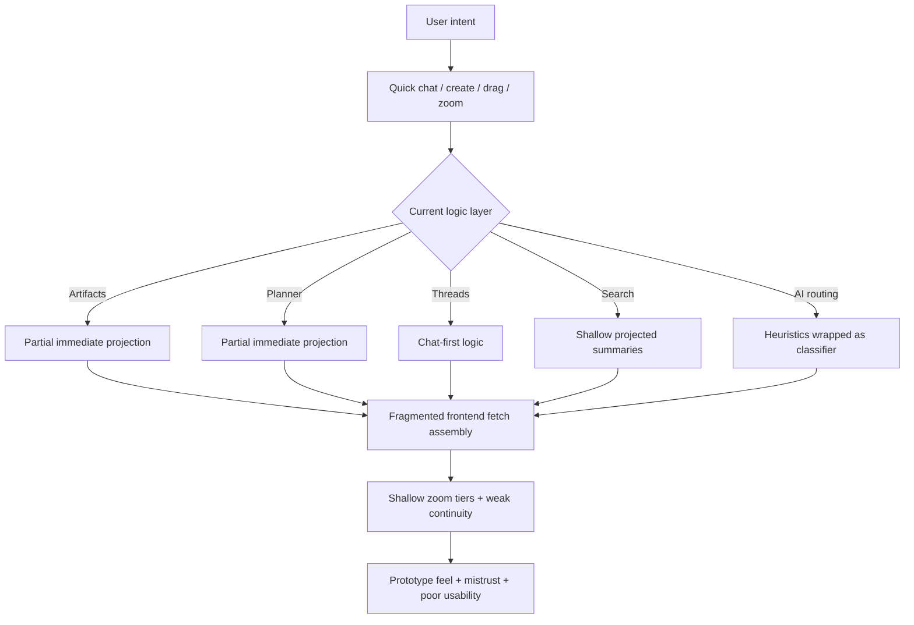

# Spectra Workspace Redesign — Deep Gap Specification (Expanded, Agent-Hardening Edition)

## 1. Purpose of this document

This is **not** an implementation plan and it is **not** a bug list. It is a deep gap specification whose job is to define, as clearly and forcefully as possible, how far the current product still is from the intended Spectra workspace. It is meant to ground the next spec-generation and implementation agents so they do not mistake scaffolding for completion, partial flows for trustworthy behavior, or UI presence for architectural correctness.

This document is intentionally ambitious. It should not reduce the problem to polish, to “a few broken flows,” or to “making the canvas nicer.” The current system still needs substantial transformation across backend truth, AI orchestration, projection, rendering, persistence, spatial logic, and overall product coherence. Wherever there is ambiguity, this document should push the next agent toward deeper investigation rather than premature confidence.

This document should be treated as the strongest synthesis of what has been concluded in the conversation so far.

### 1.1 Product truth and evidence hierarchy

The following should be treated as the product truth, in this order:

1. `docs/workspace-mega-source-of-truth.md`
2. `spectra-workspace-redesign-agent-execution-spec.md`
3. `spectra-redesign-context.md`
4. `1.jpeg` and `2.jpeg`
5. direct manual user observations from browser testing
6. `spectra_testing_report.txt`
7. the current codebase

The current codebase is **not** the source of truth. It is evidence. It contains a mixture of real foundations, misleading shells, placeholder implementations, partial migrations, and disconnected subsystems. It should never be used to argue that the product is closer to done than real usage evidence suggests.

### 1.2 What this document is for

This document is intended to support **two later specs / implementation streams**:

- a **backend / logic / contracts** spec and implementation stream
- a **frontend / workspace experience / interaction** spec and implementation stream

The backend and logic stream must lead. The frontend and experience stream must then hook into that truth and express it properly. The two should not be treated as separate products, but they should be specified separately because many of the current failures are the result of frontend surfaces being built on top of incomplete or misleading backend truth.

---

## 2. Browser-truth override

Where there is tension between code-shaped evidence and real usage evidence, real usage evidence should be treated as more trustworthy.

This codebase already shows a recurring pattern of:

- classifier-shaped code without classifier-first behavior
- view mode/state support without real product rendering
- projection-related helpers without fully trustworthy projection semantics
- panel shells without true Deep Edit continuity
- ghost plumbing without mature workspace truth underneath
- canonical helpers without canonical runtime truth
- hub items that technically exist but still feel wrong in use

That means the next agent must not say “this exists” when what matters is whether it is working in the product, in the correct layer, with the correct semantics, and in a way that aligns with the redesign. If browser testing shows that a flow is misleading, incoherent, fragile, broken, or effectively unusable, that matters more than a helper function, enum, or shell component.

This override is critical because the workspace is already suffering from false signals of progress.

---

## 3. Preserve what is already promising

Not every subsystem should be flattened into “all of it is equally broken.” Some areas appear to contain meaningful foundations and should be preserved, strengthened, and correctly surfaced rather than casually replaced.

Most importantly:

- **version history and AI edit infrastructure** appear to contain real value
- some **normal chat / model routing behavior outside the workspace** is healthier than workspace-specific orchestration
- some **dock and hub-shell ideas** are closer to the intended direction than other workspace surfaces
- the **idea** of quick chat scope, canonical types, ghost support, and clustering is present, even where the product behavior is not yet correct

These are not reasons for complacency. They are reasons for precision. The next implementation agent must distinguish between:

- systems requiring full architectural replacement
- systems requiring authoritative integration
- systems requiring semantic correction
- systems requiring better exposure, not destruction

One particularly important example is version history: it is promising, but currently surfaced unevenly and with the wrong granularity semantics. That should lead to refinement, not removal.

---

## 4. High-level conclusion

The current workspace is still much closer to a partially modernized prototype than to the intended AI-native study environment. The codebase contains many redesign-shaped shells: view mode types, canonical type helpers, ghost plumbing, panel shells, focus timers, dock shells, workspace mutations, clustering fields, scope badges, partial touch editors, and some projection logic. But these do not yet compose into the intended product. The new source of truth also replaces the old `/workspace` right-panel Deep Edit model with edge-bound deep-edit surfaces and a hub ecology, so any surviving panel-first assumptions should now be treated as evidence of prior architectural drift.

The core failure is not “many bugs.” The core failure is that the system still lacks a strong enough underlying contract for:

- what a workspace region actually is
- what must project into the workspace immediately
- how placement and spatial identity should work
- what quick chat really resolves into
- how Glance, Touch, and Deep Edit differ semantically
- how one authoritative renderer path should consume one authoritative workspace-content contract
- how persistence and undo should work in a spatial workspace
- how AI capability should express itself through the workspace rather than through legacy thread/panel-first flows
- how preserved systems such as planner, versions, agents, and hub utilities should become workspace-native rather than remain side systems

As a result, many things technically exist but still feel wrong in practice.

The product therefore remains **architecturally underbuilt**, not merely incomplete.

---

## 5. Immediate user-flow reality

The current system fails so early and so visibly in real usage that many deeper capabilities cannot even be meaningfully evaluated. This is one of the strongest conclusions from manual testing.

The problem is not just that advanced flows are rough. The problem is that the workspace still resists being inhabited at all. The user cannot comfortably sit inside it, type into it, create through it, navigate through it, trust what appears, or rely on it as the place where work actually happens.

### 5.1 Immediate visible failures in ordinary use

The following failures appear in basic, first-layer interaction:

- the bottom quick chat is too cramped, too crowded, and too physically weak to serve as the main AI command surface
- there is no trustworthy right-click path for creation and contextual actions
- the add button opens in a weak accordion-like way rather than as a powerful creation surface
- “Create with AI” does not resolve into a meaningful AI-native workspace action and can collapse into irrelevant chat behavior
- creating a planner item can fail with “planner item not found” style behavior
- creating code can produce an empty or useless untitled artifact
- creating a note can succeed in storage while still failing to feel like a real workspace object
- the user can fail to understand where created objects went
- grid/blank background controls do not visually behave as promised
- timer and some hub elements still behave too much like floating widgets rather than edge-bound operating tools
- opening the right panel still does not feel like entry into a trustworthy Deep Edit mode
- there is currently no single end-to-end workspace flow that feels coherent, spatially trustworthy, AI-native, and worth inhabiting

### 5.2 Why this matters

This means the product is already failing at the **first interaction layer**. It is not only deep edge cases that are broken. The system is still not meeting the bar for “basic believable habitation.”

That is why any next spec or implementation pass that treats this as polish or refinement will fail.

---

## 6. The redesign intent the current product still fails to deliver

The redesign context and visual references define a very specific kind of product:

- a **large inhabitable workspace region**, not a small card you open
- a **progressive zoom journey**, not a static canvas where similar things merely enlarge
- a **single coherent working surface** where notes, code, threads, planner items, visuals, exports, quick notes, timer, planner, and AI assistance coexist
- **edge-bound hub items** that feel permanent, useful, and operating-system-like rather than floating widgets
- **AI as an intelligent action system**, not a text box that mostly opens or continues threads
- **soft spatial knowledge regions**, not dashed boxes and prototype boards
- **backend truth first**, so frontend experience becomes trustworthy rather than decorative
- **Glance, Touch, and Deep Edit** as semantically distinct layers, not just visual scale states
- **view intelligence** through By Type, By Topic, and Timeline, not just card grouping
- **planner and hub ecology** as meaningful persistent workspace infrastructure
- **artifact and thread behavior** as workspace-native, not chat-native or panel-native first

The current product still misses this on both the backend/logic side and the frontend/experience side.

---

## 7. Visual-reference takeaways the current product still misses

The sketch references matter because they communicate things the codebase still undershoots badly.

### 7.1 What the references imply

1. The workspace should read as a **large region with internal organization already legible before deep entry**
2. Artifacts and threads should occupy **major spatial zones**, not tiny cards or pills
3. Hub items should live on edges with strong permanence and intentionality
4. Quick chat should feel like the central bottom command surface of the workspace
5. The right-side panel should feel like a continuation of the workspace rather than a separate app
6. The workspace should be customizable and flexible without losing coherence
7. Divider and grouping logic should feel light, structural, and spatial rather than boxed and card-heavy

### 7.2 What the current product still does instead

- still reads as “canvas of cards” more than “AI-native study environment”
- still undersells scale at far and medium zoom
- still keeps too much value hidden behind panel opening or awkward deep zooms
- still lets edge items behave like floating windows too often
- still uses enough dashed/dotted/wireframe language to feel prototype-like
- still communicates a much smaller ambition than the product is actually supposed to embody

### 7.3 Why this matters

The interface still tells the user “unfinished canvas tool” much more readily than “future-facing AI workspace.” That changes how users interpret everything else. If the visual system still feels boxed, dashed, and prototype-like, then even partially correct logic will feel less trustworthy.

---

## 8. Architectural truth: the current product is blocked by contract failures, not just polish

Legend:
- **Partial immediate projection** = some entity classes project, but not uniformly
- **Chat-first logic** = thread creation/reuse remains dominant
- **Fragmented frontend fetch assembly** = client assembles workspace from multiple sources/endpoints

This is why the app keeps showing visible failures that can look unrelated while actually sharing the same root causes.

---

# Part I — Backend / Logic / Data-Flow Failures

## 9. Projection truth is still inconsistent and therefore untrustworthy

The redesign makes projection correctness foundational. The current implementation still does not satisfy that contract consistently across entity classes.

### 9.1 Artifact projection is ahead of the rest, but still not redesign-correct

There is some immediate artifact projection behavior, but it is still built on legacy workspace-item typing and placement assumptions. This means the app can technically project an artifact while still making it appear under the wrong semantic model, in the wrong place, or with the wrong frontend expectations.

### 9.2 Thread projection is structurally behind

Threads remain chat-table centric. Creation and continuation still primarily mean “work with a chat entity,” not “a thread becomes an equal first-class workspace object.” This is one of the deepest reasons quick chat still feels wrong: threads are still treated as chat flows first and workspace objects second.

### 9.3 Planner projection exists, but not in the right long-term semantics

Planner items appear closer to the intended path than threads, but their behavior is still too shallow and in some flows too aggressively archived or under-expressed. This weakens both workspace history and planner continuity.

### 9.4 Immediate appearance still depends too much on frontend refetch behavior

The redesign requires a strict ordering:

1. entity mutation  
2. workspace mutation record  
3. workspace item upsert/archive  
4. event dispatch  
5. invalidation/refetch  

The current codebase still appears to depend too much on frontend-driven refresh or subscription side effects rather than a fully explicit and uniform mutation/projection/invalidation contract.

### 9.5 Why this matters to users

This is why users experience:
- created notes not appearing where expected
- AI-created outputs vanishing or showing up late
- planner items feeling half-real
- threads feeling detached from the workspace
- duplication after retries or re-creation attempts
- low trust in whether something actually exists where it should

---

## 10. Canonical artifact/workspace taxonomy is still not truly authoritative

The redesign context is explicit about collapsing to a clearer canonical object model. That has not truly landed as runtime truth.

### 10.1 Current mismatch

The codebase contains canonical mapping helpers, but backend projection and ghost acceptance still heavily use legacy buckets such as:
- `document`
- `visualization`
- `media`
- `reference`
- `custom`

This means the frontend can speak canonical language while backend truth still speaks in older categories.

### 10.2 Consequences

1. renderer branching stays brittle  
2. touch/deep-edit semantics are hard to make consistent  
3. search, grouping, projection, and panel logic keep inheriting legacy assumptions  
4. implementers can overestimate how far type migration has actually progressed  

### 10.3 More serious semantic drift

A particularly damaging mismatch is the handling of `document`. The redesign says current `document` becomes **Export**, not Note. But parts of the current canonical/frontend mapping still blur or mis-map this distinction. That creates confusion across creation, editing, rendering, and AI generation flows.

---

## 11. Search and retrieval are still much too shallow

The redesign requires global search across all workspaces and content, including thread content and artifact plaintext. The current system remains too workspace-item-summary-centric.

### 11.1 Current search weakness

Search appears to rely too much on projected summaries or local command-bar heuristics rather than a proper cross-entity search substrate.

### 11.2 Why this matters

This is not just a “search feature missing” problem. It prevents:
- reliable overflow recovery
- confident navigation into large workspaces
- AI retrieval over real workspace contents
- planner/task/workspace cross-navigation
- the sense that the workspace is the user’s real long-term environment

---

## 12. Undo, revert, and mutation history exist, but not in a product-trustworthy way

The existence of `workspaceMutations` is promising, but the redesign needed more than a ledger.

### 12.1 Current gap
- mutation recording is uneven across entity types
- revert coverage is incomplete
- user-facing undo behavior is not coherently surfaced
- drag/layout changes and entity changes do not appear to share one clear reversal model

### 12.2 Why this matters

In a spatial workspace, undo is not a convenience. It is core trust infrastructure. If a user drags, moves, creates, archives, or lets AI create something, the workspace must feel safely reversible.

---

## 13. Workspace placement and center logic are still too naive

The observation about deriving workspace center from actual item distribution is exactly right. The current system still uses simplistic default placement and layout assumptions.

### 13.1 Current symptoms
- new artifacts landing in awkward or hidden positions
- ghost items appearing far away
- panning/orientation confusion after entry
- workspace identity feeling like an ID/state choice rather than a real spatial territory

### 13.2 Root cause

Placement is still too count/grid based rather than driven by:
- current workspace center
- group region geometry
- visible viewport context
- semantic grouping
- user overrides

### 13.3 Why this matters

This is one of the reasons the whole product still feels spatially fake instead of spatially meaningful.

---

## 14. Persistence is still best-effort rather than trustworthy

The redesign context treats persistence as foundational. The current implementation still appears to use layered local-storage plus delayed sync patterns that create race conditions and state drift.

### 14.1 Persistence failures
- viewport persistence is too global or insufficiently workspace-aware
- position persistence is split across local overrides, delayed sync, and direct mutations
- internal layout overrides are not durably modeled enough
- drafts and quick-chat continuity are fragmented by surface
- collapse/group/view state persistence remains incomplete
- hub-state persistence is incomplete and not grounded in one clear source of truth
- refresh/re-entry still risks reintroducing mistrust in placement and state

### 14.2 Why this matters

This produces the exact product smell already identified: the user cannot trust that things will still be where they left them.

---

## 15. The classifier architecture is still not genuinely installed

This is one of the biggest gaps in the entire system.

### 15.1 The current system still behaves as heuristic-first

Although the code contains classifier contracts and classifier-shaped structures, the effective decision path is still largely synthesized from:
- auto-settings heuristics
- regex-ish mode detection
- route-plan state
- local assumptions about tier, scope, and output format

### 15.2 Why this is more serious than it looks

This means the product still lacks the actual intelligence substrate the redesign depends on. The result is:
- quick chat misrouting
- shallow skill selection
- wrong thread/artifact behavior
- weak workspace targeting
- underpowered multi-step orchestration
- poor confidence-tier auto-creation behavior

### 15.3 Hidden danger

Because there is classifier-shaped code, an implementation agent could wrongly assume this work is “mostly done.” It is not.

---

## 16. Skills are still shallow and not really the runtime truth

The redesign requires rich `SKILL.md`-driven capability composition. The current system still behaves too much like legacy modes and lightweight trigger-based skill selection.

### 16.1 Consequences
- AI still feels limited relative to intended product power
- visual generation quality bar is not guaranteed
- prompt/runtime behavior remains shallow
- the mode-first mental model continues to leak into actual experience

### 16.2 Why this matters to users

This is one of the reasons the AI feels much less capable than it should, even though the system in principle could become much smarter.

---

## 17. Quick chat still lacks an action-resolution layer

The redesign says quick chat should be able to do anything from anywhere, with thread creation only as a downstream choice. That contract is still missing.

### 17.1 Current behavior pattern

Quick chat currently behaves too much like:
- infer workspace from title words
- open or reuse a chat thread
- send the text there
- maybe let downstream systems figure it out

### 17.2 Missing intermediate layer

What is missing is a proper quick-chat action resolver capable of deciding among:
- answer only
- create note/code/visual/export directly
- create planner item
- modify existing artifact
- continue thread
- create new thread
- perform multi-step sequence before deciding whether a thread is needed

### 17.3 Why this matters

Without this layer, quick chat can never become the AI-native command center the redesign promised.

### 17.4 User-visible evidence of this failure

The current failure is visible not only in routing quality but in the fact that simple creation intents like “Create with AI,” “create a task,” or “create code” cannot yet be trusted to resolve into meaningful workspace outcomes.

---

## 18. AI capabilities are still dramatically under-expressed relative to the product vision

The workspace is meant to feel like an intelligent environment, not a UI around a weak prompt pipeline. Right now, the AI still feels far too limited relative to what the system should be able to do.

### 18.1 Current failure mode

The AI too often feels like:
- a responder rather than an actor
- a thread opener rather than an action resolver
- a shallow orchestrator rather than a multi-step decision system
- underpowered in the workspace even when normal chat may be healthier elsewhere

### 18.2 Why this matters

The user is right that this product should feel much smarter and much more capable because the architecture is supposed to support richer tools, richer skills, better routing, and more context-aware behavior. If the AI still feels weak, then one of the core promises of Spectra is still missing.

---

## 19. Thread handling is still too coupled to recent-chat reuse and panel flow

The audit found evidence that “new” workspace quick chat may hydrate or reuse a recent chat thread. That is a structural smell.

### 19.1 Why this is bad
- new intent can attach to arbitrary recent thread state
- scope becomes confused
- continuation becomes surprising rather than intentional
- panel and quick chat can diverge
- compositional AI behavior becomes unstable

### 19.2 Product consequence

The user experiences this as “everything becomes a thread” and “context is not stable.”

---

## 20. Artifact editing and versioning are more capable in backend than the product reveals

This is one of the most important underexploited strengths in the codebase.

### 20.1 Good news
There is meaningful version / AI-edit infrastructure present:
- apply AI edit
- confirm AI edit
- discard AI edit
- reapply AI edit
- restore version

### 20.2 Bad news
That capability is surfaced very unevenly:
- strongest for document/Tiptap-like flows
- much weaker or absent for non-document artifact types
- touch-tier edits often bypass structured version semantics
- manual edit granularity does not align with the product’s ideal version-history semantics

### 20.3 Crucial mismatch

Touch-tier note/code editing appears to save plaintext-style updates that may not produce versions in the same way as structured content edits. This means one of the strongest existing system foundations is undercut by the workspace layer itself.

### 20.4 Version granularity semantics are still wrong

The current product should not treat every tiny manual change as an equally important version event. AI edits should usually land as coherent single updates, while manual editing should be grouped more intelligently around natural work boundaries or inactivity windows. The current granularity weakens one of the best parts of the system.

---

## 21. Deep Edit is still mostly document-centric

The redesign requires per-type deep editing and a coherent panel escalation system. The current right panel is still too generic for many artifact types.

### 21.1 Current state
- documents get meaningful editor support
- many other artifact types degrade to generic content/JSON-like output or shallow placeholder treatment
- planner panel is limited
- route trace is placeholder-level
- panel continuity does not yet express the real power of type-specific deep editing

### 21.2 Why this matters

This makes Deep Edit feel unreliable and uneven, which in turn weakens Touch tier because users cannot trust escalation paths.

---

## 22. The dual-system legacy (`notes` + `artifacts`) is still leaking

The redesign intended canonical artifact truth. The presence of migration/dual-read logic is expected, but the workspace still appears too exposed to the old split.

### 22.1 Consequences
- mixed assumptions in frontend and API routes
- special casing around note migration
- inconsistent content fetch/update paths
- editor behavior that differs depending on which path was hit

### 22.2 Why this matters

This is another major reason the product still feels structurally unfinished.

---

# Part II — Frontend / Workspace Experience Failures

## 23. The spatial model is still conceptually wrong in practice

Even where some large territory constants exist, the actual user journey still does not deliver the intended scale narrative.

### 23.1 What the redesign required
- far zoom: meaningful landscape of workspaces
- medium zoom: one workspace fills most of the screen
- deep zoom: content becomes actually usable

### 23.2 What users still get
- far zoom still too tiny and unreadable
- medium zoom still not dominant enough
- deep zoom still not clearly transitioning into real content work
- entering a workspace can still feel awkward or inverted

### 23.3 Why this happens

Because semantic zoom is still not truly a content/interaction progression; too often it is just scaling of similar objects with late access to actual touch behavior.

### 23.4 The proportional zoom narrative is still wrong

The problem is not merely that workspaces are too small. The whole proportional zoom narrative is wrong. Outside the workspace, everything should be scaled up dramatically so that the far landscape remains legible and feels like real territory rather than tiny UI fragments. As the user scrolls inward, representation should adapt continuously, almost map-like, so that text, preview density, and structural cues remain readable while gradually revealing more context. Entry into a workspace should feel like genuine zooming into a region, not like arriving at a tiny card that is already near minimum scale and then triggering an awkward secondary transition. The current implementation still fails this proportional narrative, which is one of the main reasons the workspace does not feel spatially believable.

---

## 24. Active workspace logic is still too unclear and too eager

The system too often behaves as though there must always be an active workspace even when the current view should be global or ambiguous.

### 24.1 Current failure
- active scope can feel forced rather than naturally derived
- panning does not always produce an intelligible shift in active workspace identity
- the relationship between zoom, viewport center, visible territory, and scope is still weak

### 24.2 Why this matters

Scope should arise from spatial context, not from a brittle requirement that some workspace always be active. Without that, quick chat, creation, and navigation all feel less intelligent.

---

## 25. The three-tier interaction model is not yet real enough

The redesign explicitly warns not to cheat by turning Touch tier into enlarged Glance cards. That warning still applies.

### 25.1 Current failures
- Glance does not always feel informative enough
- Touch often feels inaccessible, fragile, or too similar to Glance
- Deep Edit still feels like a separate app path for many flows
- the progression between tiers lacks strong semantic identity

### 25.2 Hidden frontend cause

There are still multiple rendering/view paths and zoom-band mismatches, which means the intended tier model is not strongly enforced by one authoritative renderer system.

---

## 26. There is not yet one authoritative workspace renderer path

This is one of the most important frontend architecture problems.

### 26.1 Current smell

The codebase contains multiple workspace/internal view approaches, including disconnected or dead paths. That means:
- some view modes exist in state but not in actual rendering
- placeholder topic/timeline views can misleadingly look “implemented” in code
- implementers can target the wrong path

### 26.2 Why this matters

Until there is exactly one authoritative renderer path consuming exactly one authoritative content contract, the workspace will keep feeling fragmented.

---

## 27. Workspace content loading is still assembled client-side from too many endpoints

This frontend problem reflects a backend contract problem.

### 27.1 Current pattern

The canvas/client still builds a workspace out of multiple separate fetches for chats, artifacts, planner, hub-specific data, and workspace items.

### 27.2 Consequences
- slow entry
- race conditions
- inconsistent freshness
- duplicated logic
- harder semantic zoom hydration
- more rerenders and memory pressure

### 27.3 Product effect

This is part of why the workspace feels sluggish and less trustworthy than it should.

---

## 28. Quick chat is still both architecturally wrong and physically unusable

Even ignoring the orchestration problem, the command surface itself is still too limited.

### 28.1 Current gaps
- single-line entry instead of comfortable command composition
- poor affordance for multi-step requests
- weak suggestion/help states
- weak scope legibility in practice
- poor continuity across workspace/panel/thread contexts
- still too much overlap/obstruction behavior in the canvas

### 28.2 Surface-level usability failures

The weakness here is not only orchestration. The surface itself is too cramped, too crowded, and too poor at supporting real composition of intent. This matters because this is the user’s primary AI entry point, and the product can fail emotionally before any deeper logic is even reached.

### 28.3 Why this matters

If the main command surface feels cramped, brittle, and thread-forward, the product feels underpowered immediately.

---

## 29. Right-click, creation affordances, and add-flow UX are still underbuilt

Creation still does not feel like a powerful, reliable part of the workspace.

### 29.1 Current failures
- right-click contextual creation is absent or not trustworthy enough
- the add flow feels weak and low-clarity rather than powerful
- creation pathways do not yet communicate what kinds of things can be created confidently
- users are not given a strong sense of where or how created things will live in the workspace

### 29.2 Why this matters

A workspace-native product cannot rely on one cramped input plus a weak add affordance and still claim to have a strong creation model.

---

## 30. Panel continuity is still not coherent enough

The redesign describes the right panel as Deep Edit, not a separate mini-application. The current product still falls short.

### 30.1 Current failures
- separate composer behavior between panel and workspace quick chat
- fragile `openChatQuery` / one-shot continuity
- title/header/context inconsistencies
- no robust item highlight continuity
- canvas dim/highlight behavior not subtle or coherent enough
- panel width/type treatment still uneven

### 30.2 Why this matters

This breaks the sense that quick chat, thread continuation, and deep editing are all one interaction system.

---

## 31. Artifact-page consistency is still conceptually broken

The artifact surface should not drift into a different interaction model from the workspace.

### 31.1 Current problem

Top-of-page AI bars and separate composer metaphors pull the product back toward disconnected mini-app behavior. Artifact work should still inherit the same bottom quick-chat logic, right-panel Deep Edit model, version-history semantics, and AI-editing continuity as the workspace.

### 31.2 Why this matters

If artifact pages use a different command structure, the product loses coherence and users stop experiencing Spectra as one unified environment.

---

## 32. Hub items exist as shells, but the hub system is not mature enough

The redesign’s hub is an operating layer. The current hub is still more like a collection of partial floating controls.

### 32.1 Current problems
- edge-bound behavior still too weak
- widgets can drift too much into the canvas
- planner hub not truly useful enough
- expansion/collapse model too shallow
- dock usability still incomplete
- quick notes/planner/custom hub ecology not mature

### 32.2 Hub-state behavior is still underdesigned

The hub should not only support a crude visible-versus-hidden state. It needs at least three meaningful operating states:
- a normal state where hub items remain edge-bound and hover-expand
- a hidden state for users who want maximum canvas focus
- a fully expanded state for moments when the hub becomes a true operating layer with planner, quick notes, timetable, and other persistent utilities visible at once

### 32.3 Why this matters

Without a strong hub, the workspace lacks the operating-environment feel shown in the sketches.

---

## 33. By Topic and Timeline are still missing as real product modes

This is bigger than a missing feature toggle.

### 33.1 Current issue

The codebase includes type-level support, clustering fields, and placeholder/disconnected view logic, but not a convincing real product implementation.

### 33.2 Why this matters

This means the workspace still has type grouping as its ceiling, whereas the redesign treats topic and timeline intelligence as a major part of what makes Spectra special.

---

## 34. Planner is still too half-real both on canvas and in hub

The redesign explicitly says planner should remain simple but useful. The current state is still below even that bar.

### 34.1 Current failures
- planner items not consistently trustworthy in workspace
- hub planner still not a strong cross-workspace operating layer
- AI-driven planner creation/continuity still weak
- planner navigation and persistence remain incomplete

### 34.2 Why this matters

Planner is one of the clearest tests of whether the workspace actually combines doing and organizing.

---

## 35. Drag, grouping, and movement logic still lack spatial intelligence

These observations are especially important because they expose the difference between a board and a real spatial environment.

### 35.1 Current failures
- unclear distinction between panning and dragging
- poor drop previews/highlights
- weak group intelligence
- overlap/reflow issues
- poor persistence of manual arrangement
- no convincing sense that workspace regions understand their contents

### 35.2 Why this matters

These failures make the canvas feel like an unstable board rather than a trustworthy long-term environment.

---

## 36. Grid/background modes and micro-trust cues are still weaker than they should be

Even “small” visual-control failures matter because they damage trust disproportionately.

### 36.1 Current failures
- background mode toggles do not convincingly produce the expected visual state
- blank/grid/dot behavior feels unreliable or poorly differentiated
- small UI lies reduce confidence in deeper systems

### 36.2 Why this matters

When a user cannot trust simple visual toggles, they trust creation, projection, and AI behavior even less. These are not meaningless polish bugs; they are trust failures.

---

## 37. Visual language still communicates “wireframe prototype” too often

This is not superficial criticism. It directly affects product trust.

### 37.1 Current failures
- dotted background remains too present
- dashed outlines still leak through key workspace surfaces
- card-heavy composition dominates
- typography/spacing/iconography feel inconsistent
- blur/shadow/gradient usage does not yet produce a refined future-facing environment

### 37.2 Why this matters

The interface still tells the user “unfinished canvas tool” instead of “the place where I want to spend hours studying.”

---

## 38. Accessibility and interaction feedback are still too weak

The redesign wants a flagship environment, not just an interesting canvas.

### 38.1 Current failures
- weak focus indicators outside certain local elements
- poor keyboard navigation model
- missing labels/tooltips/accessible names
- color-only status reliance
- weak screen-reader affordances

### 38.2 Why this matters

A workspace this ambitious cannot feel unfinished in such basic interaction trust signals.

---

# Part III — Performance / State / Persistence Failures

## 39. The canvas is still too monolithic to become a flagship surface

`workspace-canvas.tsx` is still overloaded with too many responsibilities:
- viewport handling
- content fetching
- cache control
- ghost handling
- drag handling
- menu handling
- rendering assembly
- persistence behavior
- panel coupling

This makes the canvas hard to optimize, hard to reason about, and easy to destabilize further.

---

## 40. The loading strategy still does not match the redesign’s viewport-zone architecture

The redesign explicitly defines Zone 1 / 2 / 3 loading and hydration/dehydration by zoom. The current system is not there yet.

### Consequences
- too much loaded too eagerly
- not enough smart metadata-only prefetching
- editor/render hydration not governed tightly enough by viewport proximity
- long-lived memory growth and heavy rerender surfaces

---

## 41. Cache behavior is improved in name, but still not solved in product terms

The presence of LRU-like structures is not enough if content also remains in broader React/state layers. The user experience still suggests unbounded or insufficiently bounded memory behavior.

---

## 42. State churn remains too high

Continuous pan/zoom/drag/timer/store updates still appear to create too much invalidation and rerender activity. This is part of why the workspace remains unpleasant to inhabit for long sessions.

---

## 43. Maximum-depth and state-loop style failures are still product-critical risks

Even if not always triggered in every session, the product still appears vulnerable to state-churn and render-loop style failures such as maximum update depth issues or equivalent instability patterns.

### Why this matters

This is not a harmless engineering smell. In a workspace that is supposed to be the primary surface of the product, these failures destroy trust rapidly and make prolonged use feel unsafe.

---

## 44. Persistence model is still layered without one authoritative truth strategy

Local optimistic state, localStorage overrides, delayed backend sync, direct mutation calls, and UI-driven refreshes all coexist. This is too fragile for a spatial productivity environment.

---

# Part IV — Hidden Placeholder and Misleadingly Partial Work

## 45. There are multiple areas where the codebase can mislead implementers about progress

This is especially dangerous for the next agent.

### 45.1 Misleading examples
- classifier contracts without true classifier-first runtime
- view mode/store support without real topic/timeline rendering
- cluster schema support without authoritative canvas consumption
- mutation history without convincing undo product behavior
- ghost plumbing without a fully mature workspace truth model
- richer artifact editor capability existing outside the main workspace Deep Edit path
- disconnected or dead workspace view components that look redesign-aligned

### 45.2 Why this matters

The next implementation agent could easily mistake scaffolding for completion and continue polishing the wrong layer.

---

# Part V — What this means for the eventual implementation program

## 46. The next implementation effort must be split backend-first, then frontend

This is not just a preference. It is required by the redesign’s own execution rules and by the shape of the current failures.

### 46.1 Backend / logic / contracts agent

This agent should own:
- canonical taxonomy as real runtime truth
- equal projection semantics for artifacts, planner, and threads
- strict mutation → projection → invalidation ordering
- source-truth search and workspace-content contracts
- real undo/revert semantics
- workspace-center and placement semantics
- persistence strategy simplification
- classifier/skills/runtime routing transformation
- quick-chat action resolution before thread creation

### 46.2 Frontend / workspace experience agent

This agent should own:
- one authoritative renderer path
- one authoritative batched workspace-content query consumption path
- true Glance/Touch/Deep Edit progression
- real far/mid/deep spatial narrative
- panel continuity and quick-chat continuity as one system
- hub items as true edge-bound operating layer
- topic/timeline views as actual product surfaces
- visual language, motion, readability, accessibility, and flagship feel

---

## 47. Recommended program structure

### Phase A — Backend truth reset
Focus areas:
- canonical taxonomy as real runtime truth
- equal projection semantics for artifacts, planner, threads
- strict mutation → projection → invalidation ordering
- search and workspace content contracts from source truth
- real undo/revert semantics
- workspace-center/placement semantics
- persistence strategy simplification

### Phase B — AI orchestration reset
Focus areas:
- real cheap-model classifier
- heuristics reduced to T0/compatibility only
- substantive skill system
- quick-chat action resolution before thread creation
- confidence-tier AI creation behavior
- ghost generation only after workspace truth is reliable

### Phase C — Workspace surface reset
Focus areas:
- one authoritative renderer path
- one authoritative batched workspace-content query
- true Glance/Touch/Deep Edit progression
- real far/mid/deep spatial narrative
- panel continuity and quick-chat continuity as one system
- hub items as true edge-bound operating layer

### Phase D — Organizational intelligence and persistence maturity
Focus areas:
- real By Topic
- real Timeline
- cluster override persistence
- layout/view/collapse/focus persistence
- planner hub maturity
- version granularity semantics

### Phase E — Coherence, quality, and flagship feel
Focus areas:
- visual language cleanup
- performance hardening
- accessibility hardening
- remove remaining dashed/wireframe/prototype carryovers
- ensure product feels like the place the user actually works

---

## 48. Exploration requirement for the next spec / implementation agent

The visible failures already identified should be treated as strong evidence, not as a complete list. The next agent must assume there is significantly more wrong than what is already written here.

It should launch focused exploration sub-agents early to inspect:
- workspace surface, zoom model, grouping, and hub behavior
- backend truth, projection, persistence, and invalidation
- quick chat, thread handling, panel continuity, and orchestration
- artifact editing, versioning, and Deep Edit coverage
- performance, cache behavior, state churn, and viewport loading
- misleading scaffolding, placeholder views, and false-progress signals

Their job is not only to confirm known issues, but to discover many more.

---

## 49. Critical guardrails for the next implementation agent
- Do not treat this as a bug-fix or polish pass.
- Do not keep quick chat as a thread opener with nicer UI.
- Do not preserve legacy workspace-item buckets as hidden truth.
- Do not continue supporting multiple authoritative workspace render paths.
- Do not call By Topic or Timeline “implemented” because schema or placeholder views exist.
- Do not rely on frontend manual event emission as the primary invalidation model.
- Do not accept document-centric Deep Edit as sufficient artifact coverage.
- Do not keep touch-tier edits on plaintext-only flows that bypass proper version semantics.
- Do not optimize visuals before fixing content contracts, projection truth, and quick-chat action resolution.
- Do not let the existence of partial code shells reduce the ambition of the implementation program.
- Do not under-scope the work because some isolated subsystems are healthier than others.
- Do not confuse “present in code” with “true in product.”
- Do not simplify this into an easier task than it is.

---

## 50. Explicit bottom line

The redesign is blocked less by missing components than by insufficiently transformed architecture. The codebase has many promising pieces, but they do not yet compose into the intended product. The next agent must assume that the workspace is still fundamentally underbuilt relative to the spec, not “mostly there with rough edges.”

If the next phase starts from canonical backend truth, classifier-led action resolution, one authoritative workspace content contract, and one authoritative renderer path, the product can finally become the AI-native environment described by the spec and the sketches. If it instead starts from UI polish or isolated fixes, it will continue producing a nicer-looking prototype rather than the intended workspace system.
