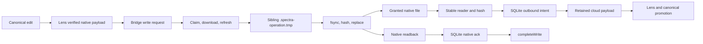

# S11-BRIDGE — native acknowledgement recovery

2026-09-25. Finite first unit on `codex/s11-bridge`, based on `d9aabfb5735bdcd8a620af8a7bdaa85aba08d150`. Effective session metadata and coordinator verification: `gpt-6-astra`, `xhigh`, `danger-full-access`, approval `never`. Worktree: `<local-workspace>`.

## Unit and evidence status

Source repair and adversarial fixtures prepared; execution is pending the campaign test hold. The first focused Vitest launch failed before discovery because shared primary `node_modules` lost `@jridgewell/sourcemap-codec`. That is infrastructure evidence, not a product test failure. No runtime, Office application, browser profile, original local file, saved database or service was changed.

The current code has a concrete lost-acknowledgement inconsistency: a successful native A→B write may be observed by discovery/upload before `completeWrite` arrives. The observer advances local revision to B. `refreshWriteClaim` previously required local A and prevented recovery after restart; `completeWrite` rejected B as superseded; receipt validation compared the queued base hash A with mutable local hash B. Rust already admits the exact B hash to readback without replacing bytes, so the backend contradicted its recovery path.

The repair validates Office receipt ancestry against the queued immutable base revision; recognizes observed B only when local revision/hash, queued target/hash and the retained active payload's account/hash agree; and uses this predicate in refresh and completion. Different local revisions remain rejected. A different cloud head without a known queued descendant is preserved. Claim tokens/generations, active device/mount and artifact permissions retain their existing gates. Successful recovery installs the queued projection ancestry and keeps the original native extension. No new API, schema, storage engine or migration is introduced.

Owned changes are `convex/bridgeSync.ts`, `convex/bridgeSync.test.ts`, the one-line `convex/replicas.test.ts` school fixture correction and this report. No `replicas.ts`, shared authority, schema, Rust or lens changes are in this unit. Coordinator approved ownership. DURABLE reviewer agreed the seam and released the fixture hunk; their native-to-canonical reconciliation repair is separate.

RUNTIME's valid isolated baseline reported 27 failures in `bridgeSync.test.ts` and 34 in `replicas.test.ts`. Source triage found that `seedUploadCandidates` and `seedWork` omit `schoolId`, although their actor setup creates an active school membership. Actual `discoverResourcesPage` inserts the authenticated actor's `schoolId`, and current authority requires same-school ownership. These two fixtures now use the supported school binding. No authority code or cross-school/revocation assertion is weakened. Guarded execution must determine which failures remain; the source finding does not classify all 61 failures as fixture defects.

## Current architecture and compatible direction

`SafeWriter` stages bytes in a same-directory temporary file before replacement; watcher filtering hides those staging files. It does not retain a durable Office-format mirror. The SQLite journal stores operation/resource/receipt metadata, not complete native generations. Native uploads read a stable snapshot into memory and retain cloud bytes. The default structure policy is `independent` for all presets; explicit structural mirroring uses `bridgeStructure` separately. Library reorganization therefore has an existing independent-mode contract, but it is not implemented by a durable local mirror.

Recommendation sent to coordinator before any architecture change: keep retained payloads and SQLite as the existing authority, repair receipt/ancestry first, then design retained staging generations under Bridge's data directory with original native extensions and a same-volume final swap stage. Define cleanup, encryption/privacy, disk quota, tombstones, grant revocation and recovery boundaries before implementation. A second conflicting storage engine is unnecessary. This unit does not implement that proposal.

## Decision review

| Source | Original decision / implementation | Current call-path evidence | Verdict and consequence | Evidence / residual |
| --- | --- | --- | --- | --- |
| S10 BRIDGE task `01a0d338-3f69-7b40-92ee-424f0466978a`, turn `01a0d33e-d14a-7243-9d05-663ec1c007ce`; integrated `eac1567b` | Admit exact target hash after replacement but before receipt; journal completion and replay rather than rewrite | `sync.rs::inspect_write_target` → `main.rs::process_write_request` → `fs.rs::write_with_readback` | Keep native behavior; repair contradictory backend base-only checks | New handler tests prepared; no physical process kill or native acceptance claimed |
| Same S10 turn / `eac1567b` | Refresh claim after payload download; rotate generations and fence late outcomes | `refreshWriteClaim`, `completeWrite`, worker refresh before SafeWriter | Keep fencing; allow refresh of exact observed result under retained payload binding | Recovery generation plus all four stale outcome tests prepared; lease overrun during filesystem operation remains open |
| Same S10 turn / `eac1567b` | Receipt must match native base and target | `validateWriteReceipt` used mutable replica hash on final validation | Replace mutable ancestry with queued immutable base; no target/operation/format guard relaxed | Wrong-base receipt and exact-result tests prepared |
| S9 OFFICE acceptance task `01a0cc6d-92d8-73d3-92cf-56492a3180ec`, turn `01a0cf7d-b011-7f72-a01a-de3492ce17dc` | Office lock, queued second edit, close/reopen and Word readback passed on disposable DOCX | Pending requests, Office-unlock short retry, native receipt / content projection remain present | Keep scoped historical evidence; it does not prove lost-ack observation order | Actual conversation explicitly excludes full crash/collaborator matrix |
| S9 DURABLE acceptance task `01a0cb5e-daed-7563-915d-a746b6da993d`, turn `01a0cb5f-951a-7fc0-9b43-051d18da2904`; `2532be1e` | Gateway lost-receipt recovery, canonical and native workbook readback | Native receipt versus canonical reconciliation are distinct boundaries | Keep separation; native byte receipt must not be treated as canonical promotion | DURABLE owns `recordExternalReconciliation` and canonical/history conflict repair |
| S10 BRIDGE report and source; `eac1567b` | Same-path mutex and late check before atomic replacement | `fs.rs` check/hash precedes `Platform::atomic_replace`; Windows uses `MoveFileExW` | Keep checks but needs additional platform proof | No cross-process filesystem compare-and-swap established; AI waiting cannot fix this race |
| `shared/sync-policy.ts` and `bridgeStructure.ts` current code | Independent organization defaults; explicit mirror directions | All preset `structure` values default to `independent` | Keep compatible policy contract | Durable hidden native mirror is still absent |

## Scenario matrix for this unit

All new fixtures call actual Convex handlers in `convex-test`. Stored bytes have real SHA-256 hashes. Native payload bytes are synthetic protocol fixtures, not valid Office packages; retaining `.docm` and receipt part names proves metadata preservation only.

| Scenario | Prepared expected behavior | Status |
| --- | --- | --- |
| Upload of exact B beats A→B acknowledgement | Verify request/operation and restore B projection ancestry | Pending test hold |
| Metadata-only discovery of B beats acknowledgement | Same recovery without requiring local payload attachment | Pending test hold |
| Legacy request without Office semantic receipt | Exact B still recovers | Pending test hold |
| Crash/restart modeled by expired claim, B observation and reclaim | New generation refreshes; old verified/waiting/failed/conflicted outcomes ignored | Pending test hold |
| Duplicate waiting outcome after verified recovery | Terminal native state stays immutable | Pending test hold |
| Native revision C arrives / content hash differs | Refuse old B and preserve both replica rows | Pending test hold |
| Retained payload quarantined / has different hash | Refuse B recovery | Pending test hold |
| Receipt claims B as its own base | Reject `NATIVE_RECEIPT_BASE_MISMATCH` | Pending test hold |
| Different cloud head C with no queued descendant | Preserve C and local observed state | Pending test hold |
| Permission revoked after observation | No refresh/verification; terminal permission failure | Pending test hold |

## Remaining finite units

1. Platform write/rename/delete fences: final check/syscall gap, an operation outliving its cloud lease, cross-process writers and true Windows locks. Use disposable directories and explicit process fault gates; no timed-kill guesses.
2. Bounded receipt recovery: `native_ack_queue` retries have capped delay but no terminal attempt/deadline policy, and `completeWrite(waiting)` extends expiration. Define retained evidence plus explicit recovery, not dropping receipts or endless automatic attempts.
3. Native mirror architecture described above, including deterministic crashes after stage creation/fsync/replacement/local journal commit/cloud acknowledgement. Existing `.tmp` stage is not a durable Office mirror.
4. Structural operations: redo actual collision reservation, lost receipt, restart, rename/move/delete, and stale native bytes against published matching worker/backend. Source tests and historical reports alone are insufficient.
5. Native-vs-cloud/AI/collaborator acceptance with canonical revision checks and reversible import history, coordinated with DURABLE/COLLAB/HISTORY. Current handler fixtures are not a live simultaneous editor test.

First-unit handler recovery adds at most one keyed payload-row lookup when the local result was already observed, and none on the ordinary unchanged-base path. This is source analysis, not measured Convex billing. No full-payload transfer or new poll is added. Whole native packages are still transferred/materialized; a future delta design must preserve OOXML package semantics and retention.
