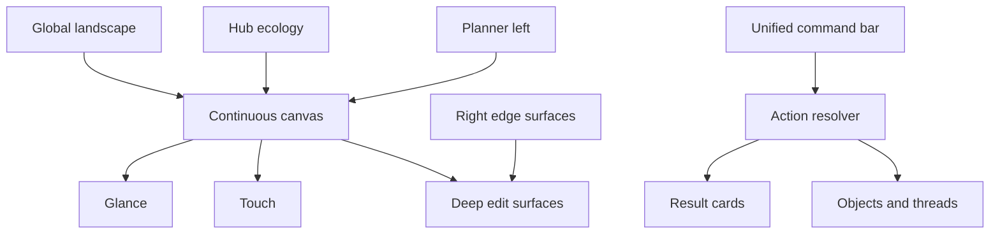
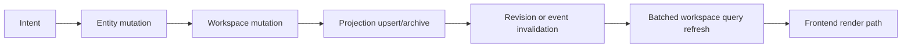

# Spectra Workspace — Authoritative Architecture Spec

## Status
This document is the primary source of truth for the workspace redesign and rebuild.

If any older workspace-facing spec, audit, recovery note, or implementation memo conflicts with this document, this document wins.

## Source-of-truth hierarchy
1. `docs/workspace-authoritative-spec.md`
2. `spectra-workspace-redesign-agent-execution-spec.md`
3. `spectra-redesign-context.md`
4. `2026-04-10-workspace-ground-up-redefinition-spec.md`
5. evidence and audit materials, including:
   - `spectra_workspace_deep_gap_spec_expanded_agent_hardening.md`
   - `RECOVER.md`
   - `spectra_testing_report.txt`
   - `WAVE1_FRONTEND_AUDIT.md`

The current codebase is evidence, not product truth. The old workspace frontend is deleted scaffolding history, not architecture.

## Product definition
Spectra workspace is a continuous operating canvas for study, planning, creation, and AI-assisted action.

It is not:
- a collection of boxed workspace subviews
- a launcher for right panels
- a thread-first chat wrapper
- a card board that merely scales larger or smaller

It is:
- one continuous canvas with semantic navigation
- one coherent working surface with organizational lenses
- one hub ecology of edge-bound operating surfaces
- one action-oriented AI environment built on backend truth

## Core architectural truths

### 1. One continuous canvas
The workspace experience must feel singular and spatially continuous.

There may be backend thresholds for deciding whether the user is inside a workspace, but the frontend must not feel like a switch between boxed workspace views or separate mini-apps.

The user must be able to:
- pan naturally
- zoom naturally
- understand where they are
- move across a meaningful landscape
- enter and leave workspaces through spatial motion rather than crude mode jumps

### 2. Semantic zoom, not raw scaling
Zoom is representation change, density change, and meaning change.

The user must feel a Google-Maps-like transition through levels of meaning:
- zoomed out: meaningful landscape and legible workspace envelopes
- mid zoom: workspace interior structure and grouped content become understandable
- deeper zoom: touch interactions and real editing become available
- deep edit: escalated surfaces become available without breaking continuity

Requirements:
- content detail increases with zoom
- representation changes with zoom
- text and previews remain perceptually stable enough to stay legible
- workspace entry/exit computes from actual content extent, not crude defaults
- dots remain fixed screen-size if dot background is used

### 3. Three-tier interaction model
The model remains:
- Glance
- Touch
- Deep Edit

But in `/workspace`, Deep Edit is no longer a right-panel architectural model.

Deep Edit happens through expanded hub items and edge-bound deep-edit surfaces that remain part of the workspace ecology.

Right panels may still exist in `/chat`, but `/workspace` must not rely on them as its primary deep-edit concept.

### 4. Hub ecology is central
The workspace behaves like an operating environment built around edge-bound hub surfaces.

Default/fundamental hub items include:
- workspace selector
- planner
- unified command bar
- timer/focus
- quick notes
- threads
- notes/deep-edit surfaces for opened content
- hub state controls

Default positions:
- planner: left edge, above workspace selector
- workspace selector: left edge
- unified command bar: bottom center
- timer/focus: bottom right
- thread/note/deep-edit expandable surfaces: right edge
- workspace-local widgets: top edge when appropriate

### 5. No right-panel workspace model
Opening notes, threads, or other deep-edit targets in `/workspace` must expand the corresponding hub or edge surface.

These surfaces may be large and powerful, but they are part of the hub ecology, not a separate panel system.

### 6. Important things can become hub items
Users must be able to pin meaningful objects to the hub.

Examples:
- a specific note
- a thread
- a planner item
- a timetable object
- other AI-created operating surfaces

This must be reversible.

### 7. Constrained hub motion
Hub item movement must be constrained by edge rails.
- top/bottom edge: effectively horizontal movement only
- left/right edge: effectively vertical movement only
- no disappearance
- no free-floating window chaos

### 8. Hub expansion model
Hub items expand on hover and can also be locked open.

The workspace must support:
- per-item hover expansion
- per-item locked-open state
- global “show all expanded” control
- global hub visibility states:
  - hidden
  - collapsed/default
  - fully expanded

### 9. Planner is a real operating layer
Planner is not a fake panel.

It must exist as a true workspace widget/hub surface that supports:
- timetable
- reminders
- input
- notifications
- planner navigation

Planner and timer must stay behaviorally in sync with any surviving sidebar equivalents.

### 10. AI response model changes
Workspace AI must not default to “create or reuse a thread and maybe open it awkwardly.”

Default workspace AI response behavior should often be command/result cards above the unified command bar:
- processing state with loading and prompt snippet
- completion state with dismissible result card
- compact summary, roughly two lines max
- single press reopens relevant context
- double-click opens associated thread or deep-edit surface when needed

Threads remain valid, but they are no longer the default visible outcome of workspace AI.

### 11. Unified command bar is a true action surface
The command bar must be able to:
- create notes
- create planner items
- create widgets
- create visuals/code/exports
- modify existing content
- trigger threads when appropriate
- use visible workspace context intelligently

Creation and command must feel like one surface, not separate competing affordances.

### 12. Organizational lenses are inside the same canvas
`byType`, `byTopic`, and `timeline` must exist as organizational lenses within the same spatial environment.

They must not become separate boxed subviews that betray the singular-canvas model.

### 13. Zoomed-out representation must be strong
Far-zoom workspace representation must be legible, spatially meaningful, and orientation-preserving.

Entering and leaving a workspace should compute center and zoom from actual content bounds and spatial envelope.

### 14. Background system
Backgrounds must support:
- dots with fixed screen-size dots
- blank mode
- grid mode

Background switching must be visually trustworthy and clean.

### 15. Real creation-flow validation
The workspace is only considered real when notes, planner items, threads, widgets, and other objects can be created through the actual command/creation UX and then used for validation.

No seeded demo-only proof counts.

## Backend truth requirements
Frontend trust depends on backend truth.

Before major frontend implementation, the backend must support:
- one batched authoritative workspace content contract
- immediate and correct projection semantics for artifacts, planner items, and threads
- mutation ordering with durable invalidation semantics
- persistence for layout, hub state, and important workspace behavior
- idempotent creation flows
- planner/timer sync truth
- placement semantics based on spatial context, not naive grids alone

## Frontend truth requirements
The rebuilt frontend must provide:
- one authoritative workspace store
- one authoritative renderer path
- one authoritative workspace data consumption path
- semantic zoom renderer transitions
- edge-bound hub primitives and expansion model
- command/result card system
- pin/unpin hub item behavior
- right-edge deep-edit surfaces
- strong visual system and legibility

## Wave structure

### Wave 0 — Documentation realignment
- rewrite workspace truth docs
- demote stale docs to evidence/reference
- remove contradictory architecture language

### Wave 1 — Backend truth reset
- projection parity
- content contract
- mutation/revision semantics
- persistence and placement foundations
- idempotency and teardown correctness

### Wave 2 — Surface foundation
- continuous canvas
- semantic zoom foundation
- hub primitives
- planner left edge
- unified command bar
- right-edge deep-edit surfaces
- strong glance layer

### Wave 3 — Direct interaction
- Touch tier
- constrained pinning and hub expansion
- persistent layout overrides
- command/result cards
- deep-edit surface continuity

### Wave 4 — Action intelligence and lenses
- action resolver before thread creation
- result-card-first workspace AI
- byType / byTopic / timeline in same canvas
- planner/timer sync maturity

### Wave 5 — Integration and flagship polish
- agent integration
- planner maturity
- browser proof at `localhost:3000/workspace`
- real object creation through UI flows
- final audit against this spec

## Validation doctrine
A wave is not complete because code exists or compiles.

A wave is complete only when:
- backend truth is correct
- frontend behavior matches this architecture
- validators pass
- backup-led audit finds no major contradiction
- end-to-end proof for that wave succeeds

## Demotion rule for older docs
Older workspace docs remain useful only as evidence, rationale, preserved audits, and migration context unless explicitly rewritten to align with this document.
