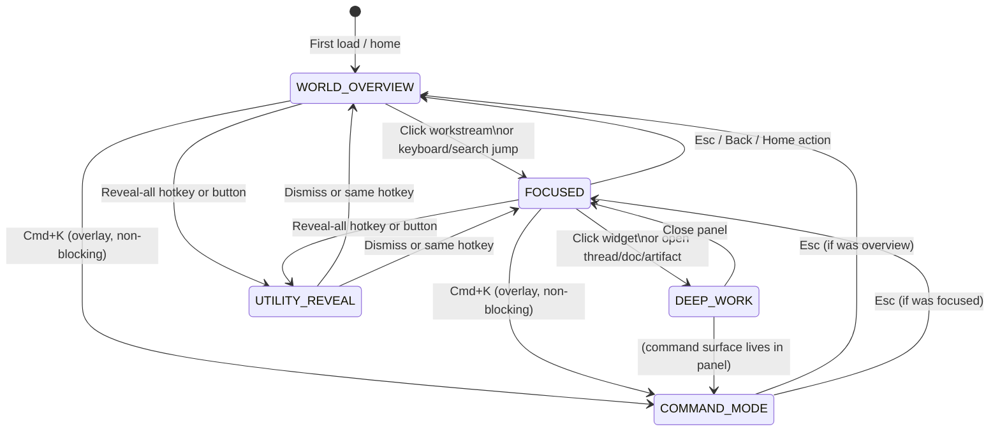
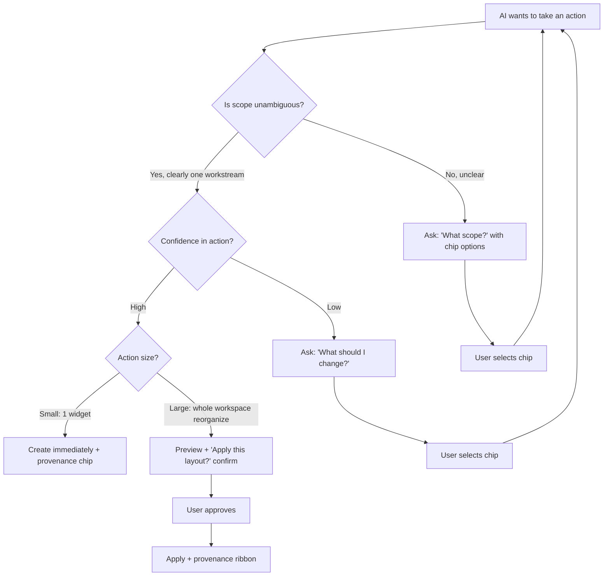

# Workspace Foundation V2
## Source-of-Truth Rewrite — April 2026

> **Status:** This document replaces the individual approach files as the governing design truth for implementation. The approach files (A/B/C/D) remain as reference material and inspiration records. This document synthesizes them into one coherent direction.

---

## 0. Why This Document Exists

The current workspace has the right engine parts assembled in the wrong order.

The three shells (Constellations, Magnetic Surface, Focal Lenses) were implemented as three separate visual renderers sharing a canvas engine. This was the right architectural intention but the wrong product execution. In practice, all three feel nearly identical — different coat of paint, same box-and-card composition underneath.

The three-view toggle must go. Not because the exploration was wrong, but because none of the three emerged as genuinely distinct enough in interaction to deserve equal parallel treatment. The synthesis lives in one coherent direction: **Magnetic Surface as the primary shell, deeply informed by the overview/relationship language of Semantic Constellations and the focus choreography of Focal Lenses.**

This document replaces that three-way structure with one explicit, implementable specification.

---

## 1. The Synthesis Direction

**The one-sentence product truth:**

> Spectra's workspace is one continuous working surface. You can see your whole academic life from a distance, enter any part of it to work, and the canvas, the AI, and the right panel all feel like one object — not three separate features.

### Where each approach contributes

| Concern | Leads | Borrows |
|---|---|---|
| Primary shell structure | **B: Magnetic Surface** | — |
| Overview identity + spatial memory | — | **A: Semantic Constellations** |
| Cross-workstream relationship language | — | **A: Semantic Constellations** |
| Entry/exit focus choreography | — | **C: Focal Lenses** |
| Neighbor dimming + contrast shifts | — | **C: Focal Lenses** |
| First-use clarity + guided emphasis | — | **C: Focal Lenses** |
| Tactile modular composition | **B: Magnetic Surface** | — |
| Hidden-but-reachable edge utilities | **B: Magnetic Surface** | — |
| Command surface centrality | **B: Magnetic Surface** | — |
| Right-panel continuity | **B: Magnetic Surface** | — |
| Macro-navigation alternative (if 2D fails) | — | **D: Strata Canvas (reference only)** |

### What B alone cannot do

Approach B as written fails on overview memorability. In its pure form, the overview state looks like a collection of frosted-glass panels on a dark canvas — visually fine but not spatially distinctive. Students need to *recognize* their workspace world by sight, not just navigate it. That spatial identity comes from A.

B alone also fails on the transition between states. Its enter/exit is too snappy and does not give the user the sense that they are *entering* something. That sense of focal depth — the world sharpening around you as you commit — comes from C.

### What A and C alone cannot do

A cannot be the default shell because it optimizes for overview beauty at the expense of daily task throughput. The atmospheric cluster rendering hides obvious actions behind ambience.

C cannot be the default shell because it reduces the infinite canvas to a managed focus cage. The user stops feeling like they have a workspace and starts feeling like they have a mode-switcher.

---

## 2. Workspace State Machine

There are five stable states. Transitions between them are always **explicit** — never triggered by scroll, proximity, or passive camera drift.



### State definitions

**WORLD_OVERVIEW**
- All workstreams visible as distinct spatial clusters
- Camera is zoomed to fit all active workstreams with margin
- Relationship hints between workstreams are visible
- Command surface (bottom-center) is visible
- Active timer (if running) is visible
- All other utilities are ambient (near-invisible)
- No workstream dominates the viewport

**FOCUSED**
- One workstream is active and dominant
- Camera has zoomed/panned to fill 80–85% of viewport with that workstream
- Other workstreams are faintly visible as silhouettes at screen edges (opacity 0.08–0.12)
- Widgets inside the active workstream are fully readable and interactive
- Command surface is visible (scoped to this workstream)
- Edge utilities are in ambient mode (timer + any pinned items only)

**DEEP_WORK**
- A right panel is open (thread, document, artifact, planner item)
- Canvas is narrowed by the panel width (spring transition, no jank)
- Command surface has transferred into the panel footer
- The canvas remains navigable behind the panel
- The active workstream remains focused

**COMMAND_MODE**
- Command surface has expanded (Cmd+K)
- Expanded surface overlays the current state without changing it
- Dismissing (Esc) returns to the previous state exactly
- In DEEP_WORK state, command mode is always active via the panel footer — no Cmd+K needed

**UTILITY_REVEAL**
- All edge utility objects become visible simultaneously
- The user can arrange, pin, unpin, or inspect utilities
- The canvas is still visible behind utilities (utilities are overlay)
- Workstream interaction is paused (canvas pointer events reduced)
- Dismissing returns to previous WORLD_OVERVIEW or FOCUSED state

### Critical state rules

```
RULE: No state changes on scroll or pan.
RULE: No state changes because a different workstream came near the viewport.
RULE: Camera movement is only allowed in: first-load, WORLD_OVERVIEW→FOCUSED, FOCUSED→WORLD_OVERVIEW, and explicit recenter/home/jump actions.
RULE: WORLD_OVERVIEW does not remember previous camera exactly — it always fits all active workstreams.
RULE: FOCUSED always computes fresh bounding box from active workstream widgets on entry.
RULE: Panning while FOCUSED shows neighbor silhouettes but does NOT change state.
RULE: UTILITY_REVEAL does not change camera position.
```

---

## 3. Scale and Spatial Model

### The core failure to fix

The current implementation has essentially no meaningful scale difference between the overview and the focused state. The canvas zooms slightly, node labels get larger, a few extra detail rows appear. It does not feel like entering a different level of the same world.

The new model requires a much stronger scale separation. The user must feel they are descending when entering a workstream and ascending when exiting.

### Overview scale (WORLD_OVERVIEW)

In the overview state:

- Each workstream cluster occupies roughly **400–700px** in canvas space (before viewport scaling)
- The camera zoom is set so that all active workstreams fit in the viewport with ~120px margin on all sides
- At this scale, individual widget content is **not individually readable** — this is intentional
- What is visible: workstream title, broad category fields (as blocks of density, not as readable text), relationship lines, the cluster's color treatment
- Multiple workstreams are visible simultaneously (3–6 on a typical screen)

### Focused scale (FOCUSED)

In the focused state:

- Camera zooms to fill 80–85% of viewport width/height with the active workstream
- Effective zoom increase from overview: approximately **2.5× to 4×** depending on cluster size
- At this scale, all widgets are fully readable and interactive
- Neighboring workstreams are visible only as faint silhouettes at the edges of the viewport (not panned away, just dimmed)
- The workstream title is large and prominent, acting as a typographic anchor for the whole field

### Cluster composition in canvas space

Each workstream cluster is not a card or a box. It is an open field with a spatial structure.

```
┌─────────────────────────────────────────────────────────┐
│                                                         │
│   Biology HL                                ← TITLE     │
│   ─────────────────────────────             ← separator │
│                                                         │
│   THREADS                                   ← category  │
│   ─────────────────────────                 ← ghost line│
│   enzymes discussion                                    │
│   genetics review                           ← strips    │
│   lab preparation                                       │
│                                                         │
│   DOCUMENTS                                 ← category  │
│   ─────────────────────────                             │
│   Lab report excerpt      Revision summary  ← sheets    │
│                                                         │
│   WIDGETS                                   ← category  │
│   ─────────────────────────                             │
│   progress arc    quiz generator    concept map         │
│                                                         │
└─────────────────────────────────────────────────────────┘
```

Important: The box shown above is a conceptual boundary, **not a visible border in the UI**. The field has no bounding box drawn around it. It ends where the content ends. Grouping is communicated through spatial proximity, category labels, and ghost separators — not through a container rectangle.

### Overview vs. focused visual contrast (A + C synthesis)

In WORLD_OVERVIEW, the A-inspired overview language applies:
- Workstream clusters have soft ambient coloring (very subtle, 4–8% opacity radial fill — NOT bright glows)
- Relationship lines between thematically related workstreams are visible as hairline strokes (1px, 5% opacity by default, 15% on hover)
- Clusters feel like distinct spatial territories, not identical card sizes

In FOCUSED, the C-inspired focus choreography applies:
- Active workstream: full opacity, full color treatment, full widget readability
- Neighboring workstreams: opacity drops to 0.08–0.12, color desaturated
- The viewport feels like it is *looking at* the active workstream through the canvas
- No blur on neighbors (blur is expensive and makes text unreadable) — use opacity and desaturation only

---

## 4. Transition Choreography

### 4.1 WORLD_OVERVIEW → FOCUSED (entering a workstream)

```
Timeline: 0ms — 550ms total

0ms:     User clicks workstream cluster / presses keyboard shortcut
         → Canvas briefly applies a "press" state on the target cluster (scale 0.97, 80ms)
         
80ms:    Camera animation begins
         → Ease: cubic-bezier(0.25, 0.1, 0.1, 1) — fast start, gradual settle
         → Duration: 380ms
         → Target: active workstream bounding box, fit with 80px padding
         
80ms:    Simultaneously — other workstreams begin dimming
         → Opacity: 1.0 → 0.10 over 280ms
         → Ease: linear
         
200ms:   Content decomposition begins inside the active workstream
         → At overview scale, widgets are shown as density blocks
         → As camera zooms in, individual widgets "resolve" into readable form
         → This resolution happens naturally through camera zoom — no separate animation needed
         → However: category labels fade in explicitly (opacity 0 → 1, 150ms, ease-out)
         → Widget affordances (hover targets, open buttons) become active
         
460ms:   Camera settles
         → Edge utilities reduce to ambient-only (200ms transition)
         → Command surface updates scope badge to show active workstream name
         
550ms:   State fully FOCUSED
         → User can now interact with widgets
```

**User perception:** They should feel they descended into the workstream, as if the cluster expanded to fill their view. The cluster did not "slide" toward them — the canvas brought them to it.

### 4.2 FOCUSED → WORLD_OVERVIEW (exiting a workstream)

```
Timeline: 0ms — 400ms total

0ms:     User presses Esc, clicks Back, or uses Home action
         → If panel is open: panel closes first (see 4.4)
         → If no panel: exit begins immediately

0ms:     Camera animation begins
         → Ease: cubic-bezier(0.35, 0, 0.65, 1) — gradual start, clean settle
         → Duration: 320ms
         → Target: fit-all-active-workstreams viewport
         
0ms:     Simultaneously — other workstreams begin restoring
         → Opacity: 0.10 → 1.0 over 260ms
         
60ms:    Active workstream begins composing back
         → Category labels fade out (120ms)
         → Widget affordances deactivate
         → Content reads as cluster density again as camera zooms out
         
320ms:   Camera settles at overview position
         → Command surface scope badge clears
         → Overview relationship lines restore
         
400ms:   State fully WORLD_OVERVIEW
```

**User perception:** The workstream they were in shrinks back to its cluster silhouette and the rest of the world becomes present again. They never feel lost — they can see where they came from.

### 4.3 FOCUSED → DEEP_WORK (opening a panel)

```
Timeline: 0ms — 500ms total

0ms:     User clicks widget
         → Widget receives a "lift" animation: scale 1.0 → 1.03, shadow deepens (100ms)
         
100ms:   Widget ghost begins drift toward right edge
         → The actual widget remains in place but a translucent ghost lifts off
         → Ghost: opacity 1 → 0, translateX 0 → +60px, over 180ms
         
100ms:   Canvas narrowing begins
         → Canvas right boundary moves left to accommodate panel (spring: stiffness 280, damping 26)
         → This compresses the visible canvas, not moves it
         
200ms:   Panel begins entering from right edge
         → Slides in from translateX(100%) → translateX(0) (spring: stiffness 240, damping 22)
         → Panel has appropriate width for content type (chat: 380px, note: 520px, artifact: 480px)
         
200ms:   Command surface begins exiting
         → Slides down: translateY(0) → translateY(+120px), opacity 1 → 0 (200ms, ease-in)
         
400ms:   Panel settled
         → After 80ms delay: panel footer reveals command surface context
         → Command bar rises from panel footer: translateY(+40px) → translateY(0), opacity 0 → 1 (200ms, ease-out)
         
500ms:   State fully DEEP_WORK
         → Canvas remains interactive (user can still pan/zoom behind panel)
         → Panel has full chat/document/artifact experience
```

**User perception:** The widget they tapped "sent itself" to the right panel. The AI assistant followed it there. The canvas is still their workspace — the panel is an extension of it, not a replacement.

### 4.4 DEEP_WORK → FOCUSED (closing a panel)

```
Timeline: 0ms — 380ms total

0ms:     User closes panel (X button, Esc, or explicit close)
         
0ms:     Command surface in panel begins exiting
         → slides down and out of panel footer (150ms, ease-in)
         
0ms:     Panel begins exiting
         → slides right: translateX(0) → translateX(100%) (spring: stiffness 260, damping 28)
         
100ms:   Canvas begins widening
         → Canvas right boundary restores (spring matching panel exit)
         
280ms:   Panel fully exited
         → After 40ms delay: global command surface begins re-entering
         → Rises from bottom-center: translateY(+80px) → translateY(0), opacity 0 → 1 (200ms, ease-out)
         
380ms:   State fully FOCUSED
```

### 4.5 Any State → COMMAND_MODE (Cmd+K)

```
0ms:     Cmd+K pressed
         → Command surface expands: width grows (480px → 640px over 200ms, cubic-bezier(0.22,1,0.36,1))
         → Background plate deepens slightly (opacity increase 0.1)
         → Input automatically focused
         → If WORLD_OVERVIEW: picker shows all active workstreams
         → If FOCUSED: picker pre-selects the active workstream (scope badge visible)
         
0ms:     Backdrop dims (optional, very subtle — 8% black overlay over canvas)
         
Dismiss: Esc
         → Command surface collapses back (200ms)
         → Backdrop clears
         → No state change to underlying canvas state
```

**Critical:** COMMAND_MODE is an overlay. It does not change the underlying state. The canvas is still navigable behind it. This is not a mode-switch.

### 4.6 Motion character guide

| Transition | Character | Spring params |
|---|---|---|
| Overview → Focused camera | Fast, settling | stiffness 180, damping 20 |
| Focused → Overview camera | Gentle, deliberate | stiffness 140, damping 22 |
| Panel opening | Springy, confident | stiffness 280, damping 26 |
| Panel closing | Smooth, receding | stiffness 260, damping 28 |
| Command bar exit | Clean sweep out | ease-in, 200ms |
| Command bar enter | Confident rise | ease-out, 200ms |
| Workstream dimming | Simultaneous fade | linear, 280ms |
| Category label resolve | Gentle emerge | ease-out, 150ms |
| Utility reveal | Staggered emerge | staggerDelay: 30ms per item |

**Do not use:** bounce, overshoot, elastic, dramatic blur transitions, slow cross-fades (>400ms), or simultaneous conflicting animations.

---

## 5. The Widget System

### 5.1 The core model

A widget is a rendered workspace object with position, size, category, and AI-editability.

An artifact is the persisted content and version history behind a widget.

These are **not the same thing** but they have a clean relationship:

```
artifact
  = persisted content (text, data, code, drawing strokes)
  + version history
  + source provenance (AI-created, user-created, imported)
  + artifact type (document, whiteboard, visualization, quiz, custom)

workspace item / widget instance
  = reference to source (artifactId | chatId | plannerItemId | utilityType)
  + canvas position (x, y)
  + canvas dimensions (width, height)
  + zIndex
  + category
  + renderMode
  + pinState
  + collapsed state
  + visualGroup (optional)
  + shell-specific renderProps

chat thread
  = conversation record (persisted, queryable)

thread widget
  = on-canvas representation of a chat thread
  = widget instance with itemType: "thread"
```

One artifact can have multiple widget instances (appearing in different workstreams or positions). One chat thread can have one thread widget per workstream it is attached to.

### 5.2 Required categories

Categories are semantic labels that remain visible in the workspace. They are not containers — they are implied through spatial grouping, typography, and spacing.

| Category | Widget examples | Default render form |
|---|---|---|
| `threads` | Chat conversations, Q&A sessions | Conversation strip (title + avatar chip + snippet) |
| `documents` | Notes, revision summaries, essays | Typographic sheet (title in display font + excerpt + timestamp) |
| `planner` | Deadlines, milestones, tasks | Timeline bar with status pips |
| `boards` | Kanban task groups, structured lists | Compact column layout (2–3 items visible, expand for more) |
| `visualizations` | Concept maps, progress arcs, diagrams, charts, quizzes | Rendered module (inline chart/map/arc) |
| `media` | Generated images, slides, diagrams | Preview thumbnail + label |
| `references` | External links, citations, bookmarks | Compact link card with favicon + title |
| `custom` | AI-generated outputs, code renderers, custom tools | Sandboxed render + error boundary |

Categories should never force everything into the same visual shape. A thread widget looks fundamentally different from a planner widget.

### 5.3 Rendering language (anti-card-soup)

The visual direction is explicit: **open composition, not nested boxes**.

```
ALLOWED:
- Conversation strip: one horizontal row, avatar chip, title, snippet, timestamp — no surrounding box
- Document sheet: tall block with typographic hierarchy — headline, excerpt, hairline separator, timestamp
- Planner bar: horizontal timeline fragment with colored milestone dots and date labels
- Visualization module: rendered area (chart/map) with minimal chrome — title above, nothing else
- Category label: uppercase 10px label, 4px left border in category color — NOT a section header box

AVOID:
- A rounded rectangle that contains another rounded rectangle
- A card with a header div, content div, and footer div
- Repeated card components that all look the same
- A "grouped box" around every category
- Any container that has more visual weight than the content inside it
```

Example: the "documents" category in a workstream should render like this:

```
DOCUMENTS
─────────────────────────────────────────
Lab Report — Enzyme Kinetics           ·· 2h ago
Genetics Revision Summary            ···· yesterday
```

NOT like this:

```
┌─────────────────────────────────────────────┐
│ DOCUMENTS (3)                        [+ New] │
├─────────────────────────────────────────────┤
│  ┌─────────────────────────────────────┐    │
│  │ 📄 Lab Report — Enzyme Kinetics     │    │
│  │ Updated 2 hours ago                 │    │
│  └─────────────────────────────────────┘    │
│  ┌─────────────────────────────────────┐    │
└─────────────────────────────────────────────┘
```

### 5.4 Backend requirements (missing, must be added)

The current codebase does not have a first-class widget/workspace-item table. This is the largest single structural gap.

Required Convex table:

```typescript
workspaceItems: defineTable({
  ownerUserId: v.string(),
  orgId: v.optional(v.string()),
  workstreamId: v.id("workstreams"),
  itemType: v.union(
    v.literal("thread"),
    v.literal("artifact"),
    v.literal("planner"),
    v.literal("utility"),
    v.literal("custom")
  ),
  sourceId: v.string(), // ID of the referenced thread/artifact/planner item
  x: v.number(),
  y: v.number(),
  width: v.optional(v.number()),
  height: v.optional(v.number()),
  zIndex: v.optional(v.number()),
  category: v.optional(v.string()), // threads | documents | planner | boards | visualizations | media | references | custom
  pinned: v.optional(v.boolean()),
  collapsed: v.optional(v.boolean()),
  hidden: v.optional(v.boolean()),
  renderMode: v.optional(v.string()),
  renderProps: v.optional(v.any()),
  visualGroup: v.optional(v.string()),
  createdAt: v.number(),
  updatedAt: v.number(),
  provenanceSource: v.optional(v.union(v.literal("user"), v.literal("ai"), v.literal("system"))),
  provenanceAction: v.optional(v.string()), // "created", "reorganized", "auto-attached"
})
```

Current codebase assets to reuse directly:
- `workstreams` — keep, extend with `spatialBounds` for auto-layout hints
- `artifacts` + `artifactVersions` — keep, extend artifact type catalog
- `chats` with `workstreamId` — keep
- `plannerItems` — keep
- `workstreamMemory` — keep, use more aggressively for evolution scoring
- ManageBac sync workstream creation — keep, extend defaults

Current artifact type catalog is too narrow. Add:
- `whiteboard` — persisted drawing/canvas state (Excalidraw-compatible or custom)
- `visualization` — chart/diagram/graph data + render spec
- `quiz` — question set + answer tracking
- `concept_map` — node/edge graph for concept relationships
- `code_output` — rendered code result with fix-with-AI
- `custom` — arbitrary renderable widget with schema + renderer reference

---

## 6. The Command Surface

### 6.1 What it is

The command surface is the primary AI entry point in the workspace. It is **not** a toolbar. It is **not** an edge utility. It is a singular, special object that exists at the center-bottom of the viewport when no panel is open and inside the panel footer when a panel is open.

It deserves its own visual hierarchy, separate from edge utilities.

### 6.2 Resting state (ambient)

```
position: bottom-center of viewport
width: 480px
height: 48px
shape: pill (border-radius: 9999px)
background: rgba(black, 0.40) + backdrop-blur-3xl
border: 1px solid rgba(white, 0.10)
shadow: 0 20px 52px -18px rgba(0,0,0,0.80)

contents:
  ← 16px gap → [search icon 16px text-white/40] → [16px gap] → [placeholder text-white/30 text-15px] → [flex-1 space] → [⌘K badge: 10px, border, text-white/30] → [16px gap]
```

### 6.3 Active/expanded state (focused or Cmd+K)

```
width: 640px (transition: 220ms cubic-bezier(0.22,1,0.36,1))
height: 48px (same)
background: rgba(black, 0.55) + backdrop-blur-3xl
border: 1px solid rgba(white, 0.14)
shadow deepens slightly

contents:
  ← [search icon] → [input text-white text-15px] → [workstream scope badge OR picker trigger] → [send button 36px]
```

When scoped to a workstream (FOCUSED state):
- Scope badge shows: `→ 🧬 Biology HL` in accent color
- Placeholder changes to: `Ask Biology HL...`
- Send routes to that workstream's chat thread

When not scoped (WORLD_OVERVIEW state):
- Picker trigger shows: `Auto ↓`
- On click: picker appears above the bar listing all active workstreams + global
- Picker: 240px wide, rounded-[20px], backdrop-blur

### 6.4 Workstream picker

The picker appears ABOVE the command bar, not below it. It never covers the input.

```
position: absolute, bottom: calc(100% + 12px), centered on bar
width: 260px
max-height: 280px (scrollable)
border-radius: 20px
backdrop-blur: 40px
background: rgba(black, 0.65)
border: 1px solid rgba(white, 0.10)

items:
  [✨ Auto (detect)]   ← default, always first
  [emoji] Biology HL
  [emoji] Physics HL
  [emoji] Mathematics AA
  ...
  [🌐 Global chat]     ← last item
```

### 6.5 Command surface as the AI mutation entry point

The command surface is also how users instruct AI to reshape the workspace. Examples:

```
"Create a planner for next week"
→ AI creates planner widget in active workstream, shows provenance chip

"Turn the revision summary into a quiz"
→ AI creates quiz artifact from existing document, adds quiz widget

"Move the deadlines utility to the left edge"
→ AI repositions the deadline edge utility with animation

"Add a concept map for enzymes"
→ AI creates concept_map artifact + widget, places in WIDGETS category

"Reorganize this workspace for the exam"
→ AI proposes a layout change, asks for confirmation before applying
```

These commands work because the underlying AI action layer has the right tools. See Section 9 (Backend Gaps) for the required tool additions.

### 6.6 The panel transfer animation

This is one of the most important micro-interactions in the product. It must feel like **one object moving through the interface**, not two objects appearing and disappearing.

```
Step 1 (0–200ms):
  Global command bar slides out of view:
  translateY(0) → translateY(+90px), opacity 1 → 0
  ease-in, 200ms

Step 2 (200–300ms):
  100ms pause — the panel is now open but no command bar is visible.
  This brief absence creates anticipation.

Step 3 (300–500ms):
  Panel footer command bar rises into view from below:
  translateY(+40px) → translateY(0), opacity 0 → 1
  ease-out, 200ms

Visual continuity:
  Both bars have identical dimensions, shape, and character.
  The user should feel the bar "went into" the panel.
  Do not add a "new" input that looks different. It must look identical.
```

Closing panel reverses this exactly.

### 6.7 What the command surface is NOT

- It is not an edge utility and must not be treated as one
- It is not draggable to different positions (it is always bottom-center or panel-footer)
- It is not a permanent dock that shows multiple actions at once
- It is not a search bar — search is a mode of the command surface, not its identity
- It is not a toolbar — it has one affordance in resting state (type to activate)

---

## 7. Edge Utilities

### 7.1 The hub model

The "hub" as a node on the canvas is removed. The hub is a viewport-overlay utility system. It does not live on the canvas coordinate space. It lives in viewport space (CSS position: fixed or absolute relative to the workspace viewport, not to the canvas).

### 7.2 Utility zones

```
┌─────────────────────────────────────────────────────────────────────┐
│  [top-left: logo/nav]    [top-center: breadcrumb]   [top-right: ○○] │
│                                                                     │
│  [left-edge:             [        CANVAS            ]  [right-edge: │
│   workstream shortcuts,   [workstream clusters or    ]   usually    │
│   quick-notes drawer,     [focused workstream field  ]   right      │
│   pinned references]      [                          ]   panel      │
│                                                                     │
│  [bottom-left:           [    command surface        ]  [bottom-right│
│   timer, session]         [  (fixed, bottom-center)  ]  : deadlines]│
└─────────────────────────────────────────────────────────────────────┘
```

**Zone definitions:**

| Zone | Primary occupants | Default state |
|---|---|---|
| Bottom-center | Command surface | Always visible |
| Bottom-left | Focus timer, session status | Timer chip if active, else hidden |
| Bottom-right | Deadline pulse, upcoming events | Pulse badge if soon, else hidden |
| Left edge | Workstream shortcuts rail, quick notes drawer | Hidden (20px reveal sliver) |
| Right edge | Panel (when open), else empty or cross-workspace refs | Hidden |
| Top-center | Breadcrumb (workstream > section), view controls | Visible only when FOCUSED |
| Top-right | Reveal-all toggle, zoom indicator | Always visible (subtle) |

### 7.3 Reveal model

Two states for all non-command edge utilities:

**AMBIENT state:**
- Only pinned or currently-active utilities are visible
- Timer chip: visible if timer is running
- Deadline badge: visible if a deadline is within 24 hours
- Workstream shortcuts sliver: 20px translucent strip on left edge (the hint that more lives there)
- Everything else: invisible

**REVEAL_ALL state:**
- Triggered by: dedicated hotkey (e.g., `) or clicking the reveal toggle in top-right
- All utility objects become visible with a staggered fade-in (30ms delay per item)
- Utilities show their compact forms (chips/badges/drawers in collapsed state)
- The user can click any utility to expand it, pin it, or reposition it
- REVEAL_ALL also shows empty utility slots (inviting customization)

**HOVER_REVEAL state (per edge):**
- When cursor moves within 40px of a canvas edge that has utilities
- That edge's utility strip becomes visible (not all edges simultaneously)
- Leaves with 800ms delay after cursor exits the zone (not instant — prevents flicker)

### 7.4 Individual utility specifications

**Focus Timer (bottom-left)**

Compact form (chip, ~80px wide):
```
[ ▶ 23:14 ]   ← running timer
[ ◑ 25:00 ]   ← paused
```
Expanded form (click or hover, ~200px × 180px, appears above chip):
```
┌─────────────────────────────┐
│  Focus Session               │
│  ●●●○○  (3/5 sessions)      │
│                              │
│  [  23 : 14  ]               │
│                              │
│  [Pause]  [Reset]  [+5min]  │
│  For: Biology HL ↓           │
└─────────────────────────────┘
```

**Deadline Pulse (bottom-right)**

Compact form (chip):
```
[ ! 2 due soon ]
```
Expanded form (~260px × auto):
```
┌─────────────────────────────────┐
│  Upcoming                        │
│  ──────────────────────────────  │
│  ! IA Lab Report         Today   │
│    Physics Problem Set   3 days  │
│    Math Portfolio        1 week  │
│  ──────────────────────────────  │
│  [Open planner →]                │
└─────────────────────────────────┘
```

**Workstream Shortcuts Rail (left edge)**

Compact form (sliver hint: 20px strip with faint workstream color chips):
```
│ ● ● ● ● ●    ← 8px colored dots, stacked
```
Expanded form (appears to right of left edge, ~180px wide):
```
  🧬 Biology HL
  ⚛️  Physics HL
  🔢 Mathematics AA
  📝 Extended Essay
  ─────────────────
  ＋ New workspace
```

**Quick Notes Drawer (left edge, below shortcuts)**

Compact form: small ✎ icon chip at bottom of shortcuts rail
Expanded form: ~280px × 360px drawer sliding in from left edge:
```
┌──────────────────────────────────────┐
│ Quick Capture                         │
│ ──────────────────────────────────── │
│                                       │
│ [Type a note... ]                     │
│                                       │
│ ──────────────────────────────────── │
│ Recent captures                       │
│ · Enzyme kinetics reminder    2h ago  │
│ · Physics formula correction  4h ago  │
│                                       │
│ [Save to workstream ↓] [Save global]  │
└──────────────────────────────────────┘
```

**Timetable Fragment (left or right edge, user-positioned)**

Compact form: today's current/next class chip:
```
[ 📅 Biology · 10:30 ]
```
Expanded form: today's full timetable (~220px × auto)

### 7.5 Repositioning rules

Utilities can be repositioned **within valid zones**, not freely anywhere on the viewport.

Valid repositioning targets:
- A utility from bottom-left can be moved to bottom-right (swap zones)
- A utility from the left edge can be moved to the right edge (if right panel is not occupying it)
- A utility cannot be moved to the top-center zone (reserved for breadcrumbs)
- A utility cannot be moved to the bottom-center zone (reserved for command surface)
- A utility cannot be moved to an arbitrary floating position on the canvas

Repositioning UX:
- During UTILITY_REVEAL, utilities show drag handles
- Valid drop targets highlight as the user drags
- Utilities snap to zone slots (no freeform placement within a zone)
- Each zone has a maximum number of utility slots (left/right edge: 6 slots each; bottom corners: 3 slots each)
- If a slot is full, the dragged utility cannot be dropped there

**Expansion direction by placement:**

| Zone | Expansion direction |
|---|---|
| Bottom-left | Up and/or right |
| Bottom-right | Up and/or left |
| Left edge | Right |
| Right edge | Left (only when no panel) |
| Top zone items | Down |

**Corner collision rule:**
If a bottom-left utility is expanded and a bottom-right utility is also expanded simultaneously, they must not overlap. If they would overlap, the one that was expanded second is prevented from fully expanding and shows a "less space" compact state.

**Pinning:**
- Any utility can be pinned to remain visible in AMBIENT state
- Pinned utilities show a small pin icon in their corner
- Maximum 2 pinned utilities per zone corner (to prevent overcrowding)

### 7.6 What the hub is NOT

- The hub is not a workstream node on the canvas
- The hub is not a bottom bar with all utilities visible at once
- The hub is not a permanent dock
- "Hub" as a concept should be retired in UI language — these are edge utilities
- The hub anchor node in the canvas (`HubAnchorNode`) should be removed from React Flow

---

## 8. Overview Identity (Borrowing from A)

### 8.1 What A contributes

The overview state should feel spatially memorable. When a student opens their workspace, they should immediately feel oriented — they know where Biology lives, where the Extended Essay sits, where the CAS cluster is.

This is not about visual novelty. It is about spatial memory. The brain navigates space better than it navigates lists.

### 8.2 Cluster visual identity in overview

Each workstream cluster in WORLD_OVERVIEW has:

**A territorial field (not a bounding box):**
- Very subtle ambient color spread centered on the cluster (radial-gradient, 4–6% opacity, in the workstream's brand color)
- This creates a sense of territory without drawing a visible border
- Related workstreams (e.g., Physics and Mathematics) can have fields that slightly overlap, showing their relationship

**A title anchor:**
- The workstream title in the cluster's primary color
- Font: display face, larger than widget text
- Acts as the spatial landmark for that territory

**Content silhouettes (at overview scale):**
- Individual widgets are not individually legible at overview zoom
- But their density and shape give a sense of "this workstream has a lot of threads and documents" vs "this one is mostly planner items"
- These silhouettes emerge from the content blocks at overview scale — no separate "overview representation" is needed

**Relationship lines (AI-informed):**
- Thin hairlines (1px, 5% opacity) connecting thematically related workstreams
- Examples: Biology ↔ Chemistry (enzyme topic overlap), Physics ↔ Mathematics (shared concepts)
- Derived from `workstreamMemory` embeddings and cross-topic analysis
- On hover over a connection line: tooltip shows the relationship ("3 shared concepts") and opacity brightens to 20%
- These must not become visual clutter — default invisible, on-hover only unless explicitly revealed

### 8.3 Layout in overview

Workstream clusters should not be arranged in a strict grid. The auto-layout should:
- Group clusters by type proximity (science subjects near each other, humanities near each other) using angular clustering
- Apply lifecycle-based radial positioning (active workstreams closer to center, archived further out)
- Allow user drag overrides that persist
- Never force perfectly uniform spacing — slight irregularity creates more spatial memorability

The current `auto-layout.ts` does most of this correctly. The main change is scaling up the cluster sizes significantly so the overview state feels appropriately zoomed out.

### 8.4 A-inspired language: "connected academic world"

The user's academic life should feel like one world, not many separate tabs.

This is expressed through:
- Consistent camera that spans all workstreams (they share a coordinate space)
- Relationship lines between related workstreams
- AI commentary that references connections: "Your enzyme kinetics notes are relevant to both Biology and Chemistry"
- Shared widget types (a deadline from ManageBac appears in the relevant workstream cluster AND in the deadline edge utility)
- Cross-workstream references as a widget type (a "reference" widget that links to something in another workstream)

---

## 9. AI Creation and Mutation Model

### 9.1 The three creation modes

**Mode A: User-explicit**
User directly requests a widget, artifact, or workspace via the command surface or a "+" action.
- AI creates immediately, no confirmation needed
- Provenance chip appears
- Revert is always available

**Mode B: AI-inferred (within active workstream)**
User makes a request that implies creating something, but does not explicitly say "create":
- "Help me study enzymes" → AI may create a quiz widget
- "Organize my revision materials" → AI may reorganize existing widgets
- Rule: AI can create ONE new widget per inferred request without asking
- AI cannot create a new workstream from an inferred request
- Provenance chip appears
- Revert available

**Mode C: AI-emergent (new workstream suggestion)**
The system detects that a topic has been worked on repeatedly across chats, without a dedicated workstream.
- Signals: repeated topic in chats + multiple related artifacts + no existing strong workstream match
- Threshold: at minimum 3 distinct sessions on the same topic before suggesting
- When threshold met: AI surfaces a non-intrusive suggestion (not a modal — a gentle card at the edge or inside the command surface response)
- User must explicitly confirm workspace creation
- After confirmation: AI proposes which threads/artifacts to include (checklist, using clarification card pattern)
- After user reviews: workspace created + items attached + provenance ribbon on workspace

### 9.2 When AI must ask before acting



Clarification question format:
- Single question, not multiple
- Multiple-choice chips preferred over free text
- Chips examples: `[Current workstream]` `[All Biology items]` `[Only the timetable]`
- Persist the pending question until answered or dismissed
- If dismissed, do not repeat the same clarification immediately

### 9.3 Provenance model

Every AI-created or AI-modified item shows a provenance chip.

**Widget-level provenance (small, compact):**
```
AI created this quiz · 2m ago   [Revert]
```
- Positioned at top-right corner of the widget (overlapping, not inside the widget bounds)
- 16px height, subtle, not distracting
- [Revert] button: visible on hover, always available
- After revert: `Change reverted   [Restore]`

**Workspace-level provenance (for workspace reorganization actions):**
```
┌──────────────────────────────────────────────────────────┐
│ AI reorganized this workspace for exam prep · 5m ago     │
│                                          [Undo all]      │
└──────────────────────────────────────────────────────────┘
```
- Appears as a ribbon at the top of the focused workstream
- Dismissible
- Undo all reverts the entire layout change to the previous state

### 9.4 Merge and attachment model

When a new workstream is created (explicitly or AI-emergent), the system should offer to attach relevant existing items.

```
Review items to include in "University Applications":
────────────────────────────────────────────────────
☑  Current chat thread "UCAS personal statement"
☑  Essay draft "Why I want to study Physics"
☐  Old scholarship chat from November
☑  Application deadlines planner
────────────────────────────────────────────────────
[Create with selected items]   [Create empty]
```

This UI reuses the clarification card pattern already in the codebase.

### 9.5 Error handling for AI-generated widgets

Custom and AI-generated widgets that have renderer code or schemas must have error isolation.

Required:
- React Error Boundary wrapping every custom widget render
- On error: widget shows fallback state (title + "Render error" + action buttons)
- Fallback actions: `[Restore previous version]` `[Fix with AI]` `[Open raw content]`
- AI schema validation before persisting new custom widget code
- Type-checking and rendering test before commit for code-backed widgets
- Automatic rollback to last valid rendered state if a widget fails hard post-commit

---

## 10. Backend Gaps — Required Additions

### 10.1 New Convex table

See Section 5.4 for the full `workspaceItems` table schema. This is the highest-priority structural addition.

### 10.2 New AI tools for the orchestrator

The current tool layer does not expose workspace structure mutations. These must be added:

```
create_workstream(title, description, color, defaultWidgets?)
  → Creates workstream + places it on canvas with auto-layout
  → Returns workstreamId

create_widget(workstreamId, itemType, sourceId?, props?)
  → Creates a workspace item instance
  → AI can create widgets of any category
  → Returns workspaceItemId

update_widget(workspaceItemId, changes)
  → Updates position, size, renderProps, etc.
  → Records provenance

move_widget(workspaceItemId, newWorkstreamId, newPosition?)
  → Moves a widget from one workstream to another
  → Updates workstreamId on workspace item

attach_items_to_workstream(workstreamId, items: Array<{type, id}>)
  → Creates workspace item instances for each attached item
  → Used in merge/creation flows

suggest_workspace_from_topic(topic, evidence: string[])
  → Returns a workspace candidate object (not yet persisted)
  → Used for AI-emergent workspace suggestions

list_merge_candidates(workstreamId)
  → Returns threads and artifacts that could be attached to a workstream
  → Used in the merge review UI

update_workstream_layout(workstreamId, widgetPositions)
  → Bulk-updates positions of all widgets in a workstream
  → Used for "reorganize" AI actions
  → Creates workspace-level provenance entry
```

### 10.3 Artifact type extensions

Add to the artifact type union:
- `whiteboard` — stores Excalidraw-compatible element array
- `visualization` — stores chart type + data + render config
- `quiz` — stores question set + current answer state
- `concept_map` — stores nodes/edges for concept relationship visualization
- `code_output` — stores rendered output + source code + language
- `custom` — stores schema + renderer reference + validated content

### 10.4 Assets to preserve

Keep these — they are working and should not be touched unnecessarily:
- `workstreamMemory` with vector retrieval
- Clarification card system
- ManageBac sync workstream creation (extend defaults)
- `artifact` + `artifactVersions` tables
- `plannerItems` table
- Position persistence (localStorage + Convex 45s sync) — this is correct

Replace or heavily refactor:
- `HubAnchorNode` (remove from canvas)
- Shell-mode-specific node builders (`buildConstellationNodes`, `buildMagneticNodes`, `buildLensesNodes`) → collapse into one
- `WorkspaceShellMode` type → remove as user-visible toggle
- Zoom band semantic (`ZoomBand: overview | summary | detail | internal`) → replace with explicit state model

---

## 11. Rollback Directive

### What to remove from the current codebase

**Remove: Three-way shell toggle as a user-visible feature**
- The `WorkspaceShellMode` prop should be removed or kept only as an internal feature-flag
- Users never see or access the [A] [B] [C] toggle in the final product
- The separate builder functions for each shell should be collapsed into one

**Remove: HubAnchorNode from React Flow**
- The hub is not a canvas node
- `buildHubNodes()` and `HubAnchorNode` should be deleted
- Hub utilities move to a separate viewport-overlay layer

**Remove: Zoom band as interaction driver**
- The `ZoomBand` (overview/summary/detail/internal) concept has been driving too many decisions
- Replace with explicit state model (WORLD_OVERVIEW / FOCUSED / DEEP_WORK)
- State changes are explicit, not derived from camera zoom level
- Camera zoom is a result of state changes, not a trigger for them

**Remove: Separate three-way visual renderers in internal-content-nodes.tsx**
- `ConstellationClusterNode`, `MagneticPanelNode`, `LensesLensNode` → collapse into one workstream node
- That one node applies the synthesized visual language
- It does not have a `shellMode` prop

### What to keep and restructure

**Keep: React Flow as the canvas engine**
- The infinite canvas foundation is correct
- The pan/zoom/node interaction model is correct
- The React Flow instance methods for viewport manipulation are the right tools

**Keep: Position persistence logic (localStorage + Convex)**
- The two-layer persistence model is correct
- The 45s debounce for Convex sync is reasonable

**Keep: Auto-layout core (force-directed + radial)**
- The `computeCanonicalLayout` and `applyOverrides` logic is correct
- Extend it with larger cluster sizes and stronger lifecycle positioning

**Keep: Right push-panel (right-push-panel.tsx)**
- The panel content routing (chat / note / artifact / planner) is correct
- The adaptive widths are correct
- Add: command bar in panel footer (the transfer animation)

**Keep: Workspace store core**
- `primaryWorkstreamId`, `visibleWorkstreamIds`, `exitWorkstream`, `commitWorkstream` — all correct
- Add: explicit `workspaceState` field that maps to the 5-state model
- Remove: `hubFocusOpen`, `hubCardBounds` (hub is no longer a canvas focus target)
- Keep: timer state
- Keep: panel state

---

## 12. Design Quality Bar

### 12.1 Tests the redesign must pass

Before the implementation is considered ready, the following must be true:

1. **Overview is spatially memorable.** Ask someone to look at the overview for 10 seconds, close their eyes, and describe where their subjects are. They should be able to give approximate directions (Biology is upper-left, Math is center-right, etc.)

2. **Entering a workstream feels like descending, not expanding.** The camera movement and the content decomposition must give a sense of depth and scale change — not just a zoom-in animation on a card.

3. **The command surface feels special.** It should be the most distinctive interactive object on the canvas. If it reads as "just another toolbar element," it has failed.

4. **The three-state comparison test.** Compare a workstream in WORLD_OVERVIEW scale (as a cluster), in FOCUSED scale (full working view), and in DEEP_WORK (with panel open). These three states should feel visually and experientially distinct — different enough that a new user would not confuse them.

5. **The panel transfer animation feels like one object.** The command bar should appear to leave the canvas and arrive in the panel. If it looks like two separate inputs disappearing and appearing, it has failed.

6. **No card soup.** Count the number of visible rounded rectangle containers on the canvas during the FOCUSED state. If you can count more than 3 that are not widget content itself (i.e., decorative or grouping containers), the rendering language is too heavy.

7. **Edge utilities are discoverable but not obtrusive.** A new user should be able to find the timer within 60 seconds without being told about it. An existing user should never feel the utilities are in their way.

8. **AI actions are legible.** After any AI creation or modification, the user should be able to immediately identify: what was changed, who changed it, and how to undo it. If they have to hunt for the revert option, it has failed.

### 12.2 Anti-patterns

These are explicit failures. If any of these appear in a build, they indicate the redesign has drifted back toward rejected territory:

```
❌ A thick rounded rectangle with padding that contains all widgets of a category
❌ A bottom bar with more than 3 visible interactive elements at once
❌ An edge utility that slides in every time the cursor approaches the edge (twitchy)
❌ A workstream node in React Flow at the same scale in overview as in focused state
❌ AI creating a new workstream without explicit user confirmation
❌ The command surface disappearing in one place and appearing as a different-looking input elsewhere
❌ Category separators that look like section headers inside a container
❌ The camera moving because the user scrolled near another workstream
❌ A provenance chip that requires more than one click to access Revert
❌ An empty workspace state with no defaults for a new student
❌ Any "hub" node or "hub workstream" appearing as a peer of real workstreams on the canvas
❌ Three separate UI modes that all essentially look the same
```

### 12.3 The visual tone

The workspace should feel:

- **Calm and authoritative** — not frantic, not gamified
- **Spatially rich without being decorative** — depth and layout carry meaning
- **Premium but not precious** — polished, but work still happens here
- **AI-native but safe** — the AI is present but never feels like it's acting behind your back

Typography: Display font for workstream titles and major anchors. Monospace for technical content. Clean sans-serif for interface text and metadata. No font mixing within widget content.

Color: Workstreams have individual accent colors. The canvas background is dark by default (matches global design system: `--bg-primary: #13111a`). Category labels use their category's accent color (4px left border + label text). AI-created items use a distinctive (but not aggressive) provenance indicator — a subtle warm gold or amber signal.

---

## 13. First Use and Defaults

No new student should land in an empty void.

**System bootstrap (via ManageBac sync):**

On first meaningful sync or onboarding, the system creates:
- One workstream per detected subject/class
- One "Extended Essay" workstream (if year 2 IB)
- One "CAS" workstream (with appropriate defaults)
- One "General" workstream
- Default edge utilities: timer (bottom-left) + deadlines (bottom-right)
- Default shortcuts rail: top 4 workstreams by schedule proximity

**First session welcome state:**
- The command surface is pre-focused with placeholder: `Ask anything about your coursework...`
- A subtle welcome message appears in the active workstream (most recent class from ManageBac schedule)
- The workstream shortcuts rail is revealed (UTILITY_REVEAL automatically for first 60 seconds)
- A tooltip explains: "These are your workstreams. Click any to enter. →"

**For a teacher (different defaults):**
- One workstream per class taught
- One "Lesson Planning" workstream
- One "Resources" workstream
- Default widgets: timetable fragment, upcoming classes deadline tracker, lesson plan document template
- No CAS/EE defaults

---

## 14. The Workspace Evolution Model

Workspaces should not only exist from day one. They should be able to emerge from accumulated work.

### Signal scoring

The system tracks topic recurrence across chats, artifacts, and planner items using the existing `workstreamMemory` infrastructure.

A topic accumulates a "workspace candidate score" based on:
- Number of distinct chat sessions mentioning the topic: weight 3 per session
- Number of related artifacts created: weight 4 per artifact
- Planner items clustering around the topic: weight 2 per item
- Duration of engagement (spread over multiple days): weight 1.5x multiplier if > 3 days
- Absence of an existing workstream that would absorb this: no deduction, but check first

**Threshold for suggestion:** score ≥ 15 (roughly: 3 sessions + 1 artifact + some planner activity)

### The suggestion

Not a modal. Not intrusive. Appears as a compact card at the bottom of the command surface response, or as a gentle edge notification:

```
─────────────────────────────────────────────────────────
  You've been working on University Applications frequently.
  Create a workspace to organize this work?
  [Create workspace]   [Not now]
─────────────────────────────────────────────────────────
```

If user clicks "Create workspace": proceeds to merge review (see Section 9.4).
If user clicks "Not now": score resets, will not suggest again for 7 days.

### Merge review

```
Creating "University Applications" workspace

What would you like to include?
─────────────────────────────────────────────────────────
☑  5 chats about UCAS and personal statements
☑  Essay draft "Why Physics at UCL"
☑  3 planner deadlines: UCAS, Oxford, Cambridge
☐  Old scholarship application from 2024
─────────────────────────────────────────────────────────
[Create with selected (3)]     [Skip — create empty]
```

After creation: workspace appears on canvas with a provenance ribbon across the top: "Created from your ongoing University Applications work · [Undo creation]"

---

## 15. Summary Checklist for Implementation

Use this as a quality gate before any significant chunk of implementation is considered complete.

### Canvas engine
- [ ] One shared canvas engine (no per-shell divergence)
- [ ] Workstream nodes much larger in canvas space than current (400–700px diameter equivalent)
- [ ] HubAnchorNode removed from canvas
- [ ] Zoom-band-driven behavior replaced with explicit state model
- [ ] State transitions: click-only entry, no scroll-to-enter
- [ ] Auto-layout: lifecycle + type clustering, user override support
- [ ] Position persistence: localStorage + Convex 45s sync

### Overview state
- [ ] Workstream clusters with soft territorial color (4–6% radial opacity)
- [ ] Relationship lines between thematically linked workstreams (hairline, hover-reveal)
- [ ] Clusters spatially distinctive (not uniform grid)
- [ ] Content silhouettes at overview scale (not individually readable)
- [ ] Camera fits all active workstreams on load

### Focused state
- [ ] Single workstream fills 80–85% of viewport
- [ ] Other workstreams at opacity 0.08–0.12 (not invisible, not full)
- [ ] Content decomposes into readable widgets as camera zooms in
- [ ] Category labels visible, typographic (not container boxes)
- [ ] Rendering language: strips/sheets/timeline bars/modules (not cards)

### Transitions
- [ ] Overview→Focused: camera + simultaneous dimming + content resolve (400–550ms total)
- [ ] Focused→Overview: reverse with appropriate timing
- [ ] All transitions explicit click-driven only

### Panel
- [ ] Widget lift animation on click
- [ ] Canvas narrows by panel width (spring)
- [ ] Panel slides in from right edge (spring)
- [ ] Command surface exits canvas footer (200ms ease-in)
- [ ] Command surface enters panel footer after delay (200ms ease-out)
- [ ] All closing reverses exactly

### Command surface
- [ ] Single pill, bottom-center
- [ ] Expands to 640px on focus
- [ ] Scoped badge when FOCUSED
- [ ] Picker above bar (not below)
- [ ] Identical appearance in canvas and panel contexts
- [ ] Transfer animation feels like one object

### Edge utilities
- [ ] Hub anchor node removed
- [ ] Utilities in viewport space (not canvas space)
- [ ] Zones: bottom-left (timer), bottom-right (deadlines), left edge (shortcuts/notes), top-center (breadcrumb)
- [ ] AMBIENT state: only pinned/active items visible
- [ ] REVEAL_ALL state: all utilities visible, rearrangeable
- [ ] HOVER_REVEAL: per-edge, 40px zone, 800ms exit delay
- [ ] Repositioning: within valid zones only, snap to slots
- [ ] Expansion direction depends on zone placement

### Widget system
- [ ] `workspaceItems` Convex table created
- [ ] Category labels visible in workstream fields
- [ ] Thread widgets: conversation strip format
- [ ] Document widgets: typographic sheet format
- [ ] Planner widgets: timeline bar format
- [ ] Visualization widgets: rendered module format
- [ ] Custom widget error boundary + Fix with AI

### AI creation
- [ ] AI can create widgets without asking (within active workstream, single widget)
- [ ] AI cannot create new workstreams without confirmation
- [ ] Provenance chip on every AI action
- [ ] Revert available immediately
- [ ] Workspace-level undo ribbon for large reorganizations
- [ ] Merge review UI for new workspace creation
- [ ] Workspace evolution scoring + suggestion card

### Backend
- [ ] `workspaceItems` table
- [ ] `create_workstream` AI tool
- [ ] `create_widget` AI tool
- [ ] `update_widget` AI tool
- [ ] `attach_items_to_workstream` AI tool
- [ ] Extended artifact types (whiteboard, visualization, quiz, concept_map, code_output, custom)

---

*End of Workspace Foundation V2*

*This document should be reviewed and updated when major implementation decisions diverge from the specification. It does not replace code comments or implementation tickets — it governs the product-level decisions that those details must serve.*
